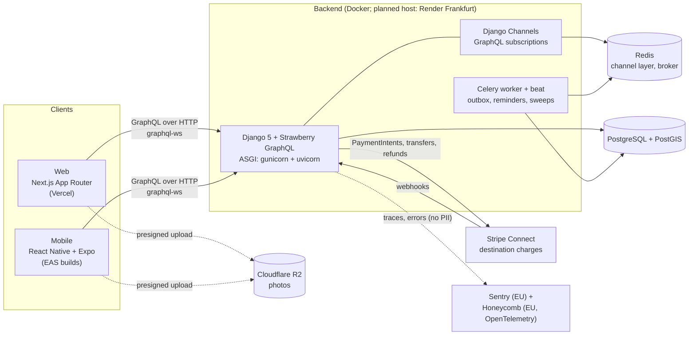
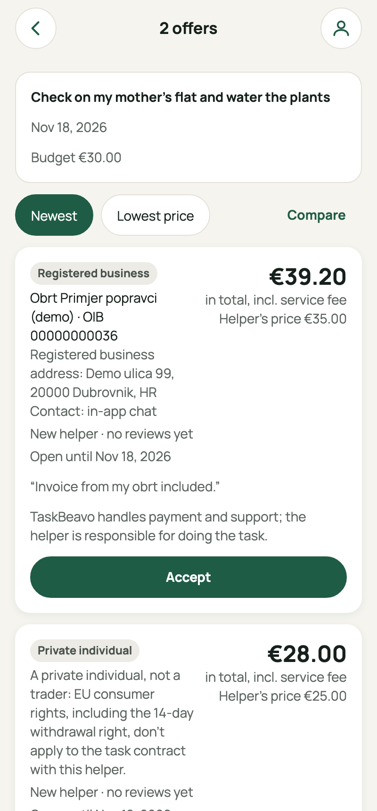
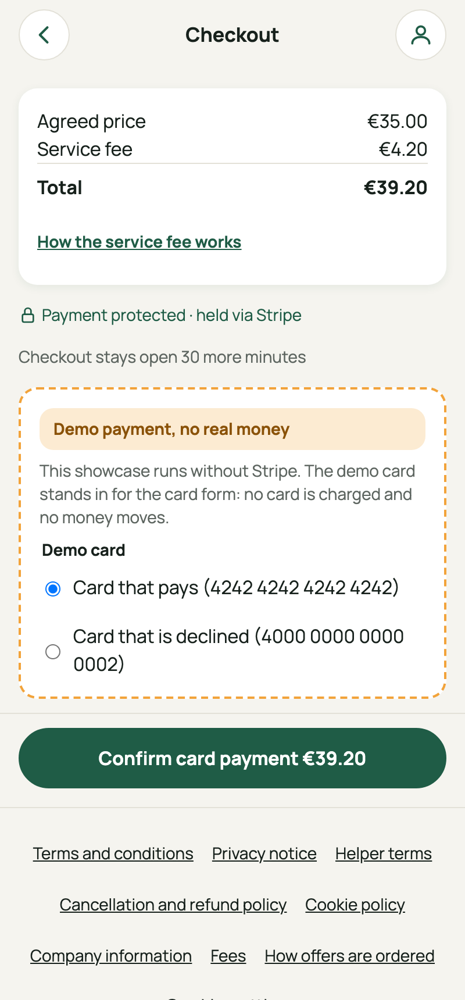
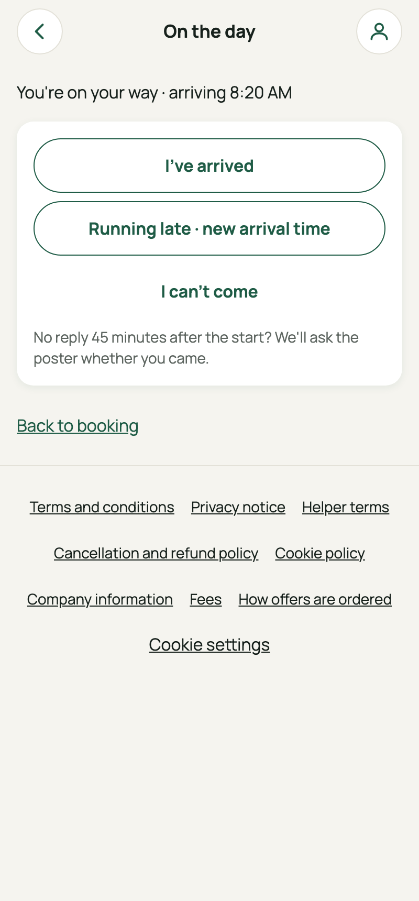
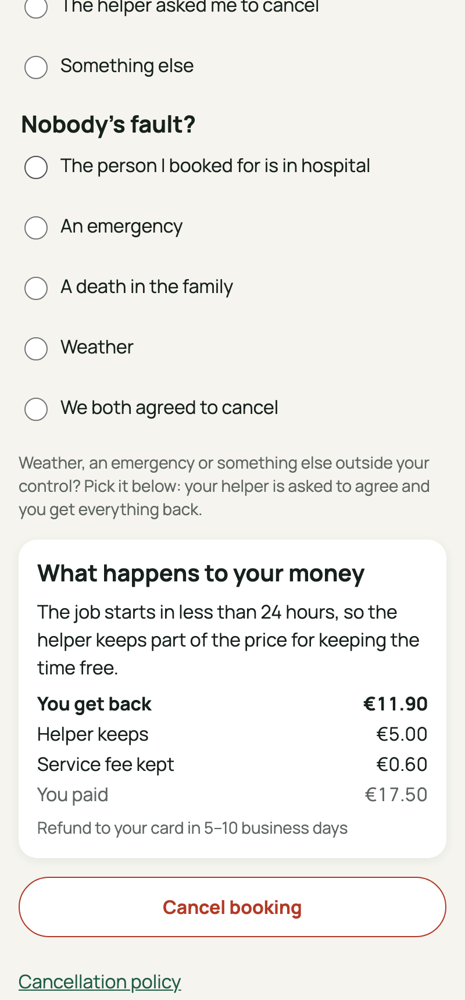
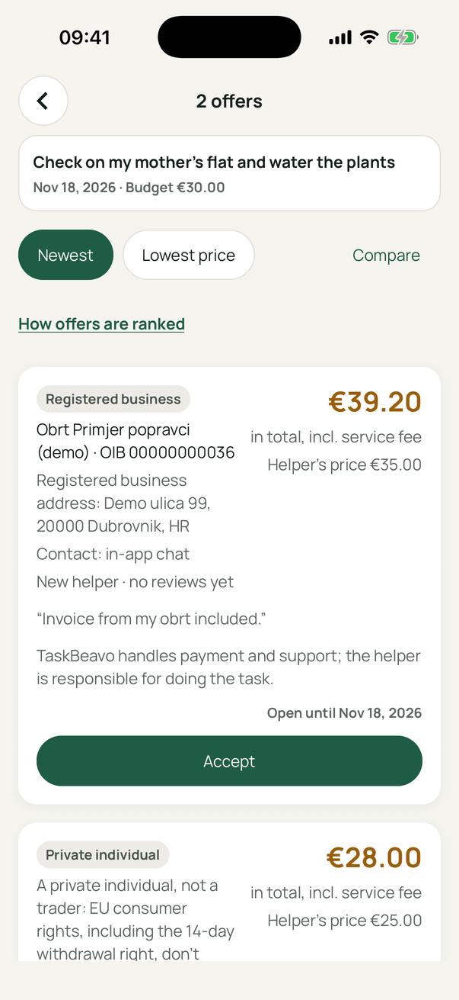
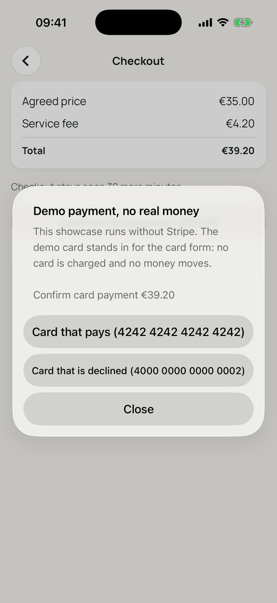
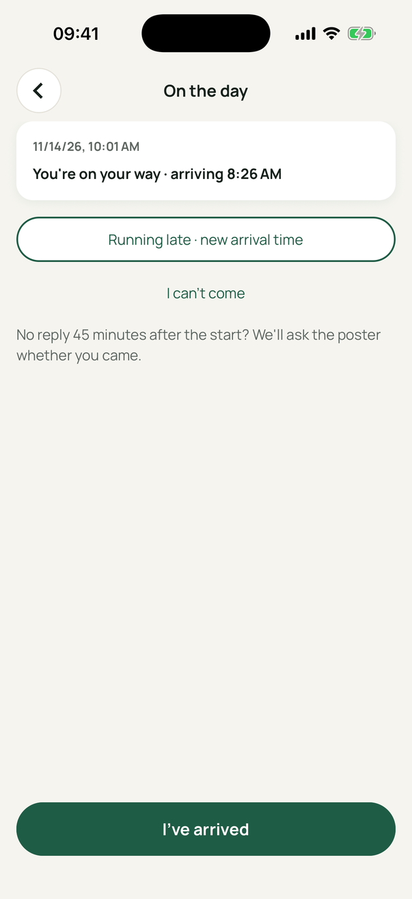
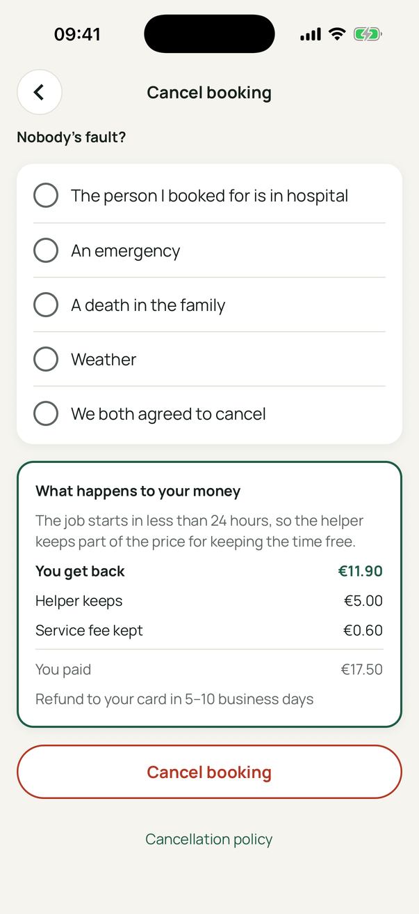

# TaskBeavo

TaskBeavo is a local help marketplace for Croatia, starting in Dubrovnik. People post small jobs (fix a tap, check on a flat, carry shopping up four floors), local helpers send price offers, and the poster accepts one and pays. Many posters live in Germany, Austria or Switzerland and are booking help for their parents back home, so the product works in Croatian, English, German and French, and everything can be done remotely.

This repository is a portfolio showcase. The code is published for viewing only; see [Licence](#licence).

**Status: pre-launch, in development.** The goal is a complete product that works end to end in test mode, with Stripe in test mode and other services in sandbox mode. A commercial launch is optional and later. See [Project status](#project-status).

## How it works

1. A poster posts a task with an approximate location, photos and a date.
2. Helpers ask questions and send offers with their own price. TaskBeavo never sets or suggests a price.
3. The poster accepts an offer and pays by card. The money is held by Stripe, not by TaskBeavo.
4. The helper does the job and taps **Request payment**.
5. The poster taps **Release payment**, and Stripe pays the helper out. Nothing releases automatically.

Cancellations, no-shows, "couldn't get in" and disputes each have their own flow with fixed amounts. The flow is modelled on Airtasker's, adapted to EU consumer law and Croatian tax law.

## Architecture



| Path                                       | What it is                                                                                                                                                                                                                                                                              |
| ------------------------------------------ | --------------------------------------------------------------------------------------------------------------------------------------------------------------------------------------------------------------------------------------------------------------------------------------- |
| `backend/`                                 | Django 5 under ASGI, managed with uv. Strawberry GraphQL (`strawberry-graphql-django`) at `/graphql`, subscriptions over Django Channels with Redis, Celery for background work, PostGIS for the service area. The only plain HTTP endpoints are the Stripe webhook and a health check. |
| `apps/web`                                 | Next.js App Router. Public pages (tasks, helper profiles, legal pages) are server components for SEO; signed-in pages are client components using Apollo Client.                                                                                                                        |
| `apps/mobile`                              | React Native with Expo development builds (`expo-dev-client`), Expo Router, Apollo Client with a persisted cache, Stripe's React Native SDK.                                                                                                                                            |
| `packages/graphql`                         | The exported `schema.graphql`, all GraphQL operations, GraphQL Code Generator output and the shared Apollo cache policies.                                                                                                                                                              |
| `packages/i18n`                            | ICU message catalogues for `hr`, `en`, `de` and `fr`, with a CI check for missing keys, invalid ICU and unused keys.                                                                                                                                                                    |
| `packages/ui-tokens`, `packages/app-links` | Brand tokens, and the deep-link routes shared by web and mobile.                                                                                                                                                                                                                        |
| `docs/PLAN.md`                             | The business plan: flows, legal and tax research, data model, build sequence. It is the source of truth for product rules.                                                                                                                                                              |
| `design/mockups`                           | Static HTML mockups, one per screen flow, built into a gallery by `design/mockups/build.py`.                                                                                                                                                                                            |

A feature normally goes through one branch: Django model and resolver, schema export, code generation, then the web and mobile screens. Both clients get fully typed operations from the same generated code.

### Some design choices

- **The backend never holds customer money.** Payments are Stripe destination charges made `on_behalf_of` the helper's Express account, so funds sit in the helper's Stripe balance until release. Holding the money in TaskBeavo's own account would make it a licensable payment service in Croatia.
- **Money moves only on a Stripe webhook.** A booking becomes "funds held" only when the webhook confirms the payment, never because a client said so. Webhook events are stored with `ON CONFLICT DO NOTHING` before processing, and every Stripe call carries an idempotency key derived from the action (for example `booking:{id}:release:v1`).
- **Every state change is transactional and leaves a trail.** Booking transitions lock the row (`select_for_update()`), write a `booking_events` row and an `outbox` row in the same transaction. A Celery publisher turns outbox rows into subscription events, push notifications and emails, so a crash can't send a notification for a change that rolled back.
- **Live updates have a fallback.** Clients subscribe over `graphql-ws`, and active bookings refetch when the app returns to the foreground or the socket reconnects, because events sent while a phone was asleep are not replayed.
- **Telemetry carries no personal data.** Sentry and Honeycomb use allow-listed attributes and `before_send` scrubbing. A W3C `traceparent` header goes from the Apollo link through Django, and the trace context is stored in outbox rows so Celery work joins the original trace.
- **Photos go straight to storage.** The API issues presigned R2 URLs and stores keys; file bytes never pass through Django.

## Hard rules

`CLAUDE.md` lists eleven rules that override any ticket. If a change conflicts with one, the work stops and the conflict goes to a person. In short:

| Area                              | Rule                                                                                                                                                                                                            | Why                                                                                                                           |
| --------------------------------- | --------------------------------------------------------------------------------------------------------------------------------------------------------------------------------------------------------------- | ----------------------------------------------------------------------------------------------------------------------------- |
| Money                             | Money moves only after a Stripe webhook confirms it; every Stripe call is idempotent; destination charges with a 12% service fee (minimum €2.50); manual payouts on "Release payment".                          | Double charges and lost payouts are the worst bugs a marketplace can have, and holding funds would require a payment licence. |
| Bookings                          | Every transition runs in a locked transaction and writes an event row and an outbox row.                                                                                                                        | An audit trail for disputes, and notifications that can't drift from the data.                                                |
| Cancellations                     | One module (`bookings/cancellation.py`) computes every cancellation, no-show, no-access and no-fault outcome, from a fixed table.                                                                               | EU consumer law gives a 14-day withdrawal right; the amounts must be predictable and identical on every screen.               |
| Privacy                           | Phone numbers, IBANs and private OIBs are never shown to other users; OIB and IBAN are encrypted at rest; the exact address and door code go only to the accepted helper, and only while the booking is active. | The posters' parents are often elderly and live alone.                                                                        |
| Fiscalization                     | Every service fee produces a Croatian fiscal receipt (ZKI signed with a FINA certificate, JIR from the tax authority); refunds produce a storno.                                                                | Croatian law requires it for every card payment.                                                                              |
| GDPR                              | Account deletion deletes or anonymises personal data within a month; accounting, fiscal and DAC7 records go to a restricted archive for their legal retention period.                                           | Deletion rights and tax retention duties both apply, so they need an explicit split.                                          |
| Marketplace, not a work organiser | TaskBeavo never sets prices, never assigns tasks, never ranks helpers by acceptance rate or availability, never penalises declining, and sends automated decisions about a helper to a human.                   | Doing any of these would make it a digital labour platform under Croatian labour law and the EU Platform Work Directive.      |
| i18n and accessibility            | All text goes through the catalogues in four languages; the API returns error codes, not text; legal texts are never machine-translated; 44px tap targets and WCAG AA contrast.                                 | The users are split across four languages, and many of the people helped are elderly.                                         |
| Service area                      | Tasks are accepted only inside an active Croatian service-area polygon, checked on the server with PostGIS.                                                                                                     | Tax and legal rules are researched for Croatia only.                                                                          |

## How it was built

The project is built by one developer directing AI coding agents (Claude Code), with the work split into Jira tickets:

- **Plan first.** `docs/PLAN.md` was written up front from public legal, tax and market sources, and every ticket implements named sections of it.
- **One agent per ticket.** A manager agent picks tickets whose blockers are merged, and starts an implementing agent in its own git worktree. The implementer writes tests first, follows the project skills in `.claude/skills/` (one per area: GraphQL features, booking payments, i18n, GDPR, observability and so on), and runs the same commands CI runs.
- **Independent review rounds.** A separate reviewer agent, with no access to the implementer's reasoning, reads the branch against the ticket, the hard rules and the skills, and returns a PASS or FAIL report. Findings go back to the implementer; at most two rounds, then a person decides.
- **Compliance checks.** Any change touching payments, bookings, personal data, consent, legal pages or user-facing text also runs a compliance checklist against the hard rules (`.claude/skills/compliance-check`). Payment changes get an extra security review (`.claude/agents/payments-reviewer.md`).
- **Contested legal and tax questions** are decided with a documented method: one evidence-ranked research round, citation verification, and a decision by probability and cost of being wrong (`.claude/skills/legal-decision`, records in `docs/decisions/`).
- **A person approves every ticket start, every merge, and every legal, money or privacy decision.**

About 70 pull requests have been merged this way so far.

## Tests and CI

- **Backend:** pytest against PostGIS and Redis, about 4,000 tests, covering the state machine, cancellation amounts, Stripe webhook handling with recorded test-mode events, permissions on every query, mutation and subscription, and PII scrubbing. Ruff for lint and format, Pyright for types.
- **Web and mobile:** Vitest and Jest with Testing Library, ESLint (flat config), TypeScript, Prettier.
- **Web end to end:** Playwright in Chromium at 375px and desktop widths, against a stubbed GraphQL API.
- **GraphQL drift check:** CI fails when `schema.graphql` or the generated types no longer match the backend.
- **i18n check:** CI fails on a missing key in any of the four languages, invalid ICU, or an unused key.

`.github/workflows/ci.yml` runs four jobs on every pull request to `develop`: `Backend`, `JS`, `GraphQL drift` and `Web e2e`. Each step runs a command from the table in `CLAUDE.md`, so any failure reproduces locally. Details are in `docs/ci.md`. Third-party actions are pinned to commit SHAs, and uv refuses Python package versions less than 14 days old (`exclude-newer` in `backend/pyproject.toml`); the same rule for pnpm is planned.

## Running it locally

Requirements: Docker, Node.js 22 with pnpm, uv, and for mobile, Xcode or the Android SDK.

```bash
pnpm install
cd backend && uv sync && cp .env.example .env && cd ..

docker compose up -d postgis redis   # PostGIS on 55432, Redis on 6379
docker compose up                     # or the full stack: Django on :8000, Celery, Stripe CLI

pnpm --filter @taskbeavo/web dev      # web on :3000
pnpm --filter @taskbeavo/mobile ios   # first time: builds the iOS development build
pnpm --filter @taskbeavo/mobile start # afterwards: Metro for the development build
```

Sign-up and checkout need placeholder legal documents in the local database; the commands are in the `CLAUDE.md` Commands table ("Placeholder terms" and "Placeholder cancellation policy"). Stripe runs in test mode with your own test key in `backend/.env`; the bundled Stripe CLI refuses live keys.

Checks, the same as CI:

```bash
cd backend && uv run pytest && uv run ruff check . && uv run pyright && cd ..
pnpm format:check && pnpm turbo run lint typecheck test
pnpm --filter @taskbeavo/web exec playwright test
```

### Demo walkthrough

A local demo with fake Dubrovnik data, no Stripe keys needed:

```bash
echo "DEMO_PAYMENTS=1" >> backend/.env
docker compose up -d
docker compose exec django uv run python manage.py seed_demo --reset   # again whenever it feels stale
NEXT_PUBLIC_DEMO_PAYMENTS=1 pnpm --filter @taskbeavo/web dev
```

Sign in at `localhost:3000/en/sign-in` as a demo poster or helper (the seed prints them; the one-time code is in the Django log). Steps 3 to 5 and 7 use the real screens. Posting a task and sending an offer are **GraphiQL steps**, and request and release payment are **seeded states**, because their screens are still to come. The full walkthrough, with the GraphiQL operations, is in [`docs/demo/README.md`](docs/demo/README.md).

- Steps 1 and 2: post a task and send an offer (GraphiQL)
- Steps 3 and 4: compare offers, accept one, and pay with the demo card; the money is held once the webhook confirms
- Step 5: on my way and arrived
- Step 6: request and release payment (seeded; the buttons arrive with BEAV-117)
- Step 7: cancel, free or late
- Step 8: a contested no-show (seeded, waits for support)

The web app at phone width:

<p>




</p>

The iOS app:

<p>




</p>

Payments in the demo go through a demo stub, `DEMO_PAYMENTS=1`: an in-process stand-in for Stripe behind the real gateway. Bookings still become paid only through the real webhook handler. Settings refuse it in production and next to a live key.

## Project status

Nothing is deployed yet; everything runs locally and in CI.

**Built** (API, web and mobile screens unless noted):

- Sign-in with email codes, Google and Apple; phone verification; sessions and "log out everywhere"
- Legal pages with versioned acceptance and re-acceptance
- Offers on a task, compared and accepted; checkout with consent capture, Stripe destination charges and the webhook
- Posters booking as a registered business, who can accept offers from registered businesses only (BEAV-195)
- A demo with fake Dubrovnik data, a demo stand-in for Stripe and a walkthrough, in [docs/demo](docs/demo/README.md) (BEAV-198)
- Business details in settings: posters add or remove their obrt or company to book as a business (BEAV-199)
- Every catalogue string translated into Croatian, German and French, with a CI check that fails on English left in a translation (BEAV-200)
- On my way, running late, arrived, helper no-shows and contested no-shows; cancellations, withdrawal and "nobody's fault" requests; no access
- Live updates over GraphQL subscriptions, and push notifications
- API only, screens still to come: helper onboarding with registered businesses and payout onboarding, posting tasks with photos and the service-area check, sending offers, on-site contacts, the waitlist
- Staff tools in the Django admin, and the VAT threshold monitor

**Planned:** request and release payment (BEAV-116 to BEAV-118), the post-task wizard, the task feed and task detail, the home page, disputes, reviews, My tasks, GDPR export and deletion, moderation, fiscal receipts against the tax authority's test environment, and DAC7 reporting.

A real launch would also need a company, a FINA certificate, a binding opinion from the tax authority, lawyer-approved and professionally translated legal texts, insurance, helpers, and app store submissions. These are documented in `docs/PLAN.md` but don't block building. Legal texts in the repository are drafts and are not legal advice.

## Licence

Copyright (c) 2026. All rights reserved. The code and documentation are published for viewing only; no licence to use, copy, modify or distribute them is granted. See [`NOTICE`](NOTICE).
