# TaskBeavo turns diaspora worry into compliant help

## Goal and status

**Goal (user decision, 2026-11-09):** finish TaskBeavo as a complete, working product published as a public showcase. A real commercial launch is optional and comes later, if at all.

- **Done means** every flow in this plan works end to end in test mode, with seed data and a short demo walkthrough in the README that a visitor can follow.
- **External services run in test or sandbox mode:** Stripe test mode, EAS preview builds, and the free or trial tiers of the other services.
- **The hard rules in `CLAUDE.md` stay as written.** Money, privacy, GDPR and the marketplace-not-work-organiser rule are part of what the showcase demonstrates. Rule f (fiscalization) is marked launch-only.
- **No government integrations in the showcase (owner decision, 2026-11-14).** TaskBeavo builds no CIS fiscalization (ZKI, JIR, FINA certificate), no DAC7 reporting, no eRačun or MIKROeRACUN and no Porezna uprava filings, not even against their test environments. The tax chapters below stay as the design a real launch would need; data already collected, such as the DAC7 seller fields at helper onboarding, stays.
- **Launch prerequisites are not build blockers.** Founding the company, the FINA certificate and the government integrations above, the Porezna binding opinion, lawyer-approved and professionally translated legal texts, insurance, helper recruiting and store submissions stay documented below (the compliance checklist and Phase 0 of the build sequence) as what a real launch would need. Building does not wait for them.
- **Status:** pre-launch, in development. Publication steps are in `docs/public-release.md`.

TaskBeavo still works as a narrow, trusted-help marketplace for families abroad, and most of the open Croatian legal questions point to the same design: **TaskBeavo acts as a disclosed agent and never holds the money itself**. If TaskBeavo collected posters' money into its own balance and paid helpers later, that would almost certainly count as a licensable payment service (money remittance) under the Zakon o platnom prometu. Croatia's commercial-agent exclusion covers only agents acting for one side, and the EBA says a platform that settles a buyer's debt is not excluded by default ([NN 66/18](https://narodne-novine.nn.hr/clanci/sluzbeni/2018_07_66_1330.html); [EBA Q&A 2020_5354](https://www.eba.europa.eu/single-rule-book-qa/qna/view/publicId/2020_5354)). The fix is to change the Stripe flow to **destination charges with `on_behalf_of` the helper's connected account, with the 12% service fee as the `application_fee_amount` and the helper's payouts paused until the poster taps "Release payment"**. Stripe's own example for this charge type is "a website that matches contractors with homeowners" ([Stripe Docs: charges](https://docs.stripe.com/connect/charges)). The request-and-release flow, with no PIN, stays exactly as before. As agent rather than merchant of record, TaskBeavo charges VAT on its fee only. Only those fees count toward the €60,000 VAT threshold, which is roughly €500k of task volume ([Informator](https://informator.hr/strucni-clanci/novosti-u-zakonu-o-pdv-u-od-1-sijecnja-2025)). TaskBeavo still has firm duties:

- register for DAC7 within 8 days of becoming a platform operator, and report every helper by 31 January each year (fines up to €26,540);
- issue a fiscalized receipt (račun, with JIR, ZKI and QR code) for every card-paid fee, as required since 1 January 2026;
- be able to receive eRačuns now, and issue them to Croatian businesses from 2027.

([Porezna uprava DAC7](https://porezna-uprava.gov.hr/hr/obveze-za-operatere-platformi-dac7/4733); [NN 151/2022](https://narodne-novine.nn.hr/clanci/sluzbeni/2022_12_151_2338.html); [Porezna uprava B2C](https://porezna-uprava.gov.hr/hr/fiskalizacija-racuna-u-krajnjoj-potrosnji-b2c-poslovanje-azurirano-5-1-2026/8033); [Fiskalopedija](https://fiskalopedija.hr/baza-znanja/fiskalizacija-20))

Helpers should pay their own tax. A poster who is a private person, or who lives abroad, has no duty to withhold, so occasional helpers self-assess "drugi dohodak" (other income) through a JOPPD filing ([TEB](https://www.teb.hr/novosti/2025/drugi-dohodak-od-fizicke-osobe/)). No source confirms that a pass-through marketplace escapes being treated as the "isplatitelj" (the payer who must withhold), so the top pre-launch item is a written opinion from Porezna uprava. Consumer law forces a cancellation rewrite: a 14-day withdrawal right covers TaskBeavo's own fee and any helper who trades as a business. The revised policy refunds the whole fee on every cancellation before the task starts, and TaskBeavo takes a fee only on money the helper actually earns ([Pravilnik NN 105/2026](https://www.zakon.hr/c/podzakonski-propis/1420974/nn-105-2026-%2818.9.2026.%29%2C-pravilnik-o-sadrzaju-i-obliku-obavijesti-o-pravu-potrosaca-na-jednostrani-raskid-ugovora-sklopljenih-na-daljinu-i-ugovora-sklopljenih-izvan-poslovnih-prostorija)). The biggest classification risk is still platform-work law. Croatia had not transposed the EU Directive in late October 2026, against a 2 December 2026 deadline ([TEB](https://www.teb.hr/novosti/2026/ususret-ocekivanim-izmjenama-zakona-o-radu/)). TaskBeavo manages that risk by leaving helpers free to set prices, choose tasks and refuse work. The stack is Django with a GraphQL API (Strawberry, with GraphQL subscriptions for live updates), PostgreSQL/PostGIS, Next.js on Vercel and Expo. It gains a fiscalization service and a DAC7 reporting job, and still costs roughly **$90–190 a month** in fixed infrastructure at launch.

> **Not legal, tax or insurance advice.** This plan synthesises public sources as of 25 October 2026. Several Croatian statute texts (zakon.hr, Narodne novine) could not be fetched directly, so some article numbers rest on professional commentary. Every conclusion below should be confirmed by a Croatian lawyer, a porezni savjetnik (tax adviser) and Stripe before launch. The compliance checklist and the uncertainty table near the end list exactly what to ask.

## Airtasker charges at assignment and releases on a two-click handshake

Airtasker is the right reference because it is the clearest bid-based local services marketplace with published terms. In FY26 (to 30 June 2026) it processed about **A$240m of GMV** and earned A$52.0m in marketplace revenue, a stable **21.7% take rate** ([FY26 results, 26 Aug 2026](https://bulletin.webull.com/qbd/announcement/20260826/499500381/09acc31376e150e92d7a425d9f6e2ba9.pdf)). That take rate is a ceiling for TaskBeavo, not a target.

### The task lifecycle runs post, offer, assign, pay, complete, release, review

A Customer posts a task with a description, photos, a date and a budget. "Quote only" requests are not supported ([How do I post a task](https://support.airtasker.com/hc/en-au/articles/202427844-How-do-I-post-a-task)). Taskers ask questions in a public comment thread where **sharing contact details is banned**, and submit priced offers. On some tasks an offer can carry an expiry between 4 hours and 7 days, with a reminder to the Customer an hour before it lapses ([Offer expiry](https://support.airtasker.com/hc/en-au/articles/43591656290841-Why-is-there-an-expiry-time-on-my-offers)). A "Top Offer" ranking weighs price against budget, rating consistency, completed tasks, category skill, trust badges, response speed and rebookings ([Feature Hub July 2025](https://www.airtasker.com/blog/the-feature-hub-july-2025/)).

When the Customer accepts an offer, a Task Contract forms and the Poster "must pay the Agreed Price… into the Payment Account". **The card is charged, not just authorised, for the Agreed Price plus the Connection Fee at that moment** ([UK Terms cl. 1.5, 4.1](https://www.airtasker.com/uk/terms/)). The money is "held in escrow with Stripe while the task is ongoing", which is why customers see charges before the job starts ([Why was my card charged](https://support.airtasker.com/hc/en-au/articles/115010433128-Why-was-my-card-charged-before-the-start-of-the-task)). Private messaging opens and contact details may then be exchanged. Either side can propose a price increase. A Customer-initiated increase goes straight into escrow, and a Tasker-initiated one is charged only when the Customer approves it ([Price increase](https://support.airtasker.com/hc/en-au/articles/360021456911-How-do-I-accept-a-price-increase-request)).

After the work, the Tasker taps **"Request payment"**. Customers cannot release funds until that happens. The Customer then taps **"Release payment"**, optionally adds a tip, and the payout arrives in the Tasker's bank **3–5 business days** later ([How do I get paid](https://support.airtasker.com/hc/en-au/articles/360024521771-How-do-I-get-paid-); [When will I get paid](https://support.airtasker.com/hc/en-au/articles/205276334-When-will-I-get-paid)). Both sides then have 14 days to review. Reviews stay hidden until both submit or the window closes, and they cannot be edited ([How do reviews work](https://support.airtasker.com/hc/en-au/articles/227072627-How-do-reviews-work)). In Australia, Tasker Listings ("Request to book") are only a front end to the same machine: the Tasker answers a booking request with a final offer, and acceptance turns it into an ordinary assigned task ([Listings](https://support1.airtasker.com/hc/en-au/articles/900003186206-How-do-customers-find-and-book-my-listing)).

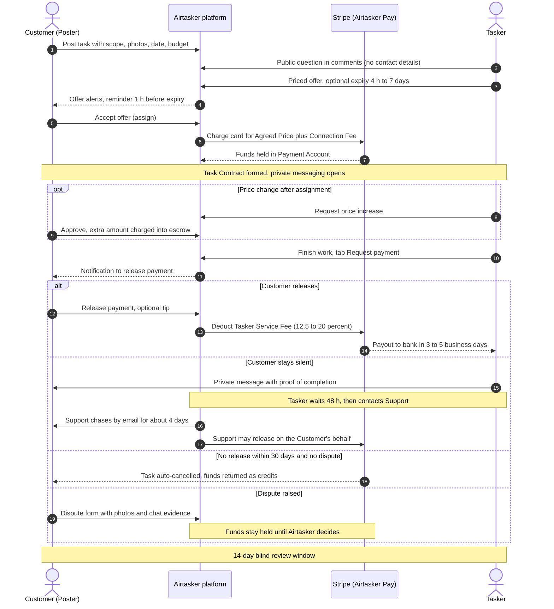

### There is no PIN, and nothing releases automatically to the Tasker

Neither the help centre nor the Terms describe a PIN, completion code, check-in or mandatory photo. Release happens "when both parties confirm completion or Airtasker is satisfied the services are complete" ([UK Terms cl. 1.9](https://www.airtasker.com/uk/terms/)). Photos matter only as evidence when chasing a silent Customer or in a dispute ([Dispute as a Customer](https://support.airtasker.com/hc/en-au/articles/360001288967-How-do-I-file-a-dispute-as-a-Customer)). This absence is inferred from the documentation rather than stated outright, but the consequence is clear. **The fallback favours the Customer**: if nobody releases within 30 days of completion and no dispute is raised, the task auto-cancels and the money returns to the Poster as credits, minus the Connection Fee ([UK Terms cl. 1.8](https://www.airtasker.com/uk/terms/)). Tellingly, that clause still contains an unresolved drafting placeholder, "[by either side / the Poster]". The Tasker's path is labour-intensive for Airtasker: message proof, wait 48 hours, contact Support, and Support chases the Customer for about four days before it can release on their behalf ([Customer not releasing](https://support.airtasker.com/hc/en-au/articles/360001417847)).

### Fees stack on both sides, now with subscriptions on top

| Fee | Who pays | Australia | UK | When |
|---|---|---|---|---|
| Connection Fee | Customer | 15.95%, min A$4.90, max A$49.95 | 17.40%, min £2.49, max £24.90 | At assignment, fixed afterwards |
| Service Fee (tiers) | Tasker | Bronze 20%, Silver 18.5%, Gold 14.9%, Platinum 12.5% on rolling 30-day released earnings | Same rates, £ thresholds | Deducted at release |
| Rebooking a past Customer | Tasker | 1.9% | Not confirmed | At release |
| Customer Membership | Customer | A$89/yr, no Connection Fees, $10 monthly voucher | Launched May 2026 | Annual |
| Pro Pass | Tasker | A$1,800 + GST/yr, zero service fees up to A$22,500 | n/a | Annual |
| Cancellation fee | At-fault party | Equal to the Connection Fee | Same | On cancellation |

Sources: [Connection Fee AU](https://support.airtasker.com/hc/en-au/articles/360031769372), [UK](https://support.airtasker.com/hc/en-gb/articles/360031769372), [Tasker tiers AU](https://airtasker.com/tasker-tiers), [UK tiers](https://www.airtasker.com/uk/tasker-tiers/), [Reconnect](https://support.airtasker.com/hc/en-au/articles/4418966029721-How-can-I-reconnect-with-Customers-I-have-worked-with), [Membership](https://www.airtasker.com/au/lp/airtasker-membership/), [FY26 results](https://bulletin.webull.com/qbd/announcement/20260826/499500381/09acc31376e150e92d7a425d9f6e2ba9.pdf), [AU cancellation policy](https://www.airtasker.com/au/cancellation-policy).

The US and Ireland use fixed fee bands instead of percentages. Ireland, for example, charges €4.95 under €30 and €39.95 above €180 ([Connection Fee IE](https://support.airtasker.com/hc/en-ie/articles/360031769372)). On an A$100 task with a Bronze Tasker, the Customer pays about A$115.95 and the Tasker keeps about A$80 before GST effects, so Airtasker grosses roughly A$36. Caps, membership waivers and rebook fees blend this down to the reported 21.7%. The Membership passed **10,000 paid subscribers** within five months, a signal that Airtasker is moving customer monetisation from per-task fees to subscriptions ([FY26 results](https://bulletin.webull.com/qbd/announcement/20260826/499500381/09acc31376e150e92d7a425d9f6e2ba9.pdf)). Airtasker's cancellation page still says "10–20%" for service fees while the tier pages start at 12.5%, so the published numbers are not perfectly consistent.

### Insurance is third-party liability only and depends on paying on-platform

Airtasker Insurance is a **Chubb third-party liability policy up to A$10m** (A$5m in the USA/Canada). Each claim carries an unpublished excess paid by the Tasker, cover is claims-made, and claims must be lodged within 30 days ([Airtasker Insurance](https://www.airtasker.com/au/insurance/)). It excludes faulty workmanship, intentional damage, sub-contracted work, vehicles, the Tasker's own injuries and property, and **any task paid off-platform, "including cash in hand"**. "Airtasker does not provide insurance for your own injuries" ([Third-party liability for Taskers](https://support.airtasker.com/hc/en-au/articles/217377767-How-does-third-party-liability-insurance-on-Airtasker-work-for-Taskers-)). The UK page uses the same Australian policy in AUD ([UK insurance](https://www.airtasker.com/uk/insurance)). Insurance works partly as an anti-leakage device: taking cash voids the cover.

### Cancellations default to credits, disputes run in three stages

Either party can request cancellation with a reason and an attribution of fault. **If the other side does not respond within 48 hours, the task cancels automatically** with fault as requested. A Customer at fault loses the Connection Fee. A Tasker at fault pays an equivalent amount from future payouts, capped at 50% of any single payout ([AU cancellation policy](https://www.airtasker.com/au/cancellation-policy); [AU Terms cl. 5.3–5.4](https://www.airtasker.com/au/terms/)). Refunds default to Airtasker Credits valid 18 months, with card refunds on request in 5–7 business days. The UK help centre refunds to the original payment method, though the UK Terms still default to credits ([Connection Fee UK](https://support.airtasker.com/hc/en-gb/articles/360031769372); [UK Terms](https://www.airtasker.com/uk/terms/)). Disputes are a free three-stage process: both parties fill in a form, Airtasker reviews as an "impartial evaluator", then decides. A party who disagrees may go to court at their own cost. No stage timeframes are published, and the dispute does not proceed if neither party completes the form ([Dispute process](https://support.airtasker.com/hc/en-us/articles/360001291168-What-is-Airtasker-s-dispute-process)). Off-platform payment requests are prohibited, and the platform's verification badges include ID Verified (government ID plus live face scan since October 2024) and an optional police check ([AU Terms cl. 3.11](https://www.airtasker.com/au/terms/); [Badges](https://support.airtasker.com/hc/en-au/articles/360001621807)).

## Diaspora payers close the affordability gap in an ageing country

### The market is ageing, poor at home and affluent abroad

Dubrovnik-Neretva County has **116,860 residents, about 23.8% (27.8k) aged 65+**, and the city of Dubrovnik has about 41.6k residents ([DZS 2025](https://podaci.dzs.hr/2026/en/121478); [Wikipedia](https://en.wikipedia.org/wiki/Dubrovnik)). Croatian long-term care relies heavily on relatives, and public spending is among the lowest in the EU ([OECD](https://oecd.org/en/publications/improving-long-term-care-in-croatia_9de55222-en/full-report/component-4.html)). The payers live elsewhere. Germany alone had **425,810 registered Croatian citizens at end-2024**, and Germany, Austria and Switzerland still absorb about 9k Croatian emigrants a year ([Total Croatia News/Destatis](https://total-croatia-news.com/?p=184049); [DZS Migration 2025](https://podaci.dzs.hr/2026/en/121584)). Community estimates add about 90k in Austria, 80k in Switzerland and 20k in Ireland, but these are not registry counts ([Total Croatia News](https://total-croatia-news.com/the-croatian-diaspora/croats-live-abroad/)). No source breaks down how many come from Dubrovnik-Neretva, which is the biggest unknown in the demand case.

Prices make the logic obvious. Croatia's average net wage was **€1,511** in January 2026 (median €1,304) ([Index.hr](https://www.index.hr/vijesti/clanak/objavljena-prosjecna-placa-u-hrvatskoj/2773353.aspx)). Apartment cleaning runs about €12–18 an hour nationally, coastal holiday-rental cleaning €20–30 an hour, and lawn mowing €0.10–0.30/m² ([eMajstor cleaning](https://www.emajstor.hr/clanak/1789/koliko_kosta_sat_ciscenja_stana); [Croatia Week](https://www.croatiaweek.com/croatia-holiday-rental-cleaning-costs-500-euro/); [eMajstor garden](https://www.emajstor.hr/cijene/hortikultura_vrt)). A €30 grocery-and-lightbulb visit is a real expense for a Dubrovnik pensioner and small change for a child earning a German wage.

### Nobody serves the small-job, family-pays niche

No Croatian platform combines small household errands with a payer abroad. **eMajstor** dominates trades and renovation with a free, "bez provizija" (no commission) lead model and 13,000–18,000 contractors ([eMajstor](https://www.emajstor.hr/clanak/1430/vise_od_13_000_izvodjaca_vec_koristi_platformu_emajstor)). Supply in Dubrovnik looks thin: one July 2026 studio-cleaning request there drew a single interested contractor ([eMajstor request](https://www.emajstor.hr/upiti/servis_za_ciscenje/ciscenje_garsonijere/424575)). **Postaj**, the 2023 "Uber for handymen", reached 30k+ downloads but kept only **about 20% of its handymen** after it introduced helper subscriptions ([FlutterFlow case study](https://blog.flutterflow.io/transforming-handyman-services-in-croatia-the-success-story-of-postaj/)). Wolt covers delivery in Dubrovnik but not errands that need judgement ([Wolt](https://wolt.com/hr/hrv/dubrovnik)). The public **Zaželi** programme has served 74,000+ elderly users with household help, groceries and bill payment, but its continuation after the current phase is undecided ([Novi list](https://www.novilist.hr/?p=1667307)). The City of Dubrovnik runs caregiver training because of staff shortages, and its social programme lists no home-visit service ([Grad Dubrovnik 2023](https://www.dubrovnik.hr/uploads/MJERE-SOCIJALNOG-PROGRAMA-GRADA-DUBROVNIKA-ZA-2023.-GODINU.pdf)).

### Leakage kills local marketplaces, and the diaspora resists it

Homejoy failed on a 25% take rate, misclassification lawsuits, uneven quality and leakage, as customers hired good cleaners directly ([TechCrunch](https://techcrunch.com/2015/07/31/why-homejoy-failed-and-the-future-of-the-on-demand-economy)). Commissions are hard to collect when the platform cannot see completion ([Version One VC](https://versionone.vc/whats-the-right-business-model-for-marketplaces/)). Here the diaspora segment is structurally better. A daughter in Munich cannot hand cash to a helper in Gruž. She values card payment, proof of completion and one accountable party, and all of those exist only on the platform. Local residents will leak much faster, so they belong in the plan as a source of liquidity and word of mouth rather than margin. Dubrovnik's holiday rentals are a second segment: about 4.2M commercial overnights in 2025, an average county stay of four days, and a cleaner shortage ([DZS Tourism](https://podaci.dzs.hr/media/ctwkrcot/tur-2025-1-2-dolasci-i-noćenja-turista-u-komercijalnom-smještaju-u-2025.pdf); [TZ DNŽ](https://visitdubrovnik.hr/wp-content/uploads/2026/03/Izvjesce-o-izvrsenju-programa-rada-TZDNZ-za-2025..pdf)). Many owners live abroad or are elderly, so "keys, changeover and eyes on the property" bridges both segments. The city is also cutting private-rental permits, which caps that segment's growth ([Croatia Week](https://www.croatiaweek.com/dubrovnik-to-become-first-in-croatia-to-ban-new-apartments/)).

### Go-to-market rides existing community hubs

Demand can be reached through the **85 Croatian Catholic missions in Germany** and the cultural and sports clubs clustered in Munich, Stuttgart, Frankfurt, Cologne, Berlin and NRW ([Središnji državni ured](https://hrvatiizvanrh.gov.hr/hrvati-izvan-rh-2463/croatian-diaspora/croatian-diaspora-in-federal-republic-of-germany/2482)). Pushes should land around Christmas and summer, when children visit and see their parents' needs firsthand. The state funds diaspora projects, with more than €900k in one round ([N1](https://n1info.hr/english/news/more-than-e900000-allocated-for-projects-benefiting-croatian-diaspora/)). Local helpers come from student centres, which run at scale (Split recorded 75,941 placements in 2024 at a 2026 minimum of €6.56/hour), from former Zaželi carers, and from retirees ([Index.hr](https://www.index.hr/vijesti/clanak/vlada-povecava-neoporezive-pragove-za-studentski-rad-u-2026-godini/2735270.aspx)). Dubrovnik-Neretva County co-funds pensioner associations, and the renters' association gives a route into the holiday-rental segment ([DNŽ 2025](https://www.dnz.hr/wp-content/uploads/2025/05/Odluka-o-dodjeli-sredstava-za-sufinanciranje-programa-projekata-iz-podrucja-skrbi-o-udrugama-koje-doprinose-unaprjedenju-zivota-umirovljenicke-populacije-2025.pdf); [CompanyWall](https://www.companywall.hr/tvrtka/udruga-iznajmljivaca-smjestaja-u-privatnim-kucama-grada-dubrovnika/MMOOTusR/osnovno)).

The launch should stay deliberately narrow. Start in Dubrovnik with a hand-recruited pool of a few dozen helpers and five task categories: garden, grocery and pharmacy runs, small repairs, light cleaning, and check-in visits. Expand to Split and Zagreb only after the request-and-release payment loop works. That sequencing is a direct response to Helpling, which closed markets after over-expanding and only reached profitability in 2019 ([Wikipedia: Helpling](https://en.wikipedia.org/wiki/Helpling)).

### Service area: tasks in Croatia only

TaskBeavo **only accepts tasks located in Croatia**, and at launch only inside the active service area (Dubrovnik first, then other Croatian cities as they open). **Who posts** is not restricted: a poster can live anywhere, which is the whole diaspora model.

| Situation | Allowed? | What happens |
|---|---|---|
| Poster in Croatia, task in an active Croatian city | Yes | Normal flow |
| Poster in Austria, Germany, Switzerland or anywhere else, task in an active Croatian city | **Yes** | Normal flow; the core diaspora case. Austrian and German consumer protection still applies to them |
| Task in Croatia but outside the active cities (for example Osijek at launch) | Not yet | "We're not in Osijek yet. Join the waitlist" |
| Task located outside Croatia (for example Vienna) | **No** | "TaskBeavo currently works only in Croatia. Join the waitlist for Vienna" |
| Helper sign-up | Only people who will do tasks in Croatia | Helpers give a Croatian address and an OIB (also needed for tax and DAC7). A Croatian IBAN is preferred but any EU IBAN works with Stripe. The country of residence must be an EU member state for now (BEAV-94); whether non-EU residents may help is open with the tax adviser (BEAV-25), and the right-to-work check is BEAV-181 |

**Why Croatia only for now:**
- **Liquidity:** a marketplace works only with enough helpers per city; spreading thin kills it.
- **Tax:** for a task done in another EU country, TaskBeavo's fee is taxed in that country (for example 20% VAT in Austria), the Croatian €60,000 small-business threshold doesn't cover it, and it would need EU One-Stop Shop declarations, likely from the first euro. An accountant must confirm before any expansion.
- **Local rules:** Austrian and German trade-licence rules for household services, their own receipt and cash-register rules, and insurance cover outside Croatia would all need checking.
- **Support:** disputes in another country need local knowledge and support hours.

**How it is enforced:**
- **Address search** (Mapbox geocoding) is restricted to Croatia (country code `hr`).
- **The backend checks every task** in the `postTask` mutation: the task point must be inside an active `SERVICE_AREA` polygon (PostGIS `ST_Covers`). The client check is only for convenience; the server check is the rule.
- **Offers and bookings** re-check the area, so a task can't be moved outside it later by editing the address.
- **Helpers** see and bid only on tasks inside the service areas they selected.
- **Out-of-area attempts** create a `WAITLIST_ENTRY` (email, city, country, task category, date), with consent for a single "we've launched in your city" email. This shows real demand for the next city or country. There is no double opt-in; every launch email carries a withdraw link (a token and the `leaveWaitlist` mutation). An entry is deleted once its area's launch email is sent, and after 24 months at most (BEAV-84).

**Expanding later** (a new Croatian city or a new country) follows a checklist: enough recruited helpers before opening, insurance cover confirmed, and for a new country, written VAT/OSS advice, local trade-licence and receipt rules, local consumer-law terms, support language, and an updated privacy notice. A new Croatian city is mostly a new polygon plus helper recruitment (staff check each area's polygon before activating it; there is no automatic clip to the Croatian border, BEAV-84); a new country is a project of its own.

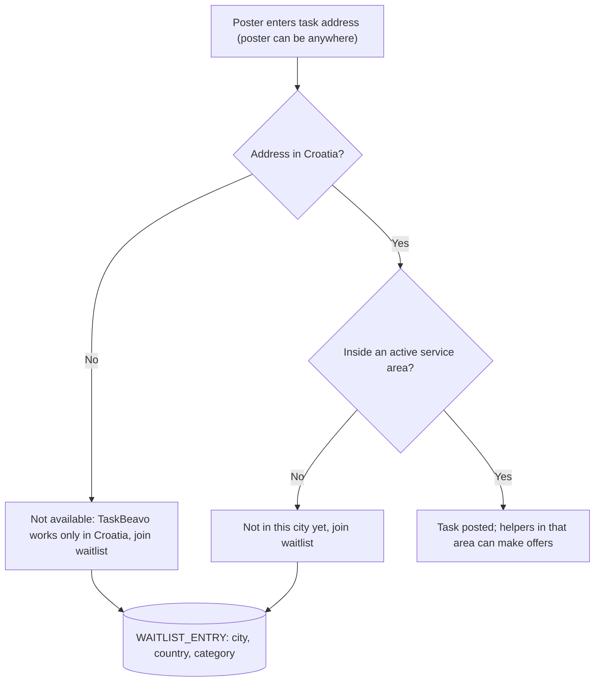

**How the app and the server enforce it** (the server check is the one that counts):

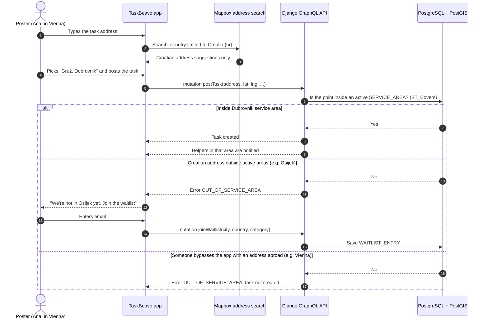

**The same rule on the helper side:**

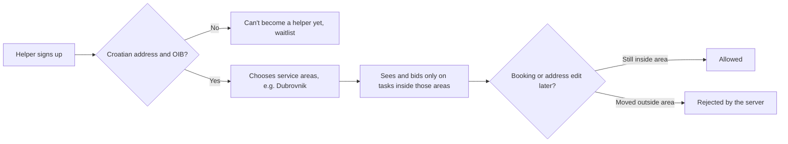

## TaskBeavo copies Airtasker's request-and-release flow

### The adapted flow keeps Airtasker's release model and changes four things

TaskBeavo keeps Airtasker's proven skeleton:

1. The poster posts a task.
2. Helpers ask public questions, with contact details masked.
3. Helpers send priced offers that expire.
4. The poster accepts an offer and is charged.
5. Poster and helper talk in private chat.
6. The helper does the job, then requests payment, and the poster releases it.
7. Both leave blind reviews.

Release works exactly as it does on Airtasker. Four other things change.

**First, the card is charged at acceptance, not put on an authorisation hold.** Card authorisations usually last only about 7 days, and SEPA Debit does not support separate capture ([Stripe: place a hold](https://docs.stripe.com/payments/place-a-hold-on-a-payment-method)). Diaspora families book visits weeks ahead, so a full charge at acceptance is the only robust option. Airtasker does the same. What changes from the earlier plan is *where* the money goes. The charge is a destination charge into the chosen helper's Stripe connected account, and that account's payouts stay paused until release (details below). Two consequences follow:

- **A helper must finish Stripe onboarding before they can send an offer**, because the charge needs a destination account.
- **App copy must never say "escrow" or "held by TaskBeavo".** Stripe states that it "doesn't provide escrow services" ([Stripe manual payouts](https://docs.stripe.com/connect/manual-payouts)), and TaskBeavo must not suggest that it controls the funds. Use "payment held securely via Stripe until you release it".

**Release matches Airtasker: request, then release.**

- When the job is finished, the helper taps **"Request payment"**, optionally attaching photos and a short note. The poster cannot release before that.
- The poster gets a push, email and in-app notification, then taps **"Release payment"** and can add a tip.
- Release tells TaskBeavo to start a payout from the helper's Stripe balance to the helper's bank. There is no PIN, completion code or check-in.
- The diaspora case still works because the poster releases from wherever she lives. She can call her mother, look at the helper's photos in chat, and then release. The person on site, who may be an 82-year-old without a smartphone, never has to use the app.
- The poster names an **on-site contact** (for example "Mama, Gruž"), so the helper knows whom to meet and the poster can check with them.

If the poster stays silent, TaskBeavo follows Airtasker's support-led path rather than releasing automatically:

- The poster gets automatic reminders at 24 and 48 hours.
- After 48 hours the helper can ask support for help. Support contacts the poster over a few days and **may release on the poster's behalf** if the photos and chat show the work was done.
- Following Airtasker's rule, if nothing is released within 30 days of the payment request and no dispute is raised, the task is cancelled and the poster is refunded.

This keeps the poster in control, which suits diaspora payers. The costs are support labour, which is manageable at Dubrovnik scale, and helpers who sometimes wait longer to be paid.

**Second, refunds go to the original card, not to credits.** Airtasker's UK help centre already does this, and EU consumers will expect it ([Connection Fee UK](https://support.airtasker.com/hc/en-gb/articles/360031769372)).

**Third, the poster pays the fee, not the helper.** This follows the Postaj lesson. It also matters legally: Croatian law forbids in-scope platforms from charging workers an intermediation fee ([Informator](https://informator.hr/strucni-clanci/rad-putem-digitalnih-radnih-platformi-u-zakonu-o-izmjenama-i-dopunama-zakona-o-radu)).

**Fourth, the task contract is between poster and helper, with TaskBeavo as disclosed agent.** The terms say so explicitly. Every offer shows whether the helper is a private individual or a registered business (trader). Helpers give TaskBeavo written authority to instruct Stripe on their behalf. This single choice underpins the payment-licence, VAT, withholding and platform-work positions in the legal section.

### State machine for task, booking and payment

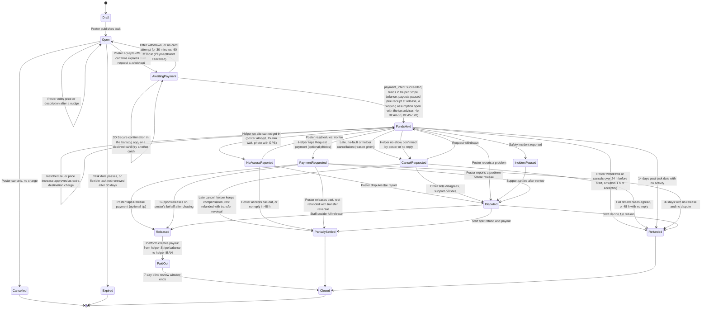

**Implementation rules:**

- Run every transition inside a database transaction with a row lock, and write a `booking_events` audit row for it. `django-fsm-2`, or a plain status field with `select_for_update()`, is enough.
- The audit trail becomes dispute evidence, for example: "Payment requested 14:32 with 3 photos, poster reminded 24 h and 48 h later, support contacted poster on day 3".
- The same log proves TaskBeavo showed withdrawal information and recorded the poster's express request to start early. Under the Consumer Protection Act (ZZP), the trader carries the burden of proving that ([Informator](https://informator.hr/strucni-clanci/sklapanje-ugovora-na-daljinu-s-posebnim-naglaskom-na-mogucnost-raskida?hls=)).
- Any refund of a fee that has already been fiscalized gets its own fiscalized storno (reversal) receipt. Whether a partial refund is a partial storno or a full storno plus a new receipt is open with the tax adviser (BEAV-30, BEAV-131).
- Celery Beat sends the reminders and flags bookings that need support follow-up.

### Money flow: destination charges keep TaskBeavo out of possession of funds

Stripe fully supports Croatia, settles in EUR, and allows cross-border transfers between EEA, UK and Swiss accounts. A German card can therefore fund a Croatian helper ([Stripe Global](https://stripe.com/global); [Stripe cross-border payouts](https://docs.stripe.com/connect/cross-border-payouts)).

**This plan changes the recommended fund flow from separate charges and transfers to a destination charge with `on_behalf_of`.** The new flow works like this:

1. When the poster accepts an offer, TaskBeavo creates a PaymentIntent for the agreed price plus the service fee.
2. The helper's Express connected account is set as both `transfer_data.destination` and `on_behalf_of`, and the 12% fee is the `application_fee_amount`.
3. The helper's account has payouts set to manual.
4. The task price sits in the helper's own Stripe balance from the start.
5. "Release payment" makes TaskBeavo create the payout to the helper's IBAN.

With `on_behalf_of`, the connected account becomes "the business of record for the payment". Settlement happens in its country, and payouts follow its own payout settings. Stripe lists "a business services marketplace, such as a website that matches contractors with homeowners" as the model use case for destination charges ([Stripe Docs: charges](https://docs.stripe.com/connect/charges)).

The previous recommendation, separate charges and transfers, is weaker on two counts:

- Stripe's own page says that with that charge type "You're the *merchant of record*". Transfers are "withdrawn from your account balance". Stripe recommends it only where the platform is responsible for negative balances ([Stripe Docs: separate charges and transfers](https://docs.stripe.com/connect/marketplace/tasks/accept-payment/separate-charges-and-transfers)).
- Money waiting weeks in TaskBeavo's own balance for a TaskBeavo-initiated transfer is exactly the "possession or control" a regulator could object to.

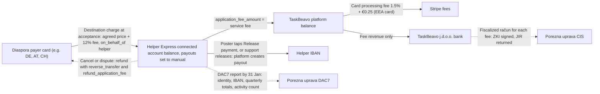

| Fund-flow option (lowest licence risk first) | Who holds funds until release | Merchant / business of record | Verdict |
|---|---|---|---|
| Destination charge + `on_behalf_of` + application fee, manual payouts | Helper's Stripe balance, inside Stripe's safeguarding | Helper's connected account | **Recommended** |
| Separate charges and transfers with Stripe "funds segregation" (private preview), short holds, `source_transaction` | Platform balance, segregated | TaskBeavo | Fallback if destination charges fail in testing |
| Plain separate charges and transfers with holds of up to 60 days | Platform balance | TaskBeavo | Earlier plan, now rejected |
| Posters pay TaskBeavo's own bank account, TaskBeavo pays helpers | TaskBeavo | TaskBeavo | Needs a payment licence. Never do this |

The ranking follows the research analysis of Stripe's documentation ([Stripe Docs: charges](https://docs.stripe.com/connect/charges); [Stripe Docs: separate charges and transfers](https://docs.stripe.com/connect/marketplace/tasks/accept-payment/separate-charges-and-transfers)). Four caveats come with the recommended flow, and all four go to Stripe in week one:

- **Refunds and disputes still debit the platform balance** under every charge type. TaskBeavo then reverses the transfer from the helper's balance, which works cleanly as long as the payout has not yet happened ([Stripe Docs: charges](https://docs.stripe.com/connect/charges)).
- **With Express accounts the platform carries negative-balance losses.**
- **Stripe holds funds under manual payouts for up to 90 days in most countries** ([Stripe manual payouts](https://docs.stripe.com/connect/manual-payouts)). The research could not confirm the current limit for Croatia. TaskBeavo therefore caps bookings at 60 days ahead.
- **`on_behalf_of` normally requires the helper's account to hold the card-payments capability.** It is not yet confirmed that Express onboarding for a private individual with country=HR grants it smoothly. Stripe's Dashboard "platform profile" gives Stripe's own charge-type recommendation, and TaskBeavo should save a copy of it.

### Agent, not merchant of record: what the choice does to VAT, tax and liability

Choosing to be an agent is a legal position, not just a Stripe setting. The terms, the receipts and the money flow must all tell the same story.

| Question | TaskBeavo as disclosed agent (recommended) | TaskBeavo as merchant of record |
|---|---|---|
| Who sells the task to the poster | The helper. TaskBeavo sells an intermediation service | TaskBeavo resells the task in its own name |
| VAT base once registered | 12% fee only, at 25% Croatian VAT | Full task price plus fee (VAT Directive Art. 28 commissionaire rule) |
| How fast the €60k threshold arrives | About 16,700 €30 tasks (€3.60 fee each) | About 1,800 tasks (€33.60 each), roughly 9× faster |
| Receipts TaskBeavo must fiscalize | One račun per fee | One račun per full task amount |
| Withholding and JOPPD on helper pay | Probably none, because the poster is the payer (needs a Porezna opinion) | Payouts to private helpers could be treated as drugi dohodak paid by TaskBeavo, with withholding and JOPPD on each one |
| Consumer-law exposure | Intermediation service, plus marketplace disclosures | Full trader liability for performance of every task |
| Payment-licence analysis | Supported by the helper being business of record | Collecting helpers' money weakens the exclusion argument |

Sources: [Porezna/Informator VAT threshold](https://informator.hr/strucni-clanci/novosti-u-zakonu-o-pdv-u-od-1-sijecnja-2025); [VAT Directive 2006/112/EC](https://eur-lex.europa.eu/legal-content/EN/TXT/?uri=CELEX:02006L0112-20240101); [Stripe Docs: separate charges and transfers](https://docs.stripe.com/connect/marketplace/tasks/accept-payment/separate-charges-and-transfers). Task counts are the author's arithmetic.

Under the agent model, **the place of supply of the fee follows the household task** (VAT Directive Art. 46 for intermediaries acting in another's name, or Art. 47 for property-linked services). The task happens in Croatia, so the fee is taxed in Croatia even when the poster lives in Munich. That has two effects:

- Foreign posters' fees **count toward** the Croatian €60,000 threshold, because only supplies whose place of supply is in Croatia count (čl. 90(3) of the VAT Act, ZPDV) ([Informator](https://informator.hr/strucni-clanci/novosti-u-zakonu-o-pdv-u-od-1-sijecnja-2025)).
- They carry 25% Croatian VAT once TaskBeavo is registered.

The main classification risk is that a tax authority treats an automated matching fee as an "electronically supplied service". The place of supply would then move to the poster's country, which brings in OSS above €10,000 and Swiss VAT for Swiss posters. Most commentators treat a fee for arranging a physical service as intermediation, but this goes to Porezna uprava for a written opinion. The EU's ViDA package does not help or hurt: its deemed-supplier rule for platforms covers only short-term accommodation and passenger transport ([Grant Thornton](https://www.grantthornton.ie/insights/factsheets/vida-vat-rules-platform-economy-ecommerce/)).

### Proposed fees and unit economics

**The minimum task price is €10** (decided 2026-11-01): `postTask` and task edits refuse a lower budget on the server with `BUDGET_BELOW_MINIMUM`.

TaskBeavo should start with **a 12% poster service fee (minimum €2.50) and a 0% helper fee**, shown upfront at checkout. That sits well below Airtasker's 21.7% and Homejoy's fatal 25%. Stripe's Croatian Connect pricing makes the margin thin but positive. Under "you handle pricing", Stripe charges ([Stripe Connect pricing HR](https://stripe.com/en-hr/connect/pricing)):

- €2 per active connected account per month;
- 0.25% + €0.10 per payout;
- 0.25% of payout volume for routing;
- **1.5% + €0.25 for standard EEA cards** (2.5% + €0.25 for UK cards).

With destination charges, the processing fee is still borne by the platform out of its application fee.

| Illustrative €30 task (EEA card, helper doing 4 tasks/month) | Below VAT threshold | After VAT registration, fee VAT-inclusive |
|---|---|---|
| Poster pays: €30.00 + 12% fee | €33.60 | €33.60 |
| Of which 25% VAT on the €3.60 fee | — | −€0.72 |
| Stripe card fee (1.5% × €33.60 + €0.25) | −€0.75 | −€0.75 |
| Payout + routing fees on €30 | −€0.25 | −€0.25 |
| €2 active-account fee spread over 4 tasks | −€0.50 | −€0.50 |
| Helper receives | €30.00 | €30.00 |
| **TaskBeavo net contribution before chargebacks, insurance, fiscalization costs** | **≈ €2.10** | **≈ €1.38** |

This is the author's arithmetic from the cited unit prices. Consumer prices must be shown VAT-inclusive. Once TaskBeavo crosses the threshold it must either absorb the VAT, cutting contribution by about a third, or move to a 15% VAT-inclusive fee, which nets the same 12%. Under the agent model the threshold is about €500k of task volume, so this is a year-two-or-later problem. Two further costs:

- **Inbound services carry VAT even below the threshold.** TaskBeavo needs a PDV ID number and must self-account 25% Croatian VAT on taxable services it buys from abroad (cloud hosting, ads) without being able to deduct it, because small taxpayers "never have a right to input VAT" ([RRiF](https://www.rrif.hr/clanak-20509/)). That inflates the dollar infrastructure line by up to a quarter.
- **Stripe Identity adds €1.25 per verified helper**, charged once ([Stripe Identity](https://stripe.com/ie/identity)).
- **Refunds lose the Stripe card fee.** TaskBeavo, as the platform, pays Stripe's card fee on every booking, and Stripe keeps it when a booking is refunded ([Stripe: fees for refunded payments](https://support.stripe.com/questions/understanding-fees-for-refunded-payments)). Every full-refund cancellation (early cancels, helper no-shows, no-fault cases) therefore costs about **€0.75** on a €33.60 booking, with no fee income. Rule of thumb: if 15% of bookings end in a full refund, the average contribution per *booked* task drops from about €2.10 to about €1.67 (85% × €2.10 − 15% × €0.75). This was confirmed in a Stripe test-mode payment, where the card fee was charged to the platform, not the helper. Keep an eye on the full-refund rate; the one-hour grace window and the abuse review for repeat cancellers help keep it low.

Fixed costs come to very roughly €150–250 a month: infrastructure, a platform liability policy, a FINA certificate and a bookkeeper's monthly fee, though the bookkeeper and fiscalization costs were not priced. On those numbers TaskBeavo needs on the order of **70–120 completed tasks a month** to cover running costs. At launch that makes it a validation project that pays for its servers, not a salary.

Revenue can grow later through a **family subscription**, mirroring Airtasker's Membership: a monthly plan with a recurring weekly check-in visit and waived service fees. The diaspora's recurring need suits it better than one-off jobs. A subscription is TaskBeavo's own service, so it needs its own fiscalized receipts and its own withdrawal-right handling. An optional helper "Pro" tier comes later, and only once supply is deep. It would charge helpers, which conflicts with the platform-work fee ban if TaskBeavo is ever found to be in scope.

### Cancellations: how Airtasker does it

Airtasker's rules turn on two questions: has the task been assigned yet, and **who is at fault**.

- **Before an offer is accepted:** nothing has been charged, so the Customer can delete the task for free.
- **After assignment:** either side taps "Cancel task", gives a reason and says who is responsible. The other side has **48 hours** to agree or disagree. If they don't respond, the task cancels automatically and fault follows the request. If they disagree, Support decides.
- **Customer at fault:** gets the task price back but **loses the Connection Fee** (or the amount it would have been, for members).
- **Customer not at fault:** gets everything back.
- **Tasker at fault:** pays a fee equal to the Customer's Connection Fee, taken from future payouts (at most 50% of any one payout). The cancellation also lowers their completion rate and can block tier promotion.
- **Repeat cancellers:** can be suspended for anything from 1 week to permanently.
- **Fee waivers:** only for declared emergencies, epidemics and natural disasters. Illness, travel and availability problems are not covered.
- **How refunds are paid:** as Airtasker Credits by default, valid 18 months, or to the card on request within 5–7 business days. UK refunds go to the original payment method.
- **Abandoned tasks:**
  - A task assigned for 30 days and inactive for 7 days past its due date auto-cancels. The task price goes back to the Customer and the Connection Fee is kept.
  - A payment request not released within 30 days, with no dispute, is cancelled and refunded as credits.

Sources: [AU cancellation policy](https://www.airtasker.com/au/cancellation-policy), [US cancellation policy](https://www.airtasker.com/us/cancellation-policy), [AU Terms cl. 5](https://www.airtasker.com/au/terms/), [UK Terms cl. 1.8, App. A 4.5, 5.1–5.5](https://www.airtasker.com/uk/terms/), [Connection Fee UK](https://support.airtasker.com/hc/en-gb/articles/360031769372).

### Consumer withdrawal law turns TaskBeavo's fee into a refundable item

The Croatian Consumer Protection Act (ZZP, NN 19/22, 59/23, 59/26) transposes the Consumer Rights Directive. For a service contract concluded at a distance, a consumer may withdraw within **14 days of conclusion** ([zakon.hr ZZP](https://www.zakon.hr/z/193/zakon-o-zastiti-potrosaca); [Pravilnik NN 105/2026](https://www.zakon.hr/c/podzakonski-propis/1420974/nn-105-2026-%2818.9.2026.%29%2C-pravilnik-o-sadrzaju-i-obliku-obavijesti-o-pravu-potrosaca-na-jednostrani-raskid-ugovora-sklopljenih-na-daljinu-i-ugovora-sklopljenih-izvan-poslovnih-prostorija)). Four rules shape the policy:

- **Early start costs only what was supplied.** If the consumer expressly asked for the service to start inside the 14 days, they owe only "an amount proportionate to what was supplied", generally pro rata to the contract price ([CJEU C-641/19](https://eur-lex.europa.eu/legal-content/EN/TXT/?uri=CELEX:62019CJ0641)).
- **Missing information or consent costs the trader everything.** If the trader failed to inform the consumer or never obtained the express request, the consumer owes nothing, even for services already fully performed ([CJEU C-97/22](https://eur-lex.europa.eu/legal-content/EN/TXT/?uri=CELEX:62022CJ0097)). The withdrawal period also stretches to 12 months ([Informator](https://informator.hr/strucni-clanci/sklapanje-ugovora-na-daljinu-s-posebnim-naglaskom-na-mogucnost-raskida?hls=)).
- **The right ends once the service is fully performed**, provided performance began with the consumer's prior express consent and acknowledgement ([CRD Art. 16(a)](https://eur-lex.europa.eu/legal-content/EN/TXT/?uri=CELEX:02011L0083-20220528)).
- **Household tasks do not fall under the "leisure activities on a specific date" exception.** The CJEU reads it narrowly and aims it at fixed-capacity events ([CJEU C-96/21](https://eur-lex.europa.eu/legal-content/EN/TXT/?uri=CELEX:62021CJ0096)).

A new model withdrawal notice under the ZZP was published in **NN 105/2026 on 18 September 2026**. It also references the Directive 2023/2673 "withdrawal function" (an online withdrawal button), which applies from 19 June 2026. TaskBeavo builds that button in BEAV-122, and it must be live before launch (BEAV-177).

The analysis splits along TaskBeavo's two contracts:

- **TaskBeavo ↔ poster (the 12% fee).** This is a B2C distance contract, so the withdrawal right applies to the fee. TaskBeavo could try to argue that its intermediation is "fully performed" at the moment of matching and use the Art. 16(a) acknowledgement to keep the fee. No Croatian or CJEU authority supports that, so the plan does not rely on it.
- **Helper ↔ poster (the task).** If the helper is a private individual, this is consumer-to-consumer. The ZZP does not apply and there is no statutory withdrawal right. If the helper is an obrt or company, the helper is the trader, the poster has a 14-day withdrawal right against them, and any late-cancellation charge inside those 14 days is limited to the proportionate value of what was supplied. Before the task starts, that value is nothing.

Lump-sum charges also face unfair-terms review. The Unfair Contract Terms Directive's grey list includes letting the trader keep sums when the consumer cancels without equivalent compensation the other way, and disproportionate compensation ([Directive 93/13 Annex 1(d)–(e)](https://eur-lex.europa.eu/legal-content/EN/TXT/?uri=CELEX:31993L0013)).

**German and Austrian posters.** TaskBeavo will plainly "direct its activities" to Germany and Austria: German-language pages, diaspora marketing through Munich missions, and euro pricing aimed at them. Rome I Art. 6 therefore means a Croatian choice-of-law clause cannot strip those consumers of their home law's mandatory protection. The CJEU treats language, currency and domain targeting as signs of "directing" ([Rome I](https://eur-lex.europa.eu/legal-content/EN/TXT/?uri=CELEX:32008R0593); [CJEU C-585/08 Pammer](https://eur-lex.europa.eu/legal-content/EN/TXT/?uri=CELEX:62008CJ0585)). The core withdrawal rules are the same Directive in all three countries. German standard-terms (AGB) control under §§ 307–309 BGB, the withdrawal rules in §§ 312g and 356 BGB, and Austria's FAGG and KSchG are known to be strict on lump-sum charges. This research did not check them, so a German-speaking consumer lawyer should review the German version of the terms. Keep the Croatian choice-of-law clause for non-mandatory matters.

The policy below is designed to survive all of this. It refunds the full fee on any pre-start cancellation. It charges a fee only on money a helper actually keeps. It never applies a late charge to a trader-helper booking that is still inside its withdrawal period. And it offers reciprocal compensation when helpers cancel late.

### TaskBeavo cancellation policy (revised, consumer-safe)

TaskBeavo keeps Airtasker's mechanics for contested cases: a cancel request with a reason, 48 hours for the other side to respond, and Support decides if they disagree. Six principles adapt it:

- **Timing replaces fault for posters.** A time window is easier to understand than "who is at fault", especially for a family booking from abroad.
- **Every cancellation before the start refunds the fee.** Earlier plan versions kept the 12% fee on poster cancellations. That was the weakest point under consumer law and is dropped. TaskBeavo absorbs the roughly €0.75 Stripe processing fee that Stripe does not return on refunds ([Stripe: fees for refunded payments](https://support.stripe.com/questions/understanding-fees-for-refunded-payments)).
- **The fee follows the helper's earnings.** When a helper keeps late-cancellation or call-out pay, TaskBeavo keeps 12% of that amount and nothing more. That fee is proportionate to intermediation that actually produced value.
- **Trader helpers inside the withdrawal window get no late charge.** If the helper is an obrt or company and the cancellation falls within 14 days of booking, the poster gets a full refund. Late-cancellation pay applies to trader bookings only once the 14 days have passed, for example a booking made three weeks ahead.
- **Helpers never pay money penalties.** Croatian platform-work rules forbid charging workers fees, and fines look like "control". Helper cancellations affect only the helper's reliability score, and a person decides any suspension. The score is visible only to support staff in the admin: it is never shown to posters and never affects how offers or tasks are ordered (hard rule k). Two faults within 30 days open a review for a person (`backend/bookings/reliability.py`). TaskBeavo itself funds a **€5 goodwill credit** to the poster when a helper cancels under 24 hours, so compensation runs in both directions. The credit comes off **TaskBeavo's service fee** on the poster's later bookings, never off the helper's price: at checkout the fee is reduced by the credit left, up to that booking's whole fee, and any rest carries over. The PaymentIntent is then price + reduced fee, with the reduced fee as the application fee, so no money passes through TaskBeavo's own account. Checkout shows the credit as its own line ("TaskBeavo credit −€X"), and the fee receipt shows the fee actually charged. The credit a booking used comes back in full, once, in the transaction that records the outcome: after a failed checkout, and after every cancellation, withdrawal split and dispute split. It is spent only when the payment is released, where TaskBeavo keeps its fee in the normal way. Where a cancellation or split keeps K, TaskBeavo collects it in cash through the transfer reversal, so keeping part of the credit as well would charge the poster twice (user decision 2026-11-07; e.g. a fully credited €30 task, 50% done: €13.20 back plus the whole €3.60 credit). Computed in `bookings/cancellation.py` (`credit_back_cents`). The cancel screen and the done screen say "Your €X TaskBeavo credit comes back". No expiry for now (open with the lawyer, BEAV-39). User decisions 2026-11-07, BEAV-123 (review rounds 1 and 2).
- **A credited booking's late cancel still keeps 12% of the compensation** (user decision 2026-11-07): K doesn't depend on the fee charged, so a credit never lowers what TaskBeavo keeps, and the credit comes back in full. When the credit lowered the application fee below K, the part of K the fee didn't cover comes back from the helper's account with the transfer reversal (X = R + max(0, K − F), fee refund Y = max(0, F − K)); the reversal is the poster's money held by the helper, so nothing passes through TaskBeavo's own account and the helper still ends with exactly the compensation. Proven in the Stripe sandbox for F = 0, F < K and F > K (`backend/payments/sandbox/k_on_credited_charge.sh`). K is never more than what is left of the charge after the helper's share. A split where that leaves no refund at all (a nearly finished job on a fully credited booking) has no refund step and no `charge.refunded`: its transfer reversal is the last step, and Stripe's `transfer.reversed` webhook confirms it the same way (user decision 2026-11-07, BEAV-123). With a refund, `charge.refunded` confirms, because the refund is only sent after the reversal succeeded. The production webhook endpoint must have `transfer.reversed` enabled.
- **The rules are shown before payment.** Checkout shows the policy, the model withdrawal information, and a required tick box for the express request to start early. The withdrawal information, the model withdrawal form and the exact tick-box text (the express request and the Art. 16(a) acknowledgement) all live in the versioned CANCELLATION legal document, written by the lawyer per language and never taken from the translation catalogues; the booking's `withdrawal_notice_version` is that document's version (BEAV-39, BEAV-111).

Suggested checkout wording for the express request and acknowledgement (a draft for the lawyer; the final text is the one in the CANCELLATION document, BEAV-39): *"I ask that my booking be arranged now and that the task be performed on the date I chose, which may be within my 14-day withdrawal period. If I withdraw after work has started, I pay only for the part already done."*

Refunds always go back to the **original card**, never to credits, in 5–10 business days.

Because the minimum task price is €10 (see "Proposed fees and unit economics"), the €5 minimum late-cancellation and call-out pay can reach half the price on the smallest tasks: on a €10 task, 25% is €2.50, so the €5 minimum applies.

**TaskBeavo keeps exactly 12% of the helper's compensation, even when the booking paid the €2.50 minimum fee** (BEAV-106). On a €10 task the poster paid €12.50; after a late cancellation the helper gets €5.00, TaskBeavo keeps €0.60 and the poster gets €6.90 back. Stripe keeps its card fee on the full charge, so that €0.60 is gross and can come out near zero net.

**Worked example:** a €30 task with a €3.60 service fee, so the poster paid €33.60.

| Situation | Poster gets back | Helper gets | TaskBeavo keeps |
|---|---|---|---|
| Poster cancels before accepting any offer | Nothing was charged | — | — |
| Poster cancels **within 1 hour of accepting**, any start time, before work begins | **€33.60** (100%) | — | €0 (absorbs ~€0.75 Stripe fee) |
| Poster cancels or withdraws **more than 24 h before** the start | **€33.60** (100%) | — | €0 (absorbs ~€0.75) |
| Poster cancels **less than 24 h before** the start: private helper, or trader booked more than 14 days earlier | **€25.20** | **€7.50** late-cancellation pay (25% of price, min €5, max €20) | €0.90 (12% of €7.50) |
| Poster cancels less than 24 h before the start: trader helper, booking still inside its 14-day withdrawal period | **€33.60** (100%) | €0 | €0 |
| **No access on site** (see the flow below): the helper turns up, nobody opens the door or the job can't be done, the evidence checks pass, and the poster accepts or doesn't answer within 48 h | **€25.20** | **€7.50** call-out pay (25% of price, min €5, max €15) | €0.90 (12% of €7.50) |
| No access, and the poster chooses **Reschedule** instead | Nothing refunded; booking moves to the new date | Full price later, when the job is done | €3.60 when released |
| **Helper cancels** at any time, or doesn't show up | **€33.60** (100%), plus a €5 credit if under 24 h | €0, and the cancellation counts against their reliability score | €0 (funds the €5 credit) |
| **No-fault cancellation:** weather (e.g. mowing in rain), hospitalisation or death of the person being helped, a declared emergency, or both sides agree | **€33.60** (100%) | €0 | €0 |
| Poster cancels **at or after the start**, with no no-fault reason (any helper, including a trader inside the 14-day period) | Not a cancellation: refused with `WORK_STARTED`. The poster opens a dispute, or, for a trader helper inside the 14-day period, uses the in-app withdrawal button; support only works out the pro rata split of the part already done | Per dispute or support decision | Per dispute or support decision |
| Helper has already **requested payment** | Not a cancellation. The poster releases payment or opens a dispute | Per dispute decision | Per dispute decision |

Mechanically, each partial row is a Stripe refund of the poster's share with `reverse_transfer`, made while the helper's payout is still paused. The helper's compensation then pays out on the normal release path. The amounts come from `bookings/cancellation.py` only, never from Stripe's proportional split: the refund uses an explicit transfer reversal and an explicit application-fee refund of the fee minus the 12% kept (BEAV-106; partial refunds are built in BEAV-108 and BEAV-122).

The call-out row for trader helpers inside the 14-day window is defensible only as "proportionate to what was supplied": the poster asked for an early start and the helper attended. That reading is untested, so treat it as a risk to raise with the lawyer.

The no-fault row is deliberately more generous than Airtasker's, which waives fees only for declared emergencies. Families booking for elderly parents will regularly hit hospital stays and bereavements. Charging them then would damage trust and word of mouth in a small community. Either side can cite a no-fault reason; the other side has 48 hours to respond. If they agree, the poster gets a full refund. A disagreement goes to support, which can ask for light evidence but should lean towards the family. **With no reply in 48 hours** (user decision 2026-11-07, BEAV-123): if the poster asked, the request stands and the poster gets a full refund, settled by a scheduled sweep; if the helper asked, it goes to support, with no automatic outcome, no reliability change and no credit until support decides. Otherwise a helper could cite a no-fault reason to an absent poster to avoid the reliability fault of a helper cancel. **Late answers** (decided 2026-11-07, BEAV-123): the helper's answer to a poster's request closes at the 48 hours, even before the sweep runs (`NO_FAULT_REPLY_CLOSED`), so a late disagreement can't hold up the poster's refund. The poster may still answer a helper's request until support decides: a late agree is the full refund, a late disagree is recorded for support. Once support decided, any answer is refused. Support upholding a reason refunds everything; rejecting a helper's reason makes it a helper cancel (full refund, the €5 credit if under 24 h, a reliability fault); rejecting a poster's reason applies the ordinary policy as of when they asked: under 24 h before the start the late-cancel compensation, and at or after the start no cancellation at all, so the booking goes back to held funds and the poster may open a dispute. Both sides are told the decision and what it means, in the app and by push and email (user decision 2026-11-07, BEAV-123).

**After the start** (user decision 2026-11-04, BEAV-108): the poster can't cancel in the app once the start time has passed, because work may already be under way; the API answers `WORK_STARTED`. A no-fault reason still gives a full refund at or after the start, through the same 48-hour flow. A helper cancel or no-show after the start stays a full refund plus the €5 credit.

**Abuse control:** full-refund cancellations cost TaskBeavo about €0.75 each. A poster with more than three pre-start cancellations in 30 days gets a human review, not an automatic penalty.

### "Couldn't do the job": how Airtasker handles it and the TaskBeavo flow

**Airtasker has no call-out pay.** When a Tasker can't get in, the help centre's path is:
1. Message the Customer in the app and try to change the date or price first.
2. If that fails, either side requests a cancellation and picks a reason, which decides who is at fault.
3. The other side has 48 hours to accept or decline; no reply cancels the task automatically with fault as requested; a disagreement goes to Support.
4. A Customer at fault pays a cancellation fee (in the UK, 10% of the task price, max £20/€20) and the rest is refunded.
5. The Tasker gets nothing for the wasted trip unless the Customer agrees to pay part of the price. Airtasker's dispute process only applies once work has started, and its Accountability Framework simply expects Customers to "grant access to your property".

Sources: [Airtasker: How do I cancel a task (UK)](https://support.airtasker.com/hc/en-gb/articles/200955870-How-do-I-cancel-a-task); [Airtasker Accountability Framework](https://support.airtasker.com/hc/en-au/articles/23418633460505-What-is-the-Cancellation-policy-for-Taskers).

**TaskBeavo pays a modest call-out, but never automatically.** Helpers are often students and retirees travelling across Dubrovnik, and an unpaid wasted trip is the fastest way to lose them. The call-out is deliberately smaller than in earlier drafts (25%, min €5, max €15 instead of 50%), because it is only travel compensation and a larger amount invites false "no access" claims.

**TaskBeavo places no phone calls at launch.** The poster always has the app, so in-app chat and push notifications reach them instantly and for free, with a written record that doubles as evidence. The only person without the app is often the on-site contact, an elderly parent. The on-site contact's phone is an access detail: the helper of the active booking sees it with a **Call** link and can ring from their own phone, and the poster remains the best bridge, because Ana calling her own mother is far more likely to get through than a stranger. Masked calling stays an optional later feature (see the architecture section).

**Preventing it in the first place:**
- **Access details at posting time.** The post-task wizard asks for the name on the doorbell, floor or flat number, gate or entry code, where a key is kept, and the on-site contact's phone number. These are shown only to the helper of the accepted booking, and only while it is active (hard rule e; the phone rule is in `backend/care_contacts/policy.py`).
- **Reminder the evening before.** A push to the poster: "Marko comes tomorrow at 9:00. Please remind Mama." On-site contacts who use the app get a push too. Only those marked "doesn't use a smartphone" get **one SMS**, the single paid message in this flow.

The flow on the day:
1. **On site, the helper taps "Couldn't do the job?"** and picks a reason: "No one opened the door", "No access to the garden/building", "Task not as described", or "Other".
2. **The app alerts the poster, who acts as the bridge.**
   - An automatic chat message and push notification go to the poster: "Marko is at Mama's door and can't get in. Please call her or reply here."
   - The poster calls the on-site contact from their own phone and answers in chat: "She's coming down" or "She's at the doctor, let's reschedule". The helper can also call the contact with the Call link in the booking.
   - **A 15-minute wait timer starts.** The helper can't request call-out pay until it ends, unless the poster replies in chat that nobody is home.
3. **The helper adds evidence:** a photo at the door taken in the app (not from the gallery), with automatic timestamp and GPS. The GPS must be within about 100 m of the task address; outside that, the request goes to manual review. The trusted timestamp is the time the server received the photo, and evidence uploads from the web are refused (BEAV-63); the location check is BEAV-125.
4. **The helper submits "Request call-out pay"** (€7.50 on a €30 task).
5. **The poster gets three choices,** by push, email and in the app:
   - **Reschedule (no fee):** pick a new date with the same helper; nothing is refunded or charged.
   - **Accept call-out:** the helper gets €7.50 and the rest is refunded.
   - **Dispute:** for example "Mama was home" or "the photo isn't our door". Support reviews the photo, GPS, chat messages and timestamps, and decides.
6. **If the poster doesn't answer within 48 hours,** the call-out is accepted automatically, mirroring Airtasker's 48-hour auto-cancel rule.
7. **Money:** the poster's share is refunded with `reverse_transfer`; the helper's call-out pays out on the normal release path; TaskBeavo keeps 12% of the call-out only. Under the working assumption, the fee receipt is issued for that 12% at release; if a receipt for the full fee was already issued, a storno follows, in a form still open (BEAV-30, BEAV-131).

**"Task not as described"** (for example a much bigger garden) uses the same flow but steers both sides to a **price increase request** first. Call-out pay applies only if the poster declines and the helper leaves.

**Abuse checks:**
- Helpers with more than two accepted "no access" call-outs in 30 days, or a high ratio to completed tasks, get a human review.
- Posters whose on-site contact is repeatedly unreachable get a reminder to confirm access the day before. The app sends every on-site contact a reminder the evening before: by push if they use the app, by SMS only if they're marked "doesn't use a smartphone".
- All evidence (photo, GPS distance, chat messages, push delivery and read times, the wait timer) is stored as `booking_events` for disputes and chargebacks.

**Airtasker compared with TaskBeavo when the helper can't get in:**

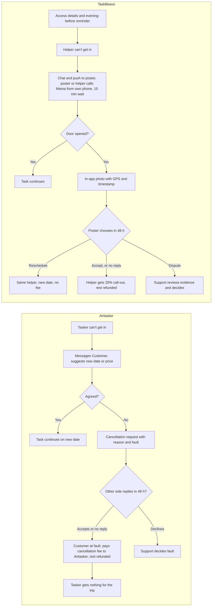

**Step by step, with the money:**

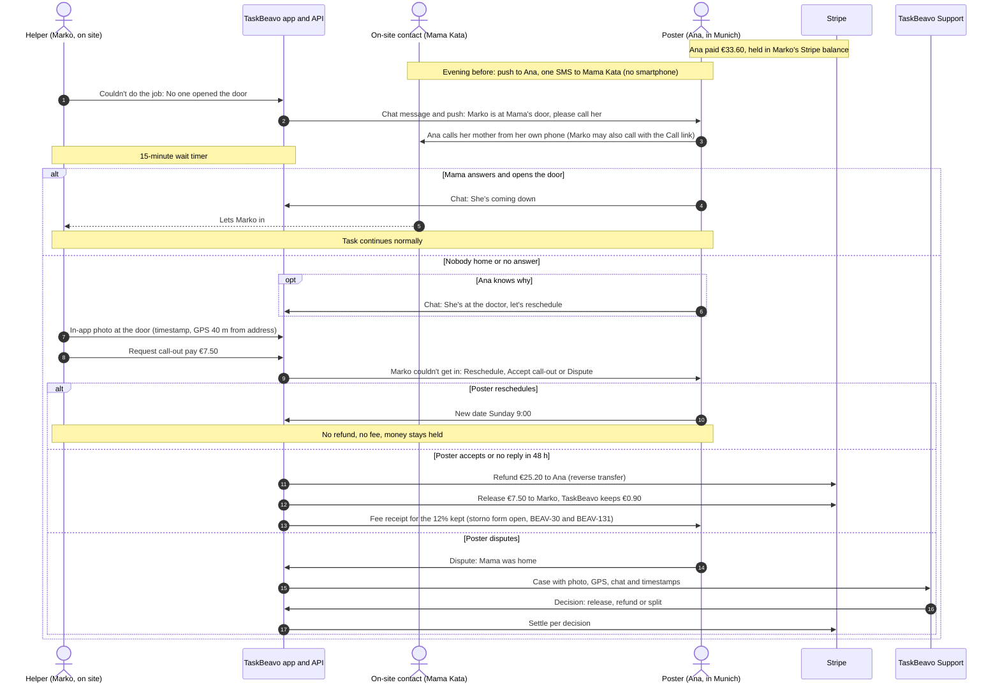

**Where the €33.60 goes in each outcome:**

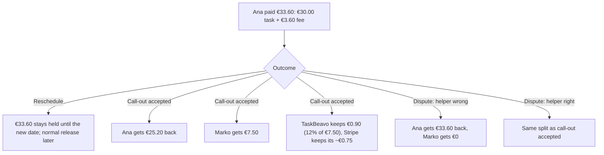

### Cancellation and edge-case flow

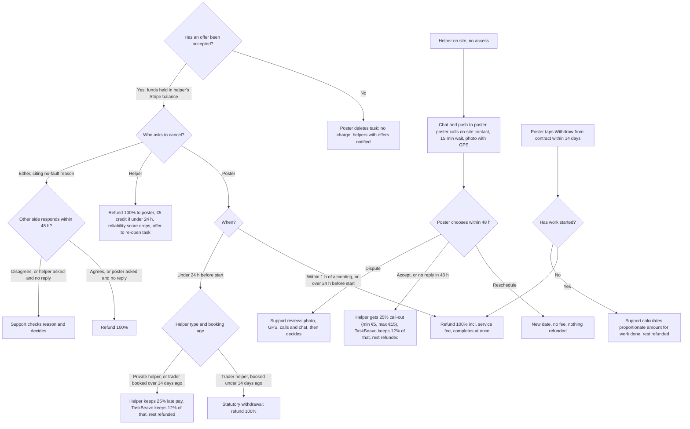

### Other edge cases and how TaskBeavo handles them

| Edge case | What happens |
|---|---|
| **Card payment fails when accepting an offer** | The booking stays in AwaitingPayment and records a `payment_attempt_failed` event; the poster tries another card in the same payment sheet (BEAV-110). While checkout is open the task takes no new or changed offers. The checkout ends 30 minutes after the last card attempt (a decline, or the start of a 3D Secure or bank-app confirmation), and never later than 60 minutes after acceptance; then the PaymentIntent is cancelled and the task is open again. The helper is told only once payment succeeds. |
| **Helper has not finished Stripe onboarding** | They can browse tasks but cannot send offers until their connected account is active and their DAC7 data is complete, because the destination charge needs a verified account. |
| **Task date passes with no accepted offer** | The task expires automatically. Nothing is charged, and the poster can re-post with one tap. Flexible-date tasks expire after 30 days unless the poster renews them. |
| **Reschedule** | Either side proposes a new date in the app and the other accepts. No fee. If the helper can't make the new time, it becomes a no-fault cancellation with a full refund, and the poster can re-open the task to other offers. |
| **Helper cancels or doesn't show up** | The poster gets 100% back (plus a €5 credit if under 24 h) and can tap "Re-open task", which notifies the other helpers who made offers. Two helper-fault cancellations in 30 days trigger a human review, never an automatic block. |
| **Job turns out bigger than described** | The helper sends a **price increase request** (as on Airtasker). If the poster approves, the extra amount is charged as a second destination charge to the same helper, with its own fee receipt. If the poster declines, the helper can do the original scope or both can cancel no-fault. |
| **Job turns out smaller, or only partly done** | The helper can lower the price before requesting payment, or the poster can **release part of the payment**. The rest is refunded automatically with a transfer reversal. Under the working assumption the fee receipt is issued at release, for the fee actually kept; if a receipt was already issued, a storno follows, in a form still open (BEAV-30, BEAV-131). Any disagreement goes to a dispute. |
| **Poster wants to cancel after the helper requested payment** | Not allowed as a cancellation. The poster releases or opens a dispute, so a finished job can't be cancelled to avoid paying. A statutory withdrawal after full performance with express consent is not available under CRD Art. 16(a). |
| **Poster uses the withdrawal button** | Before work starts it is treated as a full-refund cancellation. After work starts, support calculates the proportionate amount (pro rata to the price) and refunds the rest. |
| **Poster never releases** | Reminders at 24 and 48 h. Support can release on the poster's behalf. After 30 days with no release and no dispute, the poster is refunded (Airtasker's rule). Candidate to change after launch if helpers complain. |
| **Nobody does anything after the task date** (no payment request, no cancellation) | Reminders to both sides the day after. After 7 days, the poster is asked "Was this done?" and can release or cancel. After 14 days with no activity, the task is cancelled and the task price refunded. |
| **Helper's account is suspended, or fails Stripe identity checks, before the job** | The booking is cancelled no-fault with a 100% refund, and the task is re-opened. |
| **Helper ignores DAC7 data requests** | After two reminders at least 60 days apart, the law requires TaskBeavo to close the account or **withhold payouts** until the data arrives ([NN 151/2022](https://narodne-novine.nn.hr/clanci/sluzbeni/2022_12_151_2338.html)). The payout hold is a flag on the helper profile. |
| **Obrt helper finishes a job** | The helper owes the poster a fiscalized invoice for the task price, whatever the payment method ([Porezna uprava B2C](https://porezna-uprava.gov.hr/hr/fiskalizacija-racuna-u-krajnjoj-potrosnji-b2c-poslovanje-azurirano-5-1-2026/8033)). The app prompts them to upload it or enter its JIR before requesting payment. |
| **Private helper's quarterly earnings grow large** | The app shows a neutral notice suggesting an obrt and a tax adviser. This is a safeguard against the Labour Act's quarterly earnings cap (Art. 221.n), in case TaskBeavo is ever held to be in scope. |
| **Poster files a card chargeback instead of using TaskBeavo** | Stripe debits disputes from the platform balance even under destination charges. TaskBeavo responds with the chat, photos and event log. It reverses the transfer if the helper's payout is still paused. Otherwise it bears the loss. Repeat chargebacks lead to account suspension. A chargeback after the payout is handled in BEAV-127; until then it raises a money alert for support (see "Payout failures and account problems"). |
| **Booking far ahead** | Bookings are capped at 60 days ahead, so funds in the helper's balance stay well inside Stripe's manual-payout limit. |
| **Tips** | Tips are a separate destination charge at release with no application fee, and are not refundable after release. |
| **Damage to property during the job** | Not a cancellation. It goes to a dispute and to the platform liability insurance claim process. |
| **Poster and helper agree to pay in cash off the app** | Breaks the terms. The job loses insurance cover and dispute protection, and repeat cases lead to suspension. |
| **Someone tries to post a task outside Croatia** (for example in Vienna) | Blocked at address search and again on the server. They see "TaskBeavo currently works only in Croatia" and can join the waitlist for their city. |
| **A poster edits the address of an open task to outside the service area** | The edit is rejected by the server; the task keeps its original address. |
| **A helper moves abroad** | They can keep their account but only bid on tasks in Croatian service areas. DAC7 records their new residence country. Only EU member states are accepted as residence for now (BEAV-94); whether non-EU residents may help, and what to report for them, is open with the tax adviser (BEAV-25). |

### Disputes

Disputes must be opened before the poster releases payment. They freeze the helper's payout, and staff decide release, refund or split in the Django admin. The evidence is the chat, the photos, and the log of payment requests, reminders and cancellations. Every decision comes with written reasons sent to both sides. This is good practice under the Digital Services Act (DSA), and it is what the Platform Work Directive will expect for decisions that affect helpers.

## User journeys end to end, including the unhappy paths

The sections above cover money, cancellations, no access and disputes. This section fills the remaining journeys: signing up and logging in, becoming a helper, posting and offers, paying with card authentication, helper no-shows, safety incidents, reviews, reporting and suspension, and failed payouts.

### Sign-up and login

**Methods:** email with a one-time code (no passwords to forget), Sign in with Google, and Sign in with Apple. Apple requires Sign in with Apple, or an equivalent privacy-focused option, in an iOS app that offers Google sign-in. Everyone verifies a **mobile number by SMS code** before posting, sending an offer or chatting, which cuts fake accounts and is needed for booking reminders.

**One account, two roles.** The same account can post tasks and, after helper onboarding, send offers. Language, country and time zone are saved on the account. A language picked while signed out stays on that device: with no explicit pick, the account language wins after sign-in; with an explicit pick, the device keeps it, the account stays unchanged, and the app asks once "Also use X for emails and notifications?", changing the account language only on Yes (BEAV-65, BEAV-73).

**Rules:**
- **18+ only:** a date-of-birth confirmation at sign-up; helpers are checked again through Stripe identity verification.
- **Sessions:** short-lived access token plus a refresh token. "Log out of all devices" in settings revokes every refresh token, closes open WebSocket connections and forgets every known device. Ended sessions, with their coarse location and device hash, are deleted 6 months after they end (BEAV-76, after CNIL Délibération 2021-122).
- **Known devices:** a server-issued device token (`tb_device`, a strictly necessary security cookie on web) lasts 6 months and is renewed at each sign-in; it counts only if the account has seen it within those 6 months (BEAV-76).
- **Google and Apple sign-in never link to an existing account automatically.** If the provider's email matches an existing account, the user must first verify an email code sent to that address, and that email is the owner's notice (BEAV-71).
- **SMS caps:** every country's mobile numbers can get a code, under caps against SMS pumping: 20 an hour per country by default (Croatia 200, Germany 100, Austria 60, Switzerland 60) and 500 a day in total, with an alert at 80%. +1 numbers get no SMS until a numeric sender exists. The phone number is deleted with the account, with no fingerprint kept (BEAV-72).
- **Rate limits:** at most 5 code requests per hour per email or phone. 5 wrong codes for an address from one device or IP block that device or IP for that address for 30 minutes, while the owner's other devices can still sign in. The address itself locks for 30 minutes only after 20 wrong codes in an hour across all devices and IPs (NIST SP 800-63B allows up to 100 and prefers throttling, so attackers can't lock owners out).
- **New-device notice:** an email "New login to TaskBeavo from iPhone, Munich" with a "This wasn't me" link that logs out everywhere.
- **Account recovery:** lost phone means login by email code and re-verifying a new number. Lost email access means support verifies identity (for helpers through Stripe identity) before changing the email.
- **Suspended accounts** can log in only to see the reason, appeal, finish open bookings and download their data.
- **The on-site contact never has an account.** They exist only as the poster's contact record.

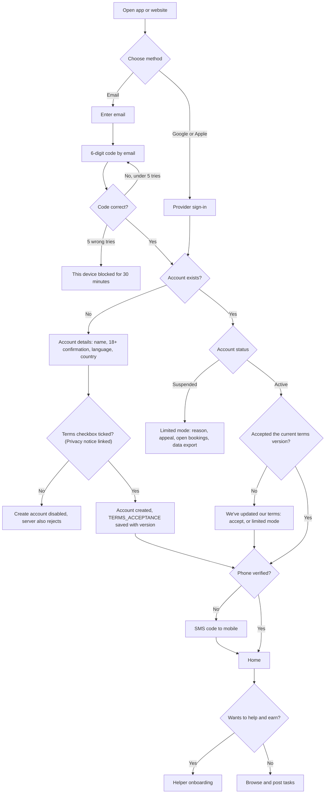

### Terms and conditions: pages, acceptance and updates

The final wording comes later with the lawyer (checklist item 9). The **mechanics** are built now, so every account is created only after accepting the terms, and TaskBeavo can prove it.

**Legal pages** (web, in HR/EN/DE/FR, linked in the footer, sign-up, checkout and app settings):

| Page | Who it's for | Accepted when |
|---|---|---|
| **Terms and conditions** (`/terms`) | Everyone | Sign-up (required) |
| **Privacy notice** (`/privacy`) | Everyone | Shown at sign-up; it informs rather than needing consent |
| **Helper terms** (`/helper-terms`): own prices, freedom to refuse, no fees, authority to instruct Stripe, tax and DAC7 duties | Helpers | Helper onboarding (required) |
| **Cancellation and refund policy** (`/cancellation`) | Posters | Checkout, with the early-start consent |
| **Cookie policy** (`/cookies`) | Website visitors | Cookie banner choice |
| **Company information** (`/imprint`): j.d.o.o. name, OIB, address, court register, contact email | Everyone | Not accepted; legally required information for online services |

**How acceptance works:**
- At sign-up, an **unticked, required checkbox**: "I agree to the Terms and conditions and have read the Privacy notice", with both linked. The **Create account** button stays disabled until it's ticked, and the server rejects sign-up without it too. Google and Apple sign-in go through the same step before the account is created. Changing the account language on that step unticks the box, so the user accepts the version in the language they read (BEAV-80).
- Each acceptance is stored as a `TERMS_ACCEPTANCE` row: document (terms, helper terms, cancellation policy), **version**, language, time, and app or web. This is the proof if anyone later says they never agreed.
- Each version of each document is kept in a `LEGAL_DOCUMENT` table with its text and effective date, so TaskBeavo can always show exactly what a user accepted.

**When the terms change:**
- **Small fixes** (typos, contact details): publish the new version, no action needed from users.
- **Material changes** (fees, cancellation rules, liability): email and in-app notice **30 days before** they take effect, listing what changes.
- On the effective date, the next app open or login shows a **"We've updated our terms"** screen with a summary and a link. Users must tap **Accept** before posting, offering or booking. They can still see their history, finish open bookings and delete their account if they don't agree.
- Open bookings continue under the version that applied when they were booked.

**Placeholder terms during development:** a clearly marked draft is fine for testing, but **no real users or payments before the lawyer-approved version is live** (checklist item 9a).

**A note on liability:** accepted terms protect TaskBeavo a lot: they make clear it's an intermediary, that the task contract is between poster and helper, and how cancellations and disputes work. But under EU and Croatian consumer law, terms **can't exclude everything**. Liability for gross negligence, intent, or death and injury caused by negligence can't be excluded, and terms that are unfair to consumers are void. That's why the lawyer review, the platform liability insurance and the safety flow all still matter.

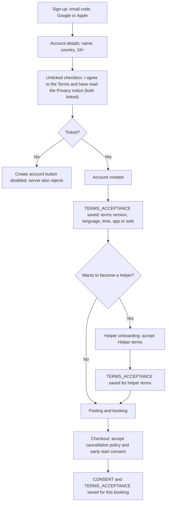

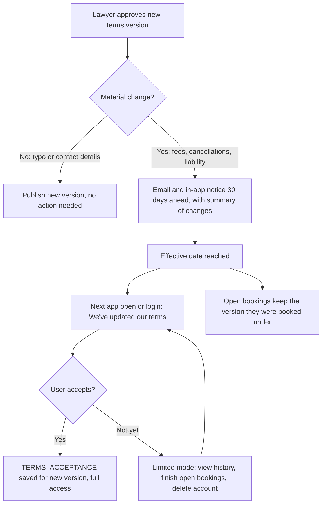

### Becoming a helper

A helper can browse right away but can only **send offers** after onboarding: status declaration, identity and tax data (DAC7), Stripe Express onboarding with identity check and IBAN, service areas, and accepting the helper rules. Stripe may ask for more documents later; until it does, the account stays active.

**Rules for helper status and data:**
- **IBAN:** TaskBeavo collects the full IBAN itself (encrypted, mod-97 checked, shown masked to its owner), because DAC7 needs it and Stripe Express exposes only the last four digits. It is required before sending offers, and the helper enters it again in Stripe onboarding (BEAV-94, BEAV-95).
- **Residence:** the country of residence must be an EU member state for now (BEAV-94). Whether non-EU residents may help is open with the tax adviser (BEAV-25).
- **Right to work:** BEAV-181 adds citizenship to onboarding (a launch condition); citizens from outside the EU, EEA and Switzerland upload a residence and work permit that staff approve, and offers stop when it expires. Which permit types allow this work, and what proof to keep, is open with a lawyer (BEAV-25).
- **Companies** stay hidden (no public business name or OIB) and can't send offers until their business is verified. Staff set the flag for now; BEAV-180 adds automatic checks against the court register (sudreg-data.gov.hr), with only non-matches going to staff review (BEAV-94). An obrt has no public register API, and its business OIB is the owner's OIB.
- **Registered business address:** an obrt or company helper has separate registered business address fields; the home address is never used as a trader address. Until it is filled, the server refuses offers with `BUSINESS_ADDRESS_REQUIRED` (BEAV-110). Helpers enter it with `updateHelperProfile(businessAddress)` (BEAV-192; any EU country, a Croatian one with a five-digit postal code), and staff in support or finance can fill it in the admin; the onboarding screen that asks for it is BEAV-97, a launch condition on BEAV-177. The poster of a task sees it on the trader's offer, at checkout and in the contract confirmation; the public profile shows only the town. Onboarding tells obrt and company owners so before they enter it.
- **Public profile and offers by payout status:** the public profile shows while the Stripe payout account is active, needs more information, is being verified or is restricted, and is hidden while there is none, it is incomplete or it was rejected. Sending offers needs an active account (BEAV-95).
- **Stripe rejection reasons** are shown in the app as incomplete verification, terms of service, or other (fraud and sanctions show as other, and support explains) (BEAV-95). Whether that meets the DSA statement-of-reasons duty is open with the lawyer.

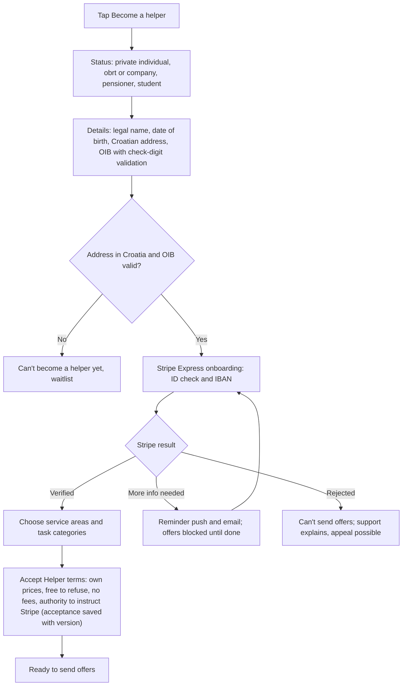

### Posting a task and handling offers

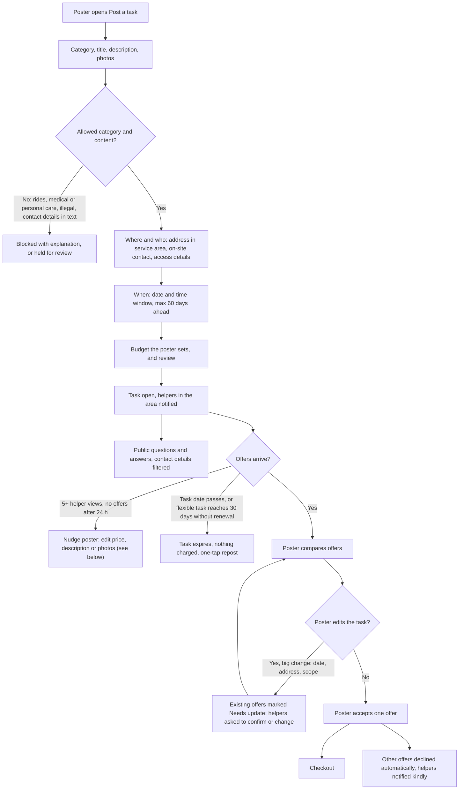

**Rules for posting and offers:**
- **Content moderation:** a category list excludes rides, medical and personal care, and anything illegal. Text and photos pass an automatic filter for phone numbers, emails and links (to stop off-platform deals before booking), and anything doubtful goes to a review queue. Every block gives a statement of reasons, as the DSA expects. In task text, a doubtful match holds the task for review, and a bare messaging-app name with no handle or number is published and logged (BEAV-137); the staff review queue is BEAV-138.
- **Offer messages** go through the same filter, but offers have no review queue: clear matches are masked, and a doubtful message is refused with `OFFER_MESSAGE_CONTACT_DETAILS` so the helper rewrites it (BEAV-100).
- **Tasks stay open until their date** (bookings are limited to 60 days ahead). **Flexible-date tasks** stay open 30 days, then the poster gets "Still need this? Renew with one tap"; without renewal the task expires.
- **Helpers' offers last 7 days** by default, renewable with one tap, and never past the task date. The poster gets a reminder a day before an offer expires.
- **A helper can withdraw an offer** any time before acceptance. If they withdraw while the poster is in checkout, the payment is cancelled and the poster is told.
- **Only one offer can be accepted.** The accept mutation locks the task row, so two quick taps or two devices can't book twice.
- **Minimum price:** a task's budget is at least €10, and so is an offer's price; the server refuses a lower one (BEAV-85, BEAV-100).
- **Duplicate tasks** (same poster, address and date) trigger a "You already posted this" warning.
- **After acceptance, the exact address and access details** become visible to the chosen helper only, while the booking is active. **Active** means FundsHeld, CancelRequested, NoAccessReported, PaymentRequested or IncidentPaused. IncidentPaused stays active so the helper keeps the address and the contact's phone while they may be calling 112. AwaitingPayment, Disputed and the settled states are not active (BEAV-107).
- **A booked task can't be edited** (`TASK_BOOKED`), except its photos and access details. Access details stay editable while the booking is active, and each change notifies the accepted helper live and by push, with no details in the push text (BEAV-107).
- **On acceptance,** the accepted offer is marked accepted and the task's other offers are declined (BEAV-107).

### Helping tasks get offers: view nudges and "Not for me" feedback

Three small features help tasks get booked instead of quietly expiring:

1. **Longer lifetimes** (above): tasks stay open until their date or 30 days for flexible ones, and offers last 7 days.
2. **A nudge when helpers look but don't offer.**
   - **Trigger:** at least 5 different helpers opened the task, there are no offers, and 24 hours have passed since posting.
   - **Message to the poster** (push and in-app card): "8 helpers looked at your task but nobody has offered yet. You decide whether to change anything." TaskBeavo never names a price or a price range (hard rule k). Buttons: **Edit price**, **Edit description**, **Add photos**.
   - **At most twice:** once at 24 hours and, if still no offers, once more after 3 days. Never more.
   - **Counts only:** the poster sees how many helpers looked, never who.
3. **"Not for me" with an optional reason.**
   - Every task card and task page has a **"Not for me"** button. It hides the task from that helper's feed.
   - It then asks once, with a **Skip** option: *Price too low · Not enough detail · Too far · Date or time doesn't suit me · Not my kind of task*.
   - **Always optional:** helpers are free to ignore any task without explaining. That keeps the helper experience light and fits the platform-work rules (no pressure to accept or justify refusals).
   - **Shared only in aggregate:** once 3 or more helpers give a reason, the nudge includes it, for example "Helpers say the price may be too low" or "Helpers asked for more detail". Single answers are never shown to the poster.
   - **Never turned into a price:** the reasons are not used to suggest a price, and accepted prices are not collected into a "similar tasks pay" range (hard rule k).

**Simple MVP scope:** view counting, the nudge with two sends, and the "Not for me" button with five reasons. No machine learning or A/B testing is needed at launch.

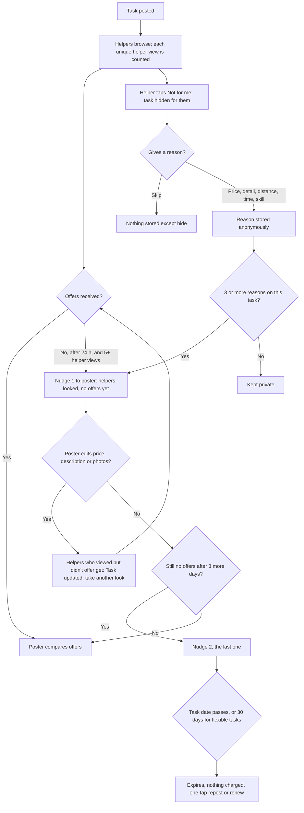

When the poster edits the price or description after a nudge, helpers who viewed the task but didn't offer, and didn't tap "Not for me", get one notification: "Task updated: Grocery run in Gruž, now €35. Take another look?"

### My tasks: history for posters and helpers

Every user has a **My tasks** tab with their current and past tasks. A user who both posts and helps sees a switch at the top: **As poster | As helper**.

**For posters:**

| Tab | What's in it |
|---|---|
| **Active** | Open tasks (with offer counts and any "no offers yet" nudge), booked tasks with status (payment held, payment requested, waiting for release), and anything needing action first, such as "Release payment" or a cancellation request |
| **Drafts** | Unfinished task posts |
| **Past** | Completed, cancelled and expired tasks, newest first, filterable by status, category, on-site contact (for example "Mama Kata") and date |

Each past task opens a **read-only summary**: the task as posted, the helper, the agreed price and what was actually paid, refunded or tipped, photos from the payment request, the chat (read-only), reviews, and documents. Actions:
- **Book again:** pre-fills the post-task wizard and invites the same helper.
- **Repost:** for expired or cancelled tasks.
- **Receipts:** the fiscalized receipt for the service fee, any storno receipts, the helper's invoice if they are a registered business, and a booking summary PDF.
- **Report a problem:** for issues found later, which go to support rather than reopening the payment.

**For helpers:**

| Tab | What's in it |
|---|---|
| **Offers** | Offers sent and still pending, with expiry and one-tap renew; withdrawn or declined offers are kept for 30 days |
| **Upcoming** | Booked jobs with date, area and, once accepted, the address and access details |
| **Completed** | Done jobs with photos, reviews and what was paid out |
| **Earnings** | Totals by month and year, each payout and its status (released, paid to bank, failed), call-out and late-cancellation pay shown separately, and the yearly earnings statement that matches the DAC7 report |

**Rules:**
- **Full history stays visible** for as long as the account exists. Old, finished items move to an "Archive" after 12 months to keep lists short, but stay searchable.
- **Privacy in history:** after a booking closes, the other side's exact address, access details and phone are hidden again; past tasks show only the area, such as "Gruž, Dubrovnik".
- **After account deletion,** the user's own history goes with it. The other side keeps their record, with the deleted person shown as "Former user". Accounting and DAC7 records stay in the restricted archive, as in the GDPR section.
- **Data export:** "Download my data" in settings includes the full task history as JSON or CSV (GDPR portability).
- **Repeat helpers:** posters see "Helpers you've booked before" when posting, and can invite them directly. This is how the diaspora's weekly visits become routine.

**GraphQL:** `myTasks(role: POSTER | HELPER, status, page)`, `task(id)` with a read-only `summary` for closed tasks, `myEarnings(year)` and `documents(bookingId)`. All are paginated, and Apollo's cache merges pages with a type policy.

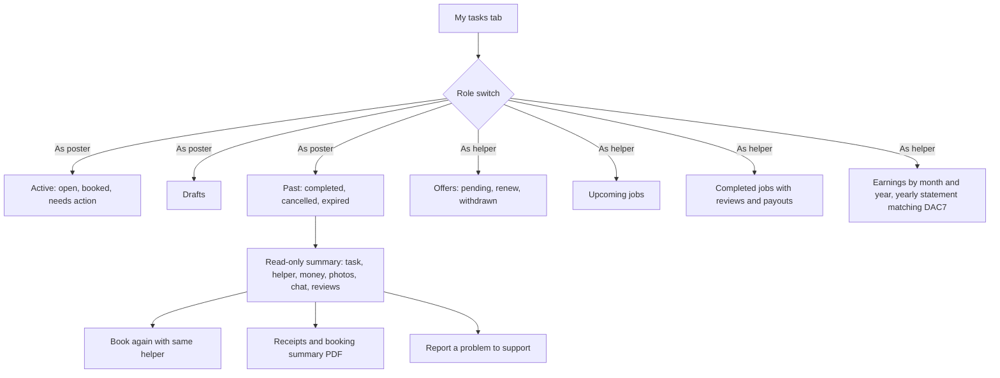

### Checkout with card authentication (3D Secure)

EU card rules (PSD2 strong customer authentication) mean many payments need the cardholder to confirm in their banking app. Stripe's payment sheet handles this; TaskBeavo must handle the waiting and failure cases.

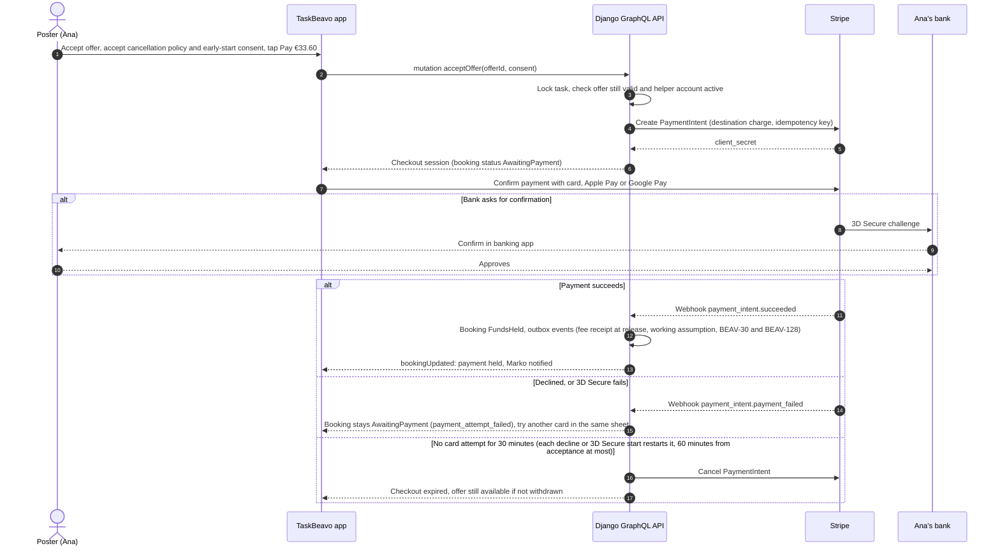

**Checkout rules (BEAV-110):**
- **The checkout clock** runs 30 minutes from the last card attempt. A decline (`payment_intent.payment_failed`) and the start of a 3D Secure or bank-app confirmation (`payment_intent.requires_action`) both restart it, and 60 minutes from acceptance is the hard limit.
- **The contract confirmation email** goes to the poster on a durable medium when the booking reaches FundsHeld, in the poster's language. It states the task, its start, the helper and whether they are a private individual or a registered business, the task price, the fee and the total, TaskBeavo's own identity as the trader for the fee, and the poster's express request with its time. It attaches the CANCELLATION document version the booking is governed by. What the withdrawal right covers depends on the helper: with a private helper the task is consumer-to-consumer, so only TaskBeavo's fee carries the 14-day right and the early-start wording; with a trader helper both the fee and the task do. For a trader the email also shows the full business name, OIB and registered business address, as snapshotted at checkout in the `CONSENT_RECORD`; a private helper's address is never shown.
- **Open for review:** the email's legal sentences need the lawyer and a professional translation; whether the trader's business address also goes into DAC7 or the archive, whether the private-helper wording needs a separate checkout consent, and keeping an obrt's seat (often the home address) for 11 years in the consent record are open with the lawyer (BEAV-110).

### Helper no-show and late arrival

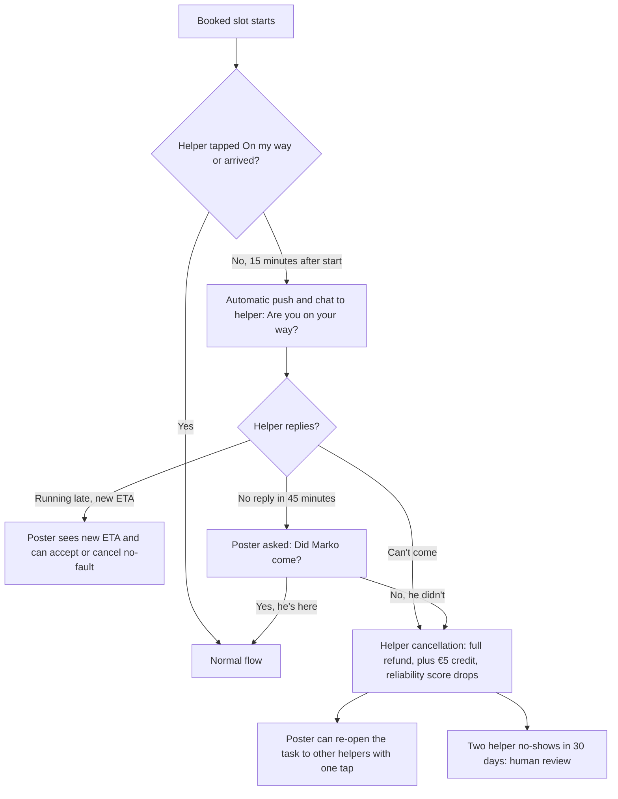

**Decided for BEAV-124 (user decisions 2026-11-07 and 2026-11-08):**
- The helper's taps ("On my way" with an ETA, "Running late" with a new ETA, "I've arrived") are evidence for the timeline and for support. They never change who pays what on their own, and they are one-off timestamps, never a location.
- The poster is asked "Did … come?" 60 minutes after the start with no word from the helper. If the helper said they were on their way or late, the question comes 45 minutes after the start or their ETA, whichever is later, and never later than 4 h 45 after the start. After "I've arrived" the poster isn't asked, but may still say "No" 45 minutes after the start or the tap, whichever is later; only the poster's own "Yes" ends that route.
- **"No, he didn't come" waits 24 hours** before anything moves. The booking is cancelled at once and the helper loses the address, but the refund and the no-show fault wait while the helper can answer "I was there". A contest goes to support, who uphold it (the helper cancellation: full refund, the €5 credit if the "No" came under 24 h before the start, a no-show fault that only queues a human review) or reject it (the booking continues, and the poster can't report a no-show again). Uncontested, it becomes the helper cancellation after 24 hours. This protects a helper who forgot to tap.
- After "Running late" the poster may keep the booking or **cancel for free**: a no-fault cancel the helper's own report already agreed to, a full refund at once with no credit and no fault. It stays open until the new ETA, and at least 30 minutes after the report.
- **Early start needs both sides:** an arrived helper taps "Start now" before the booked time and the poster confirms in the app. The booked start then moves to that moment, so cancelling is no longer possible and the dispute route applies. Without the poster's confirmation the booked time stays, and the request lapses at the booked start.
- The in-app GPS photo as no-show evidence is left to the no-access flow (BEAV-125). There is no chat message yet, so the prompts go by push, with email to users who have no app signed in.

The helper app gets an **"On my way"** button (with optional ETA) and a reminder push 2 hours and 30 minutes before the slot. A poster who isn't there to answer still gets the refund automatically: if neither side responds within 24 hours after the slot, the inactivity rule already in the plan applies.

### Safety incidents on a job

Helpers will meet elderly people alone, so the plan needs a clear emergency path. **TaskBeavo is not an emergency service**, and the app says so.

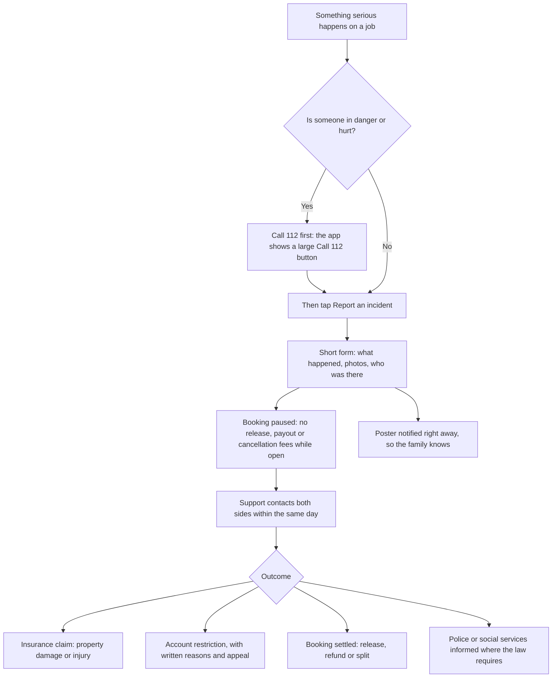

Examples: the parent has fallen or seems unwell, the helper is injured, property is damaged, someone behaves aggressively, or the helper is worried about the parent's welfare. Helpers are told in the rules to call 112 for emergencies and never to give medical care or medication. Incident data may include health details, so it is stored with restricted access and its own retention period.

### Reviews

- **Who:** both sides review each other after release or a partial settlement, never after a full refund.
- **Blind:** reviews are hidden until both are written or 7 days pass, then they can't be edited.
- **Content:** 1–5 stars, quick tags and an optional comment. The same contact-detail filter applies.
- **Reporting:** either side can report a review as abusive, false or containing personal data. Support decides, and removal is explained to both sides. A poor but honest review is never removed.
- **Display:** rating with count. Posters see no completion rate, response time, jobs-done count or other stat that steers work to particular helpers (hard rule k; BEAV-144 decides what else a profile may show). Ratings never deactivate anyone automatically.

```mermaid
flowchart LR
    R1["Payment released"] --> R2["Both asked to review"]
    R2 --> R3{"Both submitted, or 7 days passed?"}
    R3 -->|No| R2
    R3 -->|Yes| R4["Reviews published, locked"]
    R4 --> R5{"Reported?"}
    R5 -->|No| R6["Stays published"]
    R5 -->|Yes| R7["Support review: keep or remove, reasons sent to both"]
```

### Reporting, blocking, suspension and appeal

- **Report and block** are available on every profile, offer, chat and review. Blocking hides each side from the other and prevents new offers or bookings between them; open bookings continue unless support decides otherwise.
- **Notice-and-action (DSA):** anyone, including non-users, can report illegal content or behaviour through a web form. Each report gets an acknowledgement, a decision and a statement of reasons.
- **Restrictions are decided by a person,** never automatically by ratings or algorithms. The affected user gets written reasons and can appeal once to a second reviewer. This also follows the Platform Work Directive's rules on human review.
- **During a restriction,** open bookings are finished or refunded, and payouts already earned are still paid unless fraud is suspected.

```mermaid
flowchart TD
    A["Report from a user or the web form"] --> B["Support queue with evidence: chat, photos, event log"]
    B --> C{"Decision by a person"}
    C -->|"No breach"| D["Close; reporter told the outcome"]
    C -->|"Breach"| E["Warning, content removal or account restriction"]
    E --> F["Written statement of reasons to the user"]
    F --> G{"User appeals?"}
    G -->|No| H["Decision stands"]
    G -->|Yes| I["Second reviewer decides"]
    I --> J["Upheld, reduced or reversed; user told"]
```

### Payout failures and account problems

| Situation | What happens |
|---|---|
| **Payout to the helper's bank fails** (closed account, wrong IBAN) | Stripe returns the money to the helper's Stripe balance and sends `payout.failed`. The helper gets a push and email to update the IBAN in Stripe, and support is alerted. Stripe doesn't retry manual payouts, so the payout is created again once the bank details are fixed: by support until the automatic retry (BEAV-120) exists. The booking's status doesn't change (BEAV-110). |
| **A money problem needs a person** (a payment after the checkout failed, a chargeback after payout, a failed payout, an amount mismatch) | The webhook still answers 200, and support is alerted instead: a Sentry event at level error with the tag `support_flag=money` and IDs only, which the alert rule "Money problem needs support" (rule 1453544, project taskbeavo-backend) emails to the team. Later money tickets reuse the same tag (BEAV-110). A chargeback after payout is handled in BEAV-127. |
| **Stripe asks the helper for more information later** | Offers are paused until done; payouts already released wait in their Stripe balance. Open bookings can still be completed. |
| **Poster's card expires before a refund** | Stripe sends the refund to the same card account; banks normally forward it. If a refund fails, support arranges it manually. |
| **Helper deletes their account with money still to be paid out** | Deletion waits until open bookings close and payouts finish, as in the GDPR deletion flow. |
| **Poster changes their mind about who the on-site contact is** | The on-site contact is fixed once the task is booked. For a change on the day, the poster updates the access details (for example who has the key), which notifies the helper, or reschedules or cancels under the cancellation rules. The contact's own details (name, phone) can't be edited while any booking that uses the contact is unfinished: in checkout, active, disputed or paused. They unlock once the poster has released payment or the booking is cancelled or refunded; the bank payout isn't waited for. Tasks with no booking yet don't lock the contact. A poster with recurring bookings adds a new contact for new tasks. If the contact asks to correct their own data (GDPR right to rectification), support corrects it (decided 2026-11-04, replacing the slot-start lock of BEAV-78; BEAV-184 builds the edit lock, and until it ships the code still locks edits only from the slot start of an active booking). A contact can't be deleted while any booking that uses it is unfinished (today's code refuses while a booking is active), nor while a draft, pending-review or open task uses it; closed tasks lose the link (BEAV-85, BEAV-184). Landline numbers are allowed and marked as not taking SMS; premium and toll-free numbers are refused (BEAV-78). |

### Staff roles in the admin

Staff work in the Django admin in three groups: **support**, **finance** and **trust** (BEAV-156). Every staff member sees the booking list, its `booking_events`, the checkout consent, amounts and normal staff notes. On top of that:

| Capability | Support | Finance | Trust |
|---|---|---|---|
| Exact address, access details, on-site contact's name | Yes | | Yes |
| Chat text, task and evidence photos | Yes | | Yes |
| Stripe IDs and payout account status | Yes | Yes | |
| On-site contact's phone (others see the last 3 digits) | | | Yes |
| Helper OIB, IBAN and VAT ID: masked for all; **Reveal** writes an audit row | | Yes | |
| Restricted notes (incident health details), invisible to the other groups | | | Yes |
| Users' names and emails, every view audited | Yes | | Yes |
| Helper profile page; edit a trader's business address, audited (BEAV-110) | Yes | Yes | |

- Users' own phone numbers are not in the admin at all.
- **The specific reason of a health-revealing cancellation** (hospitalisation, bereavement, a helper's illness; GDPR Art. 9) needs the separate permission `view_no_fault_detail`. No group has it by default: the founder grants it by hand to the people who decide no-fault cases. Everyone else, including the rest of support, sees a label that can't be worked back, on the booking page and in its `booking_events`: "Personal emergency" for hospitalisation, bereavement and a declared emergency alike, and "personal reason" for a helper's illness or other reason (BEAV-123, decided 2026-11-07).
- Superusers are for break-glass only. They still need finance or trust membership for reveals, restricted notes and the contact's full phone, and an explicit grant of `view_no_fault_detail`.
- The staff audit log (`StaffAuditEvent`) holds IDs only and never hints that a restricted note exists.
- **Staff notes are append-only** for staff. Only a system job purges them, on the evidence-photo periods: booking close plus 180 days, or, under a legal hold, resolution plus 5 years. A redact function is there for account deletion (BEAV-153). Both periods, a possibly shorter period for restricted health notes, and a retention period for the audit log (none is set yet) are open with the lawyer (BEAV-156).


## Croatian law answers the open questions, mostly with "be an agent"

### No payment licence, as long as TaskBeavo never possesses or controls the funds

Croatia's Payment System Act (ZPP) copies PSD2's commercial-agent exclusion almost word for word. Article 5 point 2 exempts transactions through a commercial agent authorised to negotiate or conclude a sale "u ime samo platitelja ili samo primatelja plaćanja", that is, on behalf of *only* the payer or *only* the payee. Article 3 defines **money remittance** as receiving funds from a payer solely to pass them on to a payee. A platform that takes posters' money and forwards it to helpers matches that definition ([NN 66/18](https://narodne-novine.nn.hr/clanci/sluzbeni/2018_07_66_1330.html)).

The EBA has rejected the idea that settling the buyer's debt is enough to exclude a platform. The competent authority, here the Croatian National Bank (HNB), decides case by case whether the platform acts for one side or both ([EBA Q&A 2020_5354](https://www.eba.europa.eu/single-rule-book-qa/qna/view/publicId/2020_5354); [EBA Q&A 2020_5355](https://www.eba.europa.eu/single-rule-book-qa/qna/view/publicId/2020_5355)). TaskBeavo collects for the helper and holds money until the poster says "release", so it acts for both sides. **The commercial-agent exclusion is therefore not a safe basis.** The only realistic route is the one Stripe describes: funds owed to sellers "are never in the possession or control of the platform", because Stripe, as an authorised e-money institution, provides the regulated service ([Stripe PSD2 guide](https://stripe.com/en-cz/guides/how-psd2-impacts-marketplaces-and-platforms)).

Stripe's PSD2 FAQ adds the conditions that make this work:

- the platform must have no discretionary authority over the funds;
- the platform must be contractually authorised by the connected account to give payment instructions.

On that basis, Stripe says marketplaces using Connect do not need a licence (its EEA FAQ is published in Swedish: "behöver inte en licens"), while recommending independent legal advice ([Stripe FAQ Connect & PSD2](https://stripe.com/sv-fi/guides/frequently-asked-questions-about-stripe-connect-and-psd2)). The destination-charge design above satisfies both conditions more convincingly than separate charges and transfers. **Paying by bank transfer to TaskBeavo's own IBAN and forwarding the money to helpers would almost certainly need a licence, and must never be offered.**

No HNB guidance on online marketplaces under ZPP Art. 5(2) was found, and no Croatian law-firm commentary on the point either. That is why a lawyer's written opinion, optionally with an informal approach to HNB, is on the checklist.

**PSD3 and the Payment Services Regulation (PSR) close the door further.** Their status at the end of October 2026:

- Political agreement came in November 2025.
- The final compromise texts were published on 23 April 2026, and the European Parliament's ECON committee approved them on 5 May 2026 ([William Fry](https://www.williamfry.com/knowledge/psd3-psr-final-compromise-texts-are-published/)).
- As of 20 October 2026, formal adoption and publication in the Official Journal were still expected "in late 2026", with rules taking effect from late 2027 into 2028 ([Alston & Bird](https://www.alston.com/en/insights/publications/2026/10/psd3-psr-europe-business-operations)).

The final PSR text keeps the agent exclusion only for an agent acting "on behalf of only the payer or only the payee, but not both of them", and only if it has "a real scope to negotiate". The EBA must issue guidelines on this within a year ([paymentslaw.eu PSR compromise text](https://paymentslaw.eu/psr.md)). TaskBeavo uses standard terms and a fixed fee, so it fails both tests. Stripe expects the exclusion to be available to platforms "only in very limited circumstances" ([Stripe PSD3 guide](https://stripe.com/en-de/guides/what-platforms-and-marketplaces-can-expect-from-psd3)). PSD3 therefore changes nothing in the plan: TaskBeavo relies on a licensed provider today and will have to tomorrow.

### Porezna uprava expects four things: DAC7, a VAT ID, fiscalized receipts and eRačun

**DAC7.** TaskBeavo is a platform operator facilitating "personal services", a category that explicitly includes physical services such as "delivery, cleaning, administrative tasks". Personal services have **no de minimis**: the 30-sales/€2,000 exclusion covers only sellers of goods ([Porezna uprava DAC7](https://porezna-uprava.gov.hr/hr/obveze-za-operatere-platformi-dac7/4733)). Charging the fee only to posters changes nothing. Operator status comes from contracting with sellers to make the platform available and facilitating payments to them. The obligations are:

- **Register at dac7.porezna-uprava.hr within 8 days** of becoming an operator.
- **Complete due diligence by 31 December** of each reporting period.
- **By 31 January of the following year**, report each helper's name, address, OIB, date of birth, IBAN, member state of residence, **total consideration per quarter**, **number of activities**, and any fees withheld or charged. Each helper must get a copy statement by the same date.
- If a helper does not supply data after **two reminders at least 60 days apart**, close the account or **withhold payouts**.
- Keep records for **10 years after the end of the reportable period** they relate to (BEAV-47, BEAV-132). The law (ZAS čl. 35.m st. 7, NN 151/2022) sets at least 5 and at most 10 years, so 10 is a ceiling: a sweep deletes the records on 31 December of the tenth year, and they don't follow the 11-year accounting rule. A copy of the same data inside a fiscal record follows the fiscal rule.

([NN 151/2022](https://narodne-novine.nn.hr/clanci/sluzbeni/2022_12_151_2338.html); [NN 114/2023](https://narodne-novine.nn.hr/clanci/sluzbeni/2023_10_114_1616.html))

The penalties are now known. A legal person faces **€260–€26,540** and the responsible person €260–€2,650. Since 2023 they also apply to inaccurate or incomplete reports, and persistent failure leads to revocation of the registration ([NN 151/2022](https://narodne-novine.nn.hr/clanci/sluzbeni/2022_12_151_2338.html); [NN 114/2023](https://narodne-novine.nn.hr/clanci/sluzbeni/2023_10_114_1616.html)). The "fees charged" field is probably €0 per helper, because the fee is charged to posters. Porezna has not confirmed this, so ask (a free question, BEAV-25).

**VAT (PDV).** A j.d.o.o. stays outside the VAT system until its qualifying supplies exceed **€60,000**, a threshold in force since 1 January 2025 (NN 152/24). It then files form P-PDV and charges VAT from the day after crossing the threshold ([Informator](https://informator.hr/strucni-clanci/novosti-u-zakonu-o-pdv-u-od-1-sijecnja-2025)). The agent model, the place-of-supply logic and the risk of being treated as an electronically supplied service are covered in the agent-vs-merchant section above. Even below the threshold, TaskBeavo needs a **PDV ID number** and must self-account for VAT on services received from abroad ([RRiF](https://www.rrif.hr/clanak-20509/)). Profit tax is **10%** while revenue stays under €1M ([Porezna uprava](https://porezna-uprava.gov.hr/hr/2-porez-na-dobit-7637/7637)).

Under the agent model the books split Stripe receipts in two. The fee is revenue. The task price never reaches TaskBeavo's balance with destination charges, which makes that split cleaner. Small-taxpayer invoices must carry a VAT exemption note, usually worded as a reference to čl. 90 ZPDV. The exact wording should come from the accountant.

**Fiscalization.** Since **1 January 2026**, every B2C receipt issued by a profit-tax payer must be fiscalized in real time "regardless of payment method". The receipt shows the time of issue, the operator mark, the payment method, the **JIR** (unique invoice identifier returned by Porezna), the **ZKI** (the issuer's protective code, signed by TaskBeavo) and a **QR code** ([Porezna uprava B2C](https://porezna-uprava.gov.hr/hr/fiskalizacija-racuna-u-krajnjoj-potrosnji-b2c-poslovanje-azurirano-5-1-2026/8033)). Card payments were already in scope before 2026 ([Fiskalopedija](https://fiskalopedija.hr/baza-znanja/fiskalizacija-20)). The only cross-border carve-out is distance sales of *goods* taxed in another member state. A fee for a service taxed in Croatia remains a domestic B2C supply, so receipts for **fees paid by German or Austrian posters are very probably in scope too**.

In practice this means one fiscalized račun per fee charged (never for the task price), issued at release under the current working assumption (open, BEAV-30; see the fiscalization service below):

- numbered in the sequence *number/business premises/device*;
- payment method card ("K");
- sent to Porezna's central system (CIS) with a FINA application certificate.

Refunded fees get a storno (reversal) receipt; the form for a partial refund is open (BEAV-30, BEAV-131). The "business premises" code for a purely online business has to be registered, and its exact format is unconfirmed (a free question to Porezna, BEAV-25). Fines for failing to fiscalize under the new law (NN 89/25) were not verified.

**eRačun.** Since 1 January 2026, businesses outside the VAT system must be able to **receive** B2B e-invoices, and Porezna's free MIKROeRAČUN app is enough. From **1 January 2027** they must also **issue** eRačuns to Croatian business customers, such as a rental agency booking changeovers. Invoices to foreign businesses are excluded ([Fiskalopedija](https://fiskalopedija.hr/baza-znanja/fiskalizacija-20)). MIKROeRAČUN has been upgraded to issue eRačuns for free ([TEB](https://www.teb.hr/novosti/2025/projekt-fiskalizacija-20-i-eracuni/)).

### Helpers pay their own tax, and TaskBeavo should stay out of the payer role

Croatian income tax law hinges on the **isplatitelj**, the payer:

- **When a business pays** drugi dohodak (other income), it withholds tax and contributions and reports them on JOPPD ([RRiF 2/26](https://www.rrif.hr/IV_OPOREZIVANJE_DRUGIH_DOHODAKA_-24444C.pdf)).
- **When a private individual who does not run a business pays**, the recipient calculates and pays the tax and contributions and files JOPPD. Only pension contributions apply, not health ([TEB 2025](https://www.teb.hr/novosti/2025/drugi-dohodak-od-fizicke-osobe/)).
- **When income comes directly from abroad**, as from a daughter in Munich, the helper registers on form RPO **within 8 days** of receiving it, then pays and reports within 30 days ([TEB 2026](https://teb.hr/novosti/2026/inozemni-drugi-dohodak/)).

Under the agent model the poster is the payer, so **TaskBeavo does not withhold and files no JOPPD for helper payouts.** If TaskBeavo contracted with helpers in its own name, set their prices or paid them from its own funds, Porezna could treat TaskBeavo as the isplatitelj and require withholding and a JOPPD on every payout. **No Porezna opinion or ruling on pass-through marketplaces was found.** The only platform opinion found deals with hidden employment of paušal obrtnici, assessed case by case ([RRiF summary](https://www.rrif.hr/rad_fizickih_osoba_obrtnika_koji_dohodak_utvrduju_-3961-misljenje/)). This is the single most important written opinion to request. It needs a binding opinion (OPZ čl. 10: EUR 600 for a new company, about 90 days, one request per tax area, the company OIB required, and the applicant proposes its own answer), requested once the company has its OIB; the income tax of non-resident helpers, and possibly the DAC7 fees field, can go into the same request (BEAV-25).

| Helper status | Who reports and pays | Key 2026 numbers | What TaskBeavo does |
|---|---|---|---|
| **Private individual, Croatian poster** | Helper self-assesses and files JOPPD (deadline unconfirmed: Porezna says 8 days, RRiF 30; open, BEAV-25) | Pension contributions 10%. Tax advance at the city's lower rate, 20% in Dubrovnik. Example: €50 job ≈ €5 contributions + €9 tax, keeps ≈ €36 before the annual return | Collects DAC7 data, sends an earnings statement, links a self-assessment guide |
| **Private individual, poster abroad** | Helper: RPO within 8 days, payment and JOPPD or INO-DOH within 30 days | As above, no health contribution | Statement broken down by payer country |
| **Paušalni obrt (flat-rate sole trader)** | Helper, through flat-rate tax | Revenue up to €60,000. Contributions €290.98/month for a main-activity obrt; none monthly for a secondary-activity obrt. Must issue a **fiscalized invoice per task** | Labels the helper "Trader". Prompts for the invoice. Applies trader withdrawal rules |
| **Student** | Student service (servis) through JOPPD code 5501 | €6.56 net/hour minimum. Tax-free up to €12,600/yr. Payer add-ons ≈ 17.5% | **Not at launch.** A private household cannot be the ordering party. TaskBeavo would have to be, and would then become a reseller. Students may join as private individuals under the drugi dohodak route |
| **Pensioner** | As private individual or obrt | Under the 2025 pension act, a pensioner may work up to half-time and keep the full pension. From age 65 work does not stop the pension | Information note, and suggests checking with HZMO (the pension insurance institute) |

Sources: [RRiF 2/26](https://www.rrif.hr/IV_OPOREZIVANJE_DRUGIH_DOHODAKA_-24444C.pdf); [MojaFirma Dubrovnik rates](https://mojafirma.hr/kalkulatori/place/dubrovnik); [TEB 2025](https://www.teb.hr/novosti/2025/drugi-dohodak-od-fizicke-osobe/); [TEB 2026 foreign income](https://teb.hr/novosti/2026/inozemni-drugi-dohodak/); [MojaFirma paušalni obrt](https://mojafirma.hr/clanci/pausalni-obrt-obveze-2026); [gov.hr student work](https://www.gov.hr/hr/studentski-poslovi/1982); [MojaFirma students](https://mojafirma.hr/clanci/rad-studenata-studentski-ugovor-2026); [RRiF JOPPD](https://www.rrif.hr/VI_IZVJESCIVANJE_O_ISPLACENIM_PRIMITCIMA_NA_OBRASC-24446C.pdf); [TEB pensioners 2026](https://teb.hr/novosti/2026/rad-umirovljenika-u-2026/); [TEB pension options](https://teb.hr/novosti/2026/mogucnosti-rada-i-obavljanja-djelatnosti-umirovljenika/). The €50 example is the research team's arithmetic.

This changes the earlier plan, which treated the student service as the most attractive supply channel. **The naručitelj (ordering party) must be a legal entity or a registered business**, so neither a Dubrovnik household nor a family in Germany can order student work. If TaskBeavo became the ordering party, it would be buying the work and reselling it. That means merchant-of-record VAT, fiscalized receipts on the full price, and liability for performance. A "TaskBeavo Student" product on that basis could still be a later, separately priced line. At launch, students take part like any other private individual and lose the student tax exemption for that income.

Because DAC7 reports reach Porezna regardless, casual helpers who skip self-assessment will be visible. Plain-language guides and annual statements protect both the helpers and TaskBeavo's reputation.

### Platform-work rules punish control, not intermediation

Croatia's platform-work chapter (Labour Act Arts. 221.a–221.p, NN 151/22) has applied since 1 January 2024. It defines a digital work platform as an *employer* that provides a service using digital technology through individuals who perform paid work. It **excludes platforms whose "primary purpose is sharing assets or selling goods or services"** (Art. 221.c(7)), and it excludes business users under the P2B Regulation from the "other persons" category ([Informator](https://informator.hr/strucni-clanci/rad-putem-digitalnih-radnih-platformi-u-zakonu-o-izmjenama-i-dopunama-zakona-o-radu)).

The Art. 221.m presumption of employment looks for these signs ([Eurofound](https://apps.eurofound.europa.eu/platformeconomydb/croatian-labour-act-amended-and-act-on-elimination-of-unregistered-work-introduced-110032)):

- personal performance;
- orders within a subordinate arrangement;
- limited freedom to refuse;
- time, place and manner of work set in detail;
- supervision and evaluation;
- a ban on working via other platforms.

The platform carries the burden of rebutting it ([tportal](https://www.tportal.hr/tehno/clanak/algoritmi-place-i-odgovornost-sto-donose-nova-pravila-za-platformski-rad-20260728)). The chapter also brings:

- **A quarterly earnings cap (Art. 221.n).** Above 60% of three gross monthly minimum wages per quarter, work may only be done under an employment contract.
- **A mandatory ministry register (Art. 221.p)** and work records in the JEER system.
- **A ban on charging workers intermediation fees.**
- **Fines of up to about €13,000** for the company ([Wolf Theiss](https://wolftheiss.com/insights/employment-brief-new-rules-on-platform-work-in-croatia)).

Commentary focuses on Wolt, Bolt and Glovo. **No guidance classifies bid-based task marketplaces**, and ministry opinions on the presumption are paywalled. Earlier commentators also called the presumption ill-suited to the platform economy ([RRiF](https://www.rrif.hr/clanak-24169/)).

**The EU Platform Work Directive (2024/2831) is due by 2 December 2026, and Croatia is late.**

- The ministry planned full transposition into the Labour Act ([e-Savjetovanja plan](https://esavjetovanja.gov.hr/ECon/Slicing/GetDocx/31646)).
- In July 2026 the draft promised clearer platform definitions, rules on algorithmic management, and criteria to separate employees from the self-employed ([tportal](https://www.tportal.hr/tehno/clanak/algoritmi-place-i-odgovornost-sto-donose-nova-pravila-za-platformski-rad-20260728)).
- On 29 September 2026 the bundled amendment went to the social partners, with entry into force expected "toward the end of this year" ([TEB](https://www.teb.hr/novosti/2026/ususret-ocekivanim-izmjenama-zakona-o-radu/); [Novi list](https://www.novilist.hr/?p=1749671)).

The Directive's definition of a platform requires the "organisation of work performed by individuals" ([Directive (EU) 2024/2831](https://eur-lex.europa.eu/eli/dir/2024/2831/oj)). That supports TaskBeavo's position, because the poster and the helper organise the work between themselves. Its algorithmic-management chapter, however, reaches even genuinely self-employed platform workers, and Art. 10 requires human review of automated decisions ([Wikipedia: PWD](https://en.wikipedia.org/wiki/Platform_Work_Directive_2024)).

The product design therefore doubles as legal design, and TaskBeavo commits to it in the helper terms:

- Helpers set their own prices. TaskBeavo never sets or suggests a price: no recommended price, no price range, no "similar tasks pay" figure.
- Posters choose the helper. There is no dispatch algorithm.
- Offers are listed newest first, or by lowest price when the poster switches the sort; open offers come before withdrawn or expired ones. Nothing else changes the order (not ratings, history, acceptance rate, availability or response time), and nobody pays for placement. The `/ranking` page ("How offers are ordered") says so, which is also the ZZP duty to explain the main ranking parameters.
- Declining a task carries no penalty, and there are no acceptance-rate thresholds.
- There are no uniforms, scripts or exclusivity, and helpers may use their own tools.
- Ratings inform and never deactivate anyone automatically.
- The fee falls on posters only, permanently.
- Any restriction is decided by a person, with written reasons and an appeal route.

If TaskBeavo later sets prices, assigns jobs or ranks helpers punitively, these arguments collapse. A written opinion from the labour ministry (MRMSOSP) on whether TaskBeavo must join the platform register is worth requesting, and e-Savjetovanja should be watched for the transposition bill.

### Insurance must be bought, because nobody's existing policy covers paid tasks

Croatia osiguranje's private liability policy explicitly excludes "activities by which one earns" ([IPID](https://webshop.crosig.hr/ip/Resursi/Dokumenti/ipid/Informacije%20o%20proizvodu%20osiguranje%20od%20privatne%20odgovornosti.pdf?033)), so a helper's household cover is useless on a paid job. Wiener's SME package bundles general, professional and employer liability **from €86.27 a year**, but the flyer does not say what cover that price buys ([Wiener flyer](https://ponuda.wiener.hr/EasyEdit/UserFiles/letci/2024-01/wiener/le-114-24-01obrtnici-i-poduzetniciwiener.pdf)). Embedded per-task cover in the style of Qover's Wolt courier programme exists in the EU, but there is no evidence it serves small Croatian platforms ([Qover](https://www.qover.com/blog/wolt-chooses-qover-to-insure-riders)).

The workable plan has four parts:

- TaskBeavo's company buys platform general and professional liability through a broker.
- The terms state that helpers are independent and liable for their own work.
- Helpers with an obrt are encouraged to carry their own package.
- Once a group policy exists, TaskBeavo copies Airtasker's rule that cover applies only to on-platform payments.

Personal care, medication and anything medical stay out of scope at launch, because falls and health incidents involving elderly clients are the highest-severity risk.

### "Drive Mum to the doctor" is a taxi licence problem

Paid passenger transport in Croatia is autotaksi. It needs ([MMPI brochure](https://mmpi.gov.hr/UserDocsImages/dokumenti/PROMET/Promet%202_20/Brochure-TAXI%2013-2_20.pdf); [Fiskai Bolt/Uber guide](https://www.fiskai.hr/vodic/bolt-uber-vozac/)):

- a registered business;
- a county licence and a local permit for each municipality;
- a taxi driver card;
- TAXI markings;
- fiscalized rides.

Operating without a local permit risks fines of up to €6,630. Dubrovnik's taxi market is politically sensitive.

**Exclude rides from the category list.** Allow errands where the helper drives alone, and "accompaniment" where the parent takes a licensed taxi or the bus with the helper. Whether a helper driving the client's own car counts as transport is a grey area that needs legal advice.

### Company, DSA and GDPR basics

**Company.** A **j.d.o.o.** can be founded online with €1 share capital and a €10 court fee. It must reserve a quarter of its profit and keep double-entry books ([Fiskai](https://www.fiskai.hr/usporedba/firma/); [gov.hr](https://gov.hr/hr/osnivanje-jednostavnog-drustva-s-ogranicenom-odgovornoscu/2747)). It gives limited liability, and it can hold the Stripe platform account, the DAC7 registration and the FINA fiscalization certificate. A personal obrt handles all three badly.

**Digital Services Act.** TaskBeavo is an online marketplace. As a micro or small enterprise it is exempt from the marketplace-specific Arts. 30–32 until 12 months after it outgrows that status ([Springlex Art. 29](https://www.springlex.eu/en/packages/dsa/dsa-regulation/article-29/)). It still needs notice-and-action, statements of reasons, clear terms and published user numbers ([European Commission](https://commission.europa.eu/strategy-and-policy/priorities-2019-2024/europe-fit-digital-age/digital-services-act_en)).

**Consumer law (ZZP Art. 36, as amended by NN 59/26).** TaskBeavo must show, based on each helper's own declaration, whether the helper is a trader. It must also explain the main ranking parameters ([zakon.hr ZZP](https://www.zakon.hr/z/193/zakon-o-zastiti-potrosaca)). Article 6a of the Consumer Rights Directive also requires telling posters that consumer law does not apply when the helper is a private individual, and how obligations are split between the helper and the marketplace ([CRD](https://eur-lex.europa.eu/legal-content/EN/TXT/?uri=CELEX:02011L0083-20220528)).

**GDPR.** GDPR applies in full, and DAC7 adds a large store of personal data:

- Avoid storing parents' health details (special-category data).
- Keep ID documents at Stripe rather than on TaskBeavo storage.
- Encrypt OIBs and IBANs at rest.
- Reveal exact addresses only after an offer is accepted.

### GDPR: deletion requests and what must be kept

Deleting a user's data on request is one of the GDPR rights, but it isn't absolute. TaskBeavo **must delete what it no longer needs, and must keep what Croatian law requires it to keep**, locked away and used for nothing else.

**The right to erasure (GDPR Art. 17).** A user can ask for their data to be deleted without giving a reason. TaskBeavo must comply when:
- the data is no longer needed for the purpose it was collected for;
- the user withdraws consent (for example to marketing) and there is no other legal basis;
- the user objects and there is no overriding reason to continue;
- the data was processed unlawfully.

The answer is due **without undue delay and within one month**. It can be extended by two more months for complex cases, but the user must be told within the first month (GDPR Art. 12(3)). Erasure cannot be refused for convenience, efficiency or marketing reasons: the Art. 17(3) exceptions are an exhaustive list ([Nexvyra: Art. 17](https://nexvyra.de/en/fakten/gdpr-art-17-right-to-erasure.html); [GDPR on EUR-Lex](https://eur-lex.europa.eu/eli/reg/2016/679/oj)).

**The exceptions that matter for TaskBeavo.** Erasure does not apply where keeping the data is needed **to comply with a legal obligation** (Art. 17(3)(b)) or **to establish, exercise or defend legal claims** (Art. 17(3)(e)). For that data, the correct step is to restrict processing (Art. 18): keep it archived, unusable in the app and accessible only for the legal purpose.

| Data | Keep after a deletion request? | How long | Why |
|---|---|---|---|
| Profile, photo, bio, skills, saved addresses, family/on-site contacts, device tokens, marketing preferences | **Delete** | Within one month | No legal reason to keep |
| Chat messages and task photos | **Delete**, unless a dispute, chargeback or claim is open | Until the matter closes, then delete | Defence of legal claims |
| Photos, also without a deletion request (BEAV-63) | **Delete on schedule** | Unclaimed uploads 48 hours; public task photos 30 days after the task closes; evidence photos with GPS 180 days after the booking closes, or 18 months after payment for a no-access call-out, partial release or refund; an open dispute, chargeback or claim holds them until resolved plus 5 years | Storage limitation. The periods went to AZOP as a question on 2026-11-01 and the reply is pending (BEAV-38, BEAV-155) |
| Sessions: coarse location and device hash | **Delete** | 6 months after the session ends (BEAV-76) | Security; CNIL Délibération 2021-122 |
| Phone number used for SMS codes | **Delete** with the account, no fingerprint kept | Within one month | BEAV-72 |
| Waitlist entries | **Delete** | After the area's launch email is sent, 24 months at most (BEAV-84) | Consent for one email |
| Reviews written by the user | **Delete or anonymise** ("Former user") | Within one month | Other users' reviews about them may stay, without identifying details |
| Fiscalized receipts (računi) for the service fee, booking amounts, refunds, and accounting records | **Keep, restricted** | At least **11 years** from the end of the business year | Croatian Accounting Act: accounting documents and books ([Unija](https://unija.com/hr/cuvanje-poslovne-dokumentacije/); [TEB](https://teb.hr/novosti/2026/rokovi-cuvanja-knjigovodstvenih-isprava-i-poslovnih-knjiga/)) |
| Terms acceptances (`TERMS_ACCEPTANCE`: which version of which document, language, time, web or app, sign-in method) | **Keep, restricted**, detached from the account (pseudonymous account reference, no name or email) | **11 years**, like the accounting records (BEAV-79; 11 years against the limitation period is open with the lawyer) | Proof that the contract terms were accepted |
| Helper DAC7 data: name, address, OIB, date of birth, IBAN, earnings per quarter | **Keep, restricted** | **10 years** after the end of the reportable period, then deleted by a sweep (ZAS čl. 35.m st. 7; BEAV-47, BEAV-132) | DAC7 obligations ([Porezna uprava DAC7](https://porezna-uprava.gov.hr/hr/obveze-za-operatere-platformi-dac7/4733)) |
| ID documents and payment card data | Not stored by TaskBeavo | — | Held by Stripe as a separate controller under its own legal retention duties. TaskBeavo forwards nothing and tells the user to contact Stripe for Stripe's copy |
| Open dispute, chargeback or police/insurance claim | **Keep the relevant records** | Until resolved plus the limitation period | Defence of legal claims |

**What else GDPR requires of a small Croatian platform:**
- **Privacy notice** in HR, EN, DE and FR, listing purposes, legal bases, retention periods, recipients (Stripe, Render, Neon, Resend, Mapbox, PostHog, Sentry, Honeycomb, Infobip for SMS, Expo for push) and how to complain to the regulator. It also says that posters see a trader helper's registered business address in the contract confirmation (BEAV-38, BEAV-110).
- **Records of processing activities** (Art. 30). Small companies are partly exempt, but a marketplace processes data regularly, so keep the records anyway.
- **Data processing agreements** with every processor, and a check that each one stores data in the EU or has transfer safeguards.
- **The other rights:** access and a copy of the data (Art. 15), correction (Art. 16), portability as a JSON or CSV export (Art. 20) and objection (Art. 21). All have the same one-month deadline.
- **Breach notification** to the regulator within **72 hours** of becoming aware of a breach (Art. 33), and to users if the risk to them is high.
- **Children:** Croatia's age of digital consent is **16** (Zakon o provedbi Opće uredbe, Art. 19). Restrict accounts to 18+, as Airtasker does, which also suits payments and DAC7.
- **Regulator:** the Agencija za zaštitu osobnih podataka (**AZOP**) in Zagreb ([Zakon o provedbi Opće uredbe o zaštiti podataka, NN 42/18](https://www.zakon.hr/z/1023/Zakon-o-provedbi-Op%C4%87e-uredbe-o-za%C5%A1titi-podataka)).
- **Data about the parent** (the on-site contact) belongs to someone who isn't a user. Collect only name, phone, area and language, never health details, and tell the poster in the form that they must have the parent's agreement.

**How to build deletion into the app:**
1. A "Delete my account" button in settings and on the web, which confirms by email or OTP. It cannot proceed while a booking holds funds or a dispute is open; the user is told why and when deletion will happen.
2. A Celery job runs the deletion. It hard-deletes profile, contacts, photos, device tokens and chat media from Postgres and Cloudflare R2. It replaces names in reviews and chats with "Former user". Records that must be kept move to a restricted archive table linked only by an internal ID.
3. Third parties: delete the user's contacts in Resend and PostHog, close the user's open GraphQL WebSocket connections and delete Expo push tokens. Deactivate the helper's Stripe account in the platform, but Stripe keeps its own legally required records.
4. Backups: deleted data drops out as backups expire. Keep database backups to a short rolling window (for example 30 days), and don't restore deleted users from backup.
5. Archived records are purged automatically when their retention period ends (a yearly job).
6. Send the user a confirmation email listing what was deleted, what was kept, why, and until when.
7. Log the request and the completion date as proof of compliance, without the deleted content.

### GDPR flows

Every request is tracked as a `DATA_REQUEST` row (type, who asked, how identity was checked, received, due date = received + 1 month, completed, outcome). The Django admin shows a queue with due dates, so nothing misses the one-month deadline.

**1. Account deletion (right to erasure)**

```mermaid
flowchart TD
    A["User taps Delete my account (app or web)"] --> B["Confirm with email or SMS code"]
    B --> C{"Funds held, payout pending or dispute open?"}
    C -->|Yes| D["Explain why and schedule: deletion runs automatically when they close"]
    C -->|No| E["Account locked immediately, sessions and WebSockets closed"]
    D --> E
    E --> F["Celery deletion job"]
    F --> G["Delete: profile, photos, saved addresses, family contacts, device tokens, chat media"]
    F --> H["Anonymise: name in reviews and other users' history becomes Former user"]
    F --> I["Archive, restricted: fee receipts and accounting 11 years, DAC7 data, open legal claims"]
    F --> J["Third parties: Resend, PostHog, Expo tokens deleted; Stripe keeps its own legal records"]
    G --> K["Confirmation email: what was deleted, what was kept, why and until when"]
    H --> K
    I --> K
    J --> K
    K --> L["DATA_REQUEST closed, within one month"]
    I --> M["Yearly purge job deletes archive rows when retention ends"]
```

**2. Access and export (right of access and portability)**
- **Self-service:** "Download my data" in settings builds a ZIP in the background (profile, tasks, offers, bookings, payments, reviews, messages, photos, consents) as JSON and CSV, and emails a download link valid for 7 days. No support work needed.
- **By email or post:** support verifies identity (login, or an SMS code to the account's phone), then sends the same export.
- **Other people's data is removed** from the export, for example the other side's phone or address, but messages they sent in your chat stay, as they're part of your data too.

```mermaid
flowchart LR
    A["Request: Download my data, or email to support"] --> B{"Identity verified?"}
    B -->|"Logged in, or SMS code"| C["Background job builds ZIP: JSON and CSV plus photos"]
    B -->|No| X["Ask for verification, the one-month clock pauses"]
    C --> D["Remove other people's personal details"]
    D --> E["Email a download link, valid 7 days"]
    E --> F["DATA_REQUEST closed and logged"]
```

**3. Correction, objection and consent**
- **Correction:** users edit their own profile, addresses and contacts. Data they can't edit (legal name for helpers, OIB) goes through Stripe or support with proof.
- **Marketing emails and pushes are opt-in,** separate from booking messages, and can be switched off in settings or by the unsubscribe link at any time. Booking and payment messages can't be switched off, because they're part of the service.
- **Cookies and analytics on the website:** under ePrivacy rules, non-essential cookies need consent. The web app shows a consent banner (Accept, Reject, Settings, with Reject as easy as Accept). PostHog analytics runs only after consent, or in cookieless mode. Login cookies and security cookies need no consent. Sentry error tracking collects no personal data (PII scrubbing), so it runs as part of the service.
- **In the app:** an analytics toggle in settings, off until the user agrees in onboarding. No cross-app tracking, so no iOS tracking prompt is needed.
- **Objection:** users can object to non-essential processing, such as analytics, from settings or by email.
- **Every consent is logged** with version and time (`CONSENT` rows), so TaskBeavo can prove it.

```mermaid
flowchart TD
    A["First visit to website or first app launch"] --> B["Consent choice: Accept, Reject or Settings"]
    B -->|Accept| C["Analytics on, consent logged with version and time"]
    B -->|"Reject or close"| D["Only essential cookies and data, choice logged"]
    C --> E["User can change anytime in Settings or the footer link"]
    D --> E
    F["Sign-up"] --> G["Separate opt-in: news and offers by email or push, default off"]
    G --> H["Unsubscribe link in every marketing email"]
```

**4. Requests from someone who isn't a user (for example Mama Kata)**

The on-site contact's name, phone, area and language are stored on the poster's account. She has the same GDPR rights.
- She, or someone on her behalf, contacts TaskBeavo by phone, email or the web form. The privacy notice and the SMS reminders she receives say how.
- Support verifies her by sending an SMS code to the phone number stored for her.
- Her data is deleted or corrected; the poster is told that the contact was removed and asked to add an up-to-date contact if they still need help for her. Data still needed for an open booking is removed once the booking closes.

```mermaid
flowchart TD
    A["Mama Kata or her family contacts TaskBeavo"] --> B["Support sends SMS code to the stored number"]
    B --> C{"Code confirmed?"}
    C -->|No| D["Ask for another way to verify, no change yet"]
    C -->|Yes| E{"Open booking for her?"}
    E -->|Yes| F["Keep only what the booking needs, delete when it closes"]
    E -->|No| G["Delete or correct her contact record"]
    F --> H["Tell the poster and log the request"]
    G --> H
```

**5. Personal data breach (72 hours)**

```mermaid
flowchart TD
    A["Suspected breach: alert from Sentry or Honeycomb, a provider notice, or a report"] --> B["Contain: revoke keys, rotate secrets, close the hole"]
    B --> C["Assess within hours: what data, how many people, what risk"]
    C --> D{"Risk to people's rights?"}
    D -->|"Unlikely"| E["Record in internal breach log only"]
    D -->|"Likely"| F["Notify AZOP within 72 hours of becoming aware"]
    F --> G{"High risk, e.g. OIB, IBAN or addresses exposed?"}
    G -->|Yes| H["Tell affected users without delay, in their language, with advice"]
    G -->|No| I["AZOP notice and internal log"]
    H --> J["Review: fix root cause, update records"]
    I --> J
    E --> J
```

The breach plan lives as a one-page runbook (who to call, AZOP form link, email templates in HR/EN/DE/FR) so a solo founder can act quickly at any hour.


## Compliance checklist: the launch legal to-do

The checklist is ordered by when each item blocks launch. "Opinion" means a written answer kept on file. A written opinion (mišljenje) from Porezna uprava, or a lawyer's memo, is evidence of good faith if an inspector later disagrees.

| # | When | Item | Owner | Basis |
|---|---|---|---|---|
| 1 | Before building payments | Found the j.d.o.o.; engage a bookkeeping service for double-entry books, the profit-tax return (PD) by 30 April, and annual financial statements (GFI-POD) to FINA | Founder, accountant | [gov.hr](https://gov.hr/hr/osnivanje-jednostavnog-drustva-s-ogranicenom-odgovornoscu/2747) |
| 2 | Before building payments | Open the Stripe platform account, read Stripe's charge-type recommendation in the platform profile, and test **destination charge + `on_behalf_of`** with an HR Express individual account, manual payouts and the card-payments capability. Get Stripe's answer on the maximum payout hold for HR accounts in writing | Founder, Stripe | [Stripe Docs: charges](https://docs.stripe.com/connect/charges) |
| 3 | Before building payments | **Lawyer's opinion on payment licensing** under ZPP Art. 5 and the "possession or control" test for the chosen flow; optional informal question to HNB | Payments lawyer | [NN 66/18](https://narodne-novine.nn.hr/clanci/sluzbeni/2018_07_66_1330.html) |
| 4 | Before launch | **Porezna uprava written opinions** (BEAV-25). A **binding opinion** (OPZ čl. 10, paid): (a) whether TaskBeavo is the isplatitelj or must withhold or file JOPPD under the agent model, together with the income tax of non-EU and non-resident helpers. **Free questions:** (b) whether the fee is an intermediary service taxed in Croatia or an electronically supplied service (VAT place of supply); (d) what goes in the DAC7 "fees charged" field when posters pay the fee (€0 expected; may join the binding request); (e) whether the fee receipt is issued at charge or at release (BEAV-30), and the storno form for a partial refund (BEAV-131); the business-premises code for an online business and the deadline for late delivery to CIS. (c), whether fees paid by foreign consumers must be fiscalized, is answered yes by the BEAV-25 desk research and is not on the list | Tax adviser | [Porezna DAC7](https://porezna-uprava.gov.hr/hr/obveze-za-operatere-platformi-dac7/4733); [Porezna B2C](https://porezna-uprava.gov.hr/hr/fiskalizacija-racuna-u-krajnjoj-potrosnji-b2c-poslovanje-azurirano-5-1-2026/8033) |
| 5 | Before launch | **Labour ministry (MRMSOSP) opinion** on whether TaskBeavo is a "digital work platform" that must register under Art. 221.p and report in JEER. Watch e-Savjetovanja for the Platform Work Directive bill and re-check the design against it | Employment lawyer | [Informator](https://informator.hr/strucni-clanci/rad-putem-digitalnih-radnih-platformi-u-zakonu-o-izmjenama-i-dopunama-zakona-o-radu); [TEB](https://www.teb.hr/novosti/2026/ususret-ocekivanim-izmjenama-zakona-o-radu/) |
| 6 | Before launch | Request a **PDV ID number** so TaskBeavo can self-account VAT on foreign services; set a monthly check against the **€60,000** threshold and prepare form P-PDV | Accountant | [Informator](https://informator.hr/strucni-clanci/novosti-u-zakonu-o-pdv-u-od-1-sijecnja-2025); [RRiF](https://www.rrif.hr/clanak-20509/) |
| 7 | Before launch | **Fiscalization:** obtain a FINA application certificate, register the business premises and device codes, and integrate fiscalization for every fee charged (directly or through a provider; issued at release under the working assumption, BEAV-30). Test in Porezna's test environment, and set up storno receipts for refunds | Founder, accountant | [Porezna B2C](https://porezna-uprava.gov.hr/hr/fiskalizacija-racuna-u-krajnjoj-potrosnji-b2c-poslovanje-azurirano-5-1-2026/8033) |
| 8 | Now (mandatory since 1 Jan 2026) | **Receive eRačuns:** activate MIKROeRAČUN in ePorezna. Plan **B2B eRačun issuing by 1 Jan 2027** for Croatian business posters | Founder | [Fiskalopedija](https://fiskalopedija.hr/baza-znanja/fiskalizacija-20); [TEB](https://www.teb.hr/novosti/2025/projekt-fiskalizacija-20-i-eracuni/) |
| 9 | Before launch | **Terms of service:** the task contract is poster ↔ helper; TaskBeavo is a disclosed intermediary and agent; helpers give written authority for TaskBeavo to instruct Stripe; helpers set their own prices, may refuse freely, have no exclusivity and pay no fee; ranking explained; dispute and suspension procedure with reasons and appeal; Croatian law for non-mandatory matters; a German version reviewed against German and Austrian consumer law, and a French version reviewed before any French-language marketing | Lawyer | [Stripe FAQ](https://stripe.com/sv-fi/guides/frequently-asked-questions-about-stripe-connect-and-psd2); [Rome I](https://eur-lex.europa.eu/legal-content/EN/TXT/?uri=CELEX:32008R0593) |
| 9a | Before launch (no real users or payments before this) | **Legal pages and acceptance:** publish lawyer-approved Terms and conditions, Helper terms, Privacy notice, Cancellation and refund policy, Cookie policy and Company information (imprint) in HR/EN/DE/FR; required unticked terms checkbox at sign-up (also enforced on the server); helper terms in onboarding; versioned `LEGAL_DOCUMENT` and `TERMS_ACCEPTANCE` records; 30-day notice and re-acceptance screen for material changes | Lawyer, founder | Terms section in User journeys |
| 10 | Before launch | **Consumer flow:** pre-contract information; the NN 105/2026 model withdrawal notice; a required express-request and acknowledgement tick box; an online withdrawal button (BEAV-122); the withdrawal information, model form and tick-box text in the CANCELLATION document (BEAV-39); confirmation on a durable medium (the contract confirmation email, BEAV-110); a consent log with the version of the text shown | Founder, lawyer | [Pravilnik NN 105/2026](https://www.zakon.hr/c/podzakonski-propis/1420974/nn-105-2026-%2818.9.2026.%29%2C-pravilnik-o-sadrzaju-i-obliku-obavijesti-o-pravu-potrosaca-na-jednostrani-raskid-ugovora-sklopljenih-na-daljinu-i-ugovora-sklopljenih-izvan-poslovnih-prostorija); [CRD](https://eur-lex.europa.eu/legal-content/EN/TXT/?uri=CELEX:02011L0083-20220528) |
| 11 | Before launch | **Marketplace disclosures:** a "Trader / Private individual" label on every offer and profile, from the helper's own declaration; a notice that consumer law does not apply to private helpers; a "How offers are ordered" page (`/ranking`). A registered business (obrt or company) shows its business name and OIB on its public profile and on each offer, as a trader must (CRD Art. 6(1)(b)–(c), ZZP čl. 60 and 61(1), P2B Art. 3(5); BEAV-192). Its geographic business address goes only to the signed-in poster of a task it offered on, on the offer and at checkout; the public profile shows only the town, because many obrts are registered at the owner's home (user decision 2026-11-07, lawyer confirmation asked on BEAV-39). In-app chat is the rapid means of contact. Nothing changes for private helpers | Founder | [zakon.hr ZZP Art. 36](https://www.zakon.hr/z/193/zakon-o-zastiti-potrosaca) |
| 12 | Before first helper is onboarded | **Onboarding data collection:** legal name, address, OIB or foreign tax number with check-digit validation, date of birth, IBAN, VAT ID if any, country of residence; Stripe KYC and Stripe Identity | Founder | [NN 151/2022](https://narodne-novine.nn.hr/clanci/sluzbeni/2022_12_151_2338.html) |
| 13 | Before first helper is onboarded | **Helper status declaration:** private individual, obrt or company, pensioner, or student (joins as a private individual). Route each status to its tax guide; obrt helpers agree to issue fiscalized invoices; earnings statements by payer country | Founder, tax adviser | [TEB](https://www.teb.hr/novosti/2025/drugi-dohodak-od-fizicke-osobe/); [gov.hr](https://www.gov.hr/hr/studentski-poslovi/1982) |
| 14 | **Within 8 days** of becoming an operator (first helper contract) | **DAC7 registration** at dac7.porezna-uprava.hr | Founder | [Porezna DAC7](https://porezna-uprava.gov.hr/hr/obveze-za-operatere-platformi-dac7/4733) |
| 15 | Before launch | Platform liability insurance through a broker; GDPR privacy notice (HR/EN/DE/FR), records of processing, processor agreements, a retention schedule (accounting 11 years, DAC7 per law), a working "Delete my account" and data-export flow with one-month response, a cookie and analytics consent banner, marketing opt-in, a process for requests from on-site contacts, and a 72-hour breach runbook; DSA notice-and-action and statement-of-reasons templates | Broker, founder | [IPID](https://webshop.crosig.hr/ip/Resursi/Dokumenti/ipid/Informacije%20o%20proizvodu%20osiguranje%20od%20privatne%20odgovornosti.pdf?033) |
| 16 | Continuous | Fiscalize every fee in real time; issue storno receipts on refunds; reconcile against Stripe monthly | System, accountant | [Porezna B2C](https://porezna-uprava.gov.hr/hr/fiskalizacija-racuna-u-krajnjoj-potrosnji-b2c-poslovanje-azurirano-5-1-2026/8033) |
| 17 | By 31 December each year | DAC7 due diligence complete; two reminders at least 60 days apart to helpers with missing data, then a payout hold | System | [NN 151/2022](https://narodne-novine.nn.hr/clanci/sluzbeni/2022_12_151_2338.html) |
| 18 | By 31 January each year | File the DAC7 report (quarterly totals, activity counts) and send each helper a statement | System, founder | [NN 114/2023](https://narodne-novine.nn.hr/clanci/sluzbeni/2023_10_114_1616.html) |
| 18a | Before any expansion outside Croatia | Written VAT/OSS advice for the new country, local trade-licence and receipt rules, insurance cover, local-language terms and support, updated privacy notice | Founder, accountant, lawyer | Service area section |
| 19 | Watch list | PSD3/PSR Official Journal publication and the EBA agent guidelines; the Croatian Platform Work Directive transposition; the first ministry or Porezna opinions on marketplaces | Founder | [Alston & Bird](https://www.alston.com/en/insights/publications/2026/10/psd3-psr-europe-business-operations) |


## A Django monolith, Expo apps and Stripe fit a solo React developer

### Stack choices and why

**Backend: Django 5.x with a GraphQL API.** Django covers most of what this product is: CRUD, permissions, state machines, translations, GeoDjango, and an admin that serves as the ID-review, dispute, fiscal-receipt and DAC7 console without extra work. With FastAPI the founder would have to assemble SQLAlchemy, Alembic, an admin, i18n and geo support himself.

The API is **GraphQL, built with Strawberry and `strawberry-graphql-django`**. Strawberry uses Python type hints, so the schema is written as typed classes, and the Django integration maps models, filters, pagination and permissions with little code ([Strawberry](https://strawberry.rocks/); [Strawberry Django](https://strawberry.rocks/docs/django)). **GraphQL subscriptions** run over WebSockets through **Django Channels**, with Redis as the channel layer, so the backend pushes live updates to open apps and browsers. This replaces a separate realtime service like Ably.

On the frontend, **GraphQL Code Generator** (client preset) reads the schema and generates typed documents shared by web and mobile. The GraphQL client is **Apollo Client** with `graphql-ws` for subscriptions, in both Next.js and Expo. A TypeScript developer therefore works against a typed backend contract ([GraphQL Code Generator](https://the-guild.dev/graphql/codegen); [Apollo Client](https://www.apollographql.com/docs/react/)).

**Caching uses Apollo's normalised `InMemoryCache`.** Each object is stored once by type and ID (`Booking:123`, `Offer:45`, `Message:900`), so one update refreshes every screen that shows it:
- **Subscription events update the cache directly.** A `bookingUpdated` event with status `PAYMENT_REQUESTED` updates the task detail, My tasks, the Family tab and badges at once, without refetching.
- **Mutations return the changed object**, so `releasePayment` or `respondToCancellation` refresh the cache automatically. Chat messages and "Release payment" use optimistic responses so they feel instant.
- **New list items** such as offers and chat messages are added with `subscribeToMore` handlers. Type policies define merging for paginated lists such as chat history and the nearby-task feed.
- **Every type exposes `id` and `__typename`**, and the backend returns the full updated object from mutations and subscription events, so normalisation works.
- **Next.js App Router** uses `@apollo/client-integration-nextjs`. Public SEO pages such as task pages and helper profiles are fetched in server components; logged-in screens use the client cache.
- **Expo** uses `apollo3-cache-persist` so the app opens with the last known data on a poor connection. The persisted cache is cleared on logout and on account deletion. **Nothing sensitive is written to disk:** exact addresses, access details, chat text, offer messages and phone numbers stay in memory only (the `NOT_PERSISTED` deny-list in `packages/graphql`) and are refetched on launch; the rest persists unencrypted, and Android backup is off. Each new sensitive type must join the deny-list (BEAV-160).
- **Money and status stay server-authoritative.** After the app returns from the background it refetches active bookings (`fetchPolicy: "cache-and-network"`), so a missed subscription event never leaves a stale payment status on screen.

Three things stay outside GraphQL:
- **The Stripe webhook** is a plain HTTP endpoint (`POST /webhooks/stripe`), because Stripe can only call a normal URL.
- **Photo uploads** go straight to Cloudflare R2. A mutation returns a presigned upload URL, and the app uploads the file there.
- **Health checks** for Render are a plain HTTP endpoint.

**Hosting stays in Frankfurt for EU data residency.**

- **Render Frankfurt** runs the backend as a Docker image: the web service ($7/month), the Celery worker ($7/month) and Redis Key Value ($10/month). The deployment section below has the details and the path to AWS ([Render pricing](https://render.com/pricing); [Render regions](https://render.com/docs/regions)).
- For Postgres, **Neon in `aws-eu-central-1`** provides serverless Postgres with a database branch per pull request. Alternatively, Render Postgres from $19/month keeps everything on one provider ([Neon regions](https://neon.com/docs/introduction/regions); [Neon pricing](https://neon.com/pricing)).
- Task locations are stored as PostGIS `geography(Point,4326)`, searched by radius with `ST_DWithin`, and shown on public cards as a snapped, approximate pin. PostGIS support on both providers is assumed but was not verified.
- The web app is **Next.js App Router on Vercel Pro** ($20/seat, because the free Hobby plan forbids commercial use), in region `fra1` ([Vercel pricing](https://vercel.com/pricing)).

**Auth lives in Django:** JWT access plus refresh tokens, email one-time codes, and Google and Apple sign-in. Web stores tokens in httpOnly cookies via a Next.js route handler; mobile uses SecureStore. GraphQL queries and mutations send the access token in the `Authorization` header. The WebSocket connection for subscriptions sends it in the `connection_init` payload, the server checks it on connect, and the client reconnects with a fresh token when it expires.

**Mobile: Expo (EAS) from day one.** It builds on the founder's strongest skill, Expo push is free, and the EAS Free plan includes 15 iOS and 15 Android builds a month ([Expo pricing](https://expo.dev/pricing.md); [Expo push FAQ](https://docs.expo.dev/push-notifications/faq/)). Web and apps split the work:

- **The web app** handles SEO and sharing: task pages, helper profiles and the diaspora landing page. This matters because diaspora payers will often book from a laptop in Germany.
- **The apps** handle the on-site loop of camera, chat, "Request payment" and push, and give posters a one-tap "Release payment".

**Chat:** messages are written to Postgres so staff can read them during disputes, and delivered live through the `messageAdded` GraphQL subscription.

### GraphQL subscriptions deliver live updates, push covers the rest

Subscriptions only reach a user whose app or browser tab is open and connected. A phone in a pocket, or an app in the background, gets nothing over the WebSocket. So every important event goes out on **two channels at once**:

1. **A GraphQL subscription event** for anyone currently connected, which updates the screen instantly.
2. **An Expo push notification** (mobile) and, for money and cancellation events, **an email**, for anyone not connected. SMS is kept for one-time codes and urgent payment reminders only.

Both are triggered from the same place: the outbox table written in the same database transaction as the state change. A Celery task reads the outbox, publishes to the Redis channel layer for subscriptions, and sends push and email. Missed live events are not lost: when the app reopens, it simply re-runs its queries.

| Event | Subscription | Who gets it | Push | Email |
|---|---|---|---|---|
| New offer on my task | `offerReceived(taskId)` | Poster | Yes | Only if no live push device: one per offer until the digest (BEAV-178) |
| Offer about to expire | — | Poster | Yes | Only if no live push device |
| Offer withdrawn | Live event | Poster | Yes | No |
| My offer accepted / declined | `bookingUpdated` | Helper | Yes | Accepted only |
| New chat message | `messageAdded(conversationId)` | Both | Yes (if not viewing the chat) | No |
| Helper requested payment | `bookingUpdated` | Poster | Yes | Yes |
| Poster released payment | `bookingUpdated` | Helper | Yes | Yes |
| Cancellation requested / completed | `bookingUpdated` | Other side | Yes | Yes |
| Price increase or reschedule request | `bookingUpdated` | Other side | Yes | Only if they have no app signed in (web-only posters) |
| Dispute opened or decided | `bookingUpdated` | Both | Yes | Yes |
| Unread counts and badges | `notificationsUpdated` | Each user | — | — |

Offer pushes and emails never contain the offer's message, price or the helper's name (BEAV-101). Notifications about the user's own activity are service messages; a push or email that advertises is marketing and needs opt-in consent (BEAV-83).

**Example schema sketch:**

```graphql
type Query {
  me: User!
  tasksNearby(lat: Float!, lng: Float!, radiusKm: Int!, category: Category): [Task!]!
  task(id: ID!): Task
  myBookings(status: BookingStatus): [Booking!]!
  myTasks(role: Role!, status: TaskListStatus, page: Int): TaskPage!
  myEarnings(year: Int!): EarningsSummary!
  documents(bookingId: ID!): [Document!]!
  conversation(id: ID!): Conversation
}

type Mutation {
  postTask(input: PostTaskInput!): Task!
  makeOffer(taskId: ID!, price: Int!, message: String): Offer!
  acceptOffer(offerId: ID!, consent: CheckoutConsentInput!): CheckoutSession!
  sendMessage(conversationId: ID!, body: String!, photoKeys: [String!]): Message!
  requestPayment(bookingId: ID!, note: String, photoKeys: [String!]): Booking!
  releasePayment(bookingId: ID!, tipCents: Int): Booking!
  requestCancellation(bookingId: ID!, reason: CancelReason!, note: String): Booking!
  respondToCancellation(bookingId: ID!, agree: Boolean!): Booking!
  createUploadUrl(contentType: String!): UploadUrl!
}

type Subscription {
  offerReceived(taskId: ID!): Offer!
  bookingUpdated: Booking!
  messageAdded(conversationId: ID!): Message!
  notificationsUpdated: NotificationSummary!
}
```

Money never moves from a client mutation alone. `acceptOffer` creates the Stripe PaymentIntent and returns what the app needs to confirm the card, but the booking only becomes "funds held" when the Stripe webhook arrives. `releasePayment` records the release and enqueues the payout, with the same idempotency keys as before.

**Rules that keep the GraphQL API safe:**
- Every subscription checks permissions on connect and on each event, so a user only receives events for their own tasks, bookings and conversations.
- Exact addresses, phone numbers and helper OIB/IBAN are never exposed through fields that other users can query. The exceptions are the exact address, access details and on-site contact's phone for the helper of an accepted booking while it is active (hard rule e), and a trader helper's business name and business OIB on its public profile and offers, and its registered business address for the poster of a task it offered on (the public profile shows only the town; BEAV-192); never a private helper's.
- Query depth and complexity limits, plus rate limits on mutations such as `makeOffer` and `sendMessage`.
- Persisted or allow-listed queries in production, since the only clients are TaskBeavo's own apps.
- Introspection off in production.

```mermaid
sequenceDiagram
    autonumber
    actor H as Helper app
    participant API as Django GraphQL (ASGI)
    participant DB as PostgreSQL
    participant Q as Celery worker
    participant RL as Redis channel layer
    actor P as Poster (app open)
    participant EX as Expo Push and email
    P->>API: subscribe bookingUpdated (WebSocket, JWT in connection_init)
    H->>API: mutation requestPayment(bookingId, photos)
    API->>DB: Booking to PaymentRequested + outbox row (one transaction)
    API-->>H: Booking (status PaymentRequested)
    Q->>DB: Read outbox row
    Q->>RL: Publish booking event
    RL-->>API: Event for subscribers of this booking
    API-->>P: bookingUpdated (live, screen shows Release payment)
    Q->>EX: Push notification and email (for closed apps)
```

**Hosting implication:** Vercel cannot hold WebSocket connections, so browsers and apps connect directly to `wss://api.taskbeavo.com/graphql` on Render, which supports WebSockets. Django runs under ASGI (Uvicorn workers) instead of plain WSGI. At Dubrovnik scale, a few hundred open connections fit comfortably on one small Render instance with Redis.

### Contacting people on the day: chat and push at launch, masked calling later

**At launch, TaskBeavo itself places no phone calls.**
- **Helper ↔ poster** talk through in-app chat, with push notifications. This is free, instant, and creates a written record for disputes. Posters abroad are reached exactly the same way as local ones.
- **The on-site contact** (often an elderly parent without a smartphone) is reached **by the poster**, who calls them from their own phone after a push from TaskBeavo, or **by the helper**, from the helper's own phone. The poster is the person the parent trusts and is most likely to answer.
- **The on-site contact's phone is an access detail** (hard rule e, `backend/care_contacts/policy.py`). Only the poster who owns the contact and the helper of an accepted booking for that contact see it, the helper only while the booking is active, shown with a **Call** link next to the exact address and access details. Helpers who only sent an offer, other users and the helper after the booking closes never see it.
- **The only paid messages** are SMS to on-site contacts marked "doesn't use a smartphone": one reminder the evening before, and at most one alert per booking. At $0.1379 per SMS to Croatia ([Twilio SMS pricing Croatia](https://www.twilio.com/en-us/sms/pricing/hr)), 300 bookings with a third of contacts on SMS cost roughly **$15–30 a month**, usually less. A monthly SMS budget with an alert at 80% keeps it capped.
- **Users' own phone numbers are never shown** to the other side: the helper never sees the poster's number, and the poster never sees the helper's, so there is no off-platform leakage between them.

**Add masked calling later only if needed**, for example if no-access cases turn out to be common, or to stop showing the on-site contact's real number to the helper. The design below is ready for that.

#### Optional later feature: masked calling

Helpers would then call the on-site contact directly ("I'm at the gate, which bell?") without either side seeing the other's real number: both see a TaskBeavo number.

**How it works:**
1. Marko taps **"Call Mama Kata"** in the booking.
2. The backend checks he is allowed to call (see the rules below) and asks the telephony provider to set up a masked call.
3. The call starts **inside Marko's app** over the internet. The provider then dials Mama Kata's phone from a TaskBeavo Croatian number and bridges the two. Neither sees the other's real number. Calls between helper and poster stay app to app, with no phone network leg at all. (Classic phone-to-phone masking, where Marko's own phone rings first, works the same way but costs about twice as much; see the cost section.)
4. The provider sends a webhook when the call ends. The backend stores a `CALL_LOG` row: who called whom, start time, duration, answered or not. **No recording.**
5. Missed calls appear in the booking timeline ("Marko tried to call Mama Kata at 9:04, no answer"). This is the evidence the no-access flow uses.

**Who can call whom, and when:**
- Only the two parties of an active booking, plus the on-site contact.
- Only from 2 hours before the booked slot until 2 hours after it, or while a no-access report is open. Outside that window, the button is hidden and chat is used instead.
- Helper → on-site contact, helper → poster, poster → helper. The on-site contact can call back the masked number during the window and reaches the helper.
- After the booking closes, the masked numbers stop connecting, so no one can reach the other side off-platform later.

**Provider:** **Infobip**, a Croatian company with a ready-made Number Masking product and the SMS service already in the plan, is the natural first choice. Twilio Voice with your own call bridging is the alternative. Neither was priced in this research. Masked calls to Croatian mobiles should cost cents per minute, and calls to German numbers more, so at launch masked calls can be limited to on-site contacts in Croatia, with posters abroad reached by push and SMS and calling back through the app.

**Cost, and how to keep it small:**

A masked phone-to-phone call is **two billed call legs**: one to the helper and one to the person being called. Twilio's published Croatian rates (August 2026) for calls originating in the EEA are **$0.095 a minute to Croatian mobiles** and $0.030 to landlines. App-based calls (Twilio Voice SDK, "browser/app") cost **$0.004 a minute**. A rental price for Croatian numbers is not listed. Infobip, a Croatian company, does not publish number-masking prices, so get a quote; its local rates may be lower ([Twilio Voice pricing Croatia](https://www.twilio.com/en-us/voice/pricing/hr)).

| Call type | Legs | Approx. cost per minute |
|---|---|---|
| Phone to phone, both Croatian mobiles (classic masking) | 2 × $0.095 | **≈ $0.19** |
| Helper calls **from inside the app** to Mama Kata's mobile | $0.004 + $0.095 | **≈ $0.10** |
| App to app (helper ↔ poster, both have the app) | 2 × $0.004 | **≈ $0.01** |

What that means per booking and per month (author's estimate: 30% of bookings involve a call, 2 minutes on average; a no-access case adds about 3 one-minute attempts):

| | Phone to phone | In-app calling |
|---|---|---|
| Average per booking | ≈ $0.11 | ≈ $0.06 |
| One no-access case | ≈ $0.57 | ≈ $0.30 |
| 300 bookings a month | ≈ $35 | ≈ $18 |
| 1,000 bookings a month | ≈ $115 | ≈ $60 |

Against about €2.10 kept per €30 task, in-app calling costs roughly 3% of the margin. That is affordable, but only with limits.

**Rules that stop calls from breaking the bank:**
1. **Calls start inside the app.** Helpers and posters call through the app (Voice SDK over the internet), so only the leg to an on-site contact without the app uses the phone network.
2. **App-to-app wherever possible.** Helper ↔ poster calls are app to app at about $0.01 a minute, including posters in Germany, so no expensive international phone legs.
3. **Phone legs only to on-site contacts in Croatia.** No calls to foreign phone numbers at launch.
4. **Hard caps:** 3 minutes per call, 5 call attempts per booking, and only during the booking window or an open no-access report.
5. **Budget alarm and kill switch:** a monthly telephony budget (for example $50 at launch) with an alert at 80%. Above it, calling falls back to chat, push and SMS automatically.
6. **Watch SMS too, it costs more than calls.** At $0.1379 per SMS to Croatia, a reminder SMS on every booking would cost more than all the calls. Send the evening-before reminder by push, and by SMS only to on-site contacts marked "doesn't use a smartphone". Keep automatic no-access SMS to one per person per booking.

With these rules, masked calling would cost around **$20–60 a month at 300–1,000 bookings**, and never more than the set budget. Until it is added, telephony is just the SMS budget above.

**Privacy (GDPR):**
- With masked calling, real numbers are stored once, encrypted, and are only ever sent to the telephony provider, never to another user's app. (Until then, the on-site contact's phone is shown to the helper of an active booking, as above.)
- Calls are not recorded. Only call metadata is kept, and it is deleted with the booking's chat data under the retention rules.
- The privacy notice lists the telephony provider as a processor, and the on-site contact form tells the poster that Mama Kata may receive calls from helpers through TaskBeavo numbers.

```mermaid
sequenceDiagram
    autonumber
    actor H as Helper (Marko)
    participant API as TaskBeavo API
    participant TP as Infobip number masking
    actor OC as On-site contact (Mama Kata)
    H->>API: mutation startMaskedCall(bookingId, to: ON_SITE_CONTACT)
    API->>API: Check booking active, caller allowed, time window
    API->>TP: Create masked session with real numbers (never sent to apps)
    H->>TP: Call starts inside the app over the internet (about $0.004 a minute)
    TP->>OC: Dials Mama Kata's mobile from a TaskBeavo number (about $0.095 a minute)
    OC-->>TP: Answers, or no answer
    TP-->>API: Webhook: call ended, duration, answered or missed
    API->>API: Save CALL_LOG row, add to booking timeline
    API-->>H: bookingUpdated subscription: call attempt logged
```

### Languages: Croatian, English, German and French

TaskBeavo is multilingual from day one: **Croatian (hr)**, **English (en)**, **German (de)** and **French (fr)**. Croatian is the default for helpers and on-site contacts; German and English cover most diaspora posters; French covers posters in Switzerland, France and Belgium.

**One set of translations, shared everywhere.** All UI text lives in `packages/i18n` as ICU message catalogs (`hr.json`, `en.json`, `de.json`, `fr.json`), so web, mobile and backend use the same keys. ICU handles plural rules properly: Croatian has three plural forms ("1 ponuda", "2 ponude", "5 ponuda"), French and German two.

| Part | Library | How it works |
|---|---|---|
| Web (Next.js) | **next-intl** | Locale in the URL: `/hr`, `/en`, `/de`, `/fr`. Server components render translated SEO pages, with `hreflang` tags and a translated sitemap so each language is indexed. Middleware picks the locale from the URL, a saved cookie, or the browser's `Accept-Language` |
| Mobile (Expo) | **i18next + react-i18next** with **expo-localization** | Uses the phone's language on first launch, then the user's saved choice. Catalogs bundled with the app; text fixes can ship as Expo updates |
| Backend (Django) | Django translation (gettext) for emails, push, SMS and receipts | Each user has `locale`; each on-site contact has a language. Notifications are rendered in the recipient's language, not the sender's |
| Dates, money, numbers | `Intl` APIs (web and mobile), Babel (backend) | "€33,60" in hr/de/fr, "€33.60" in en; dates and times in Europe/Zagreb for the task, shown correctly to posters abroad |

**Rules that keep it correct:**
- **Every user-facing string goes through i18n.** A CI check fails if a key is missing in any of the four catalogs, and a lint rule blocks hard-coded text in components.
- **Layouts must fit long text.** German and French run 20–30% longer than English, and Croatian needs č, ć, đ, š, ž. Buttons wrap rather than truncate, and the Figma screens are checked in German and French.
- **Recipients get their own language.** Ana in Vienna sees German, Marko sees Croatian, and Mama Kata's SMS is in Croatian, all for the same booking.
- **User content is not auto-translated at launch.** Chat messages, task descriptions and reviews appear as written, with an optional "Translate" button added later (for example via DeepL).
- **The GraphQL API returns enum keys, not text** (for example `PAYMENT_REQUESTED`); the apps translate them. Only emails, push, SMS and PDFs are translated on the backend.

**Translation workflow:** English is the source language. Claude Code drafts hr, de and fr for new keys in the same pull request, and a native speaker reviews them before release, Croatian first. A translation tool (Tolgee, Lokalise or Crowdin) is worth adding once the key count grows.

**Legal texts are different:**
- **Terms, privacy notice, withdrawal information and cancellation policy** must be professionally translated and checked by a lawyer in each language, not machine-translated. The Croatian model withdrawal notice (NN 105/2026) is the base, and the German version must be checked against German and Austrian law.
- **French adds a legal point:** marketing in French to France, Belgium or Switzerland counts as "directing activities" there, so those consumers keep their home country's mandatory protections, as with Germany and Austria. The French terms need the same review before French marketing starts. Offering French for the app only, without targeting those countries, is lower risk.
- **Fiscal receipts are issued in Croatian**, as Croatian fiscalization requires; the email can include a translated summary.

**Service area stays Croatia only.** French and German are languages for posters abroad booking help in Croatia, not a sign that TaskBeavo works in France or Germany.

```mermaid
flowchart LR
    SRC["English source strings"] --> CAT["packages/i18n: hr.json, en.json, de.json, fr.json (ICU)"]
    CAT --> WEB["Next.js web with next-intl: /hr /en /de /fr"]
    CAT --> MOB["Expo app with i18next and expo-localization"]
    CAT --> BE["Django: emails, push, SMS, PDFs in the recipient's language"]
    CI["CI check: no missing keys, no hard-coded text"] --> CAT
    LEGAL["Legal texts: professional translation and lawyer review per language"] --> WEB
    LEGAL --> MOB
```

### Observability: Sentry for errors, Honeycomb for tracing, on frontend and backend

The two tools do different jobs and are used together everywhere:

- **Sentry** answers "what broke?". It captures errors and crashes with stack traces, release health, source maps and alerts, on web, mobile and backend.
- **Honeycomb** answers "why is it slow, and what happened across services?". It receives **OpenTelemetry (OTel) traces**, so one request can be followed from a button tap in the app, through the GraphQL resolver, the database queries, Stripe, the outbox, the Celery task and the subscription event.

Every request carries one W3C `traceparent` trace ID from the frontend to the backend. Sentry tags each error with that same `trace_id`, so an error in Sentry links straight to the full trace in Honeycomb.

**Backend (Django, Celery, Channels):**

| Area | Sentry | Honeycomb (OpenTelemetry) |
|---|---|---|
| Setup | `sentry-sdk` with the Django, Celery, Redis and Strawberry integrations; `release` = git SHA; `environment` = dev/staging/prod | OTel SDK with `opentelemetry-instrumentation-django`, `-celery`, `-psycopg`, `-redis` and `-httpx`/`-requests` (for Stripe, Resend, Expo and the fiscalization service); OTLP exporter to Honeycomb |
| GraphQL | Errors from resolvers with the operation name | Strawberry's OpenTelemetry extension adds a span per operation and resolver, named by operation (`AcceptOffer`, `ReleasePayment`) |
| Subscriptions | Errors in WebSocket consumers | Span on connect, and a span per published event linked to the outbox trace |
| Async work | Celery task failures and retries | Trace context is **saved in each outbox row**, so the Celery task, push, email and subscription event join the original request's trace |
| Payments and compliance | Alerts on webhook failures, payout errors, receipts with no JIR. Money problems for support go out at level error with the tag `support_flag=money` and IDs only, picked up by alert rule 1453544 (BEAV-110) | Custom spans and attributes: `booking.id`, `booking.status`, `stripe.event_type`, `fiscal.jir_ok`, `dac7.job` (never names, OIB, IBAN or addresses) |
| Sampling | Errors 100%; Sentry performance tracing off or very low, since Honeycomb does tracing | 100% at launch (well inside the free tier); add sampling later, but always keep payment and webhook traces |

**Web (Next.js on Vercel):**
- **Sentry:** `@sentry/nextjs` covers browser, server components, route handlers and edge, with source maps uploaded at build. Session Replay stays **off** at launch, because screens show addresses and chats (GDPR). If enabled later, mask all text and inputs.
- **Honeycomb:** `@vercel/otel` (or the OTel Node SDK) traces server components and route handlers. `@honeycombio/opentelemetry-web` traces page loads and Core Web Vitals in the browser. An Apollo Link adds `traceparent` to every GraphQL request, so browser, Next.js server and Django appear in one trace.

**Mobile (Expo / React Native):**
- **Sentry:** `@sentry/react-native` with its Expo config plugin captures JavaScript errors, native crashes, ANRs and release health. Source maps upload in EAS Build.
- **Honeycomb:** OpenTelemetry for React Native is less mature than for web and Python, so the app keeps it simple. An Apollo Link creates a trace ID per GraphQL operation and sends `traceparent`, so every app action shows up in Honeycomb from the backend side under the same ID. Full on-device spans (screen loads, taps) can be added later with Honeycomb's React Native OTel support once it is stable.

**Privacy and data residency (GDPR):**
- Create both accounts in their **EU regions**: Sentry's EU data region and Honeycomb's EU instance (`api.eu1.honeycomb.io`). Confirm both at signup.
- Scrub personal data before sending: Sentry `send_default_pii=False` plus `before_send` filters; OTel attributes allow-listed. Never send OIB, IBAN, addresses, phone numbers, chat text or GraphQL variables containing them.
- Add Sentry and Honeycomb to the privacy notice and sign their data processing agreements.

**Cost at MVP scale:** Honeycomb's free plan includes 20 million events a month, and Pro starts at $150 a month for 50 million ([Last9: Honeycomb pricing 2026](https://last9.io/blog/honeycomb-pricing/); [Honeycomb pricing](https://honeycomb.io/pricing)). Sentry's free Developer plan allows 1 user and 5,000 errors a month, and Team is $26 a month with 50,000 errors ([Toolradar: Sentry pricing](https://toolradar.com/tools/sentry/pricing)). For a solo founder, both free plans are enough until launch. Sentry Team is worth it once real users arrive.

**Supporting services:**

| Need | Service | Why |
|---|---|---|
| Photo storage | Cloudflare R2 | No egress fees ([R2](https://developers.cloudflare.com/r2/pricing/)) |
| Maps | Mapbox | 50k free web map loads ([Mapbox](https://www.mapbox.com/pricing)) |
| Email | Resend | 3,000 free emails a month ([Resend](https://resend.com/pricing)) |
| ID checks | Stripe Identity | €1.25 per check, cheaper at MVP volume than Veriff's $49 monthly minimum ([Veriff](https://www.veriff.com/plans)) |
| Errors | Sentry (EU region) on web, mobile and backend | Crashes, errors, release health, alerts |
| Tracing | Honeycomb (EU region) via OpenTelemetry | End-to-end traces across app, Next.js, GraphQL, Postgres, Celery, Stripe |
| Product analytics | PostHog EU | PostHog's free tier covers 1M events ([PostHog](https://posthog.com/pricing)) |

**Two compliance components** are new in this version: a fiscalization service and a DAC7 reporting job. Both run as Celery tasks inside the monolith, not as separate deployments.

```mermaid
flowchart TB
    subgraph Clients
        M["Expo app iOS and Android (posters, helpers, request and release payment)"]
        W["Browser: Next.js App Router on Vercel fra1 (SEO pages, diaspora booking)"]
        ST["Staff: Django Admin (ID review, disputes, refunds, fiscal receipts, DAC7)"]
    end
    subgraph EU["Render Frankfurt (EU)"]
        API["Django 5 ASGI: Strawberry GraphQL /graphql, subscriptions via Channels, /webhooks/stripe"]
        WK["Celery worker + beat (timers, outbox, Stripe events)"]
        R["Redis Key Value (queue, cache, Channels layer)"]
        subgraph Compliance["Compliance tasks in the same codebase"]
            FS["Fiscalization service: račun numbering, ZKI signing, CIS call, JIR and QR"]
            D7["DAC7 job: due diligence reminders, quarterly totals, 31 Jan report, helper statements"]
        end
    end
    DB[("PostgreSQL + PostGIS, Neon aws-eu-central-1 or Render FRA")]
    SEC["Secret store: FINA application certificate and key"]
    subgraph Ext["External services"]
        SC["Stripe Connect + Identity"]
        EX["Expo Push to FCM and APNs"]
        EM["Resend email"]
        SMS["Infobip or Twilio SMS (OTP, reminders for on-site contacts without a smartphone); masked calling later"]
        R2["Cloudflare R2 photos (presigned upload)"]
        MB["Mapbox maps and geocoding"]
        SEN["Sentry EU: errors and crashes (web, mobile, backend)"]
        HNY["Honeycomb EU: OpenTelemetry traces"]
        PH["PostHog EU analytics"]
    end
    subgraph Gov["Croatian tax administration"]
        CIS["Porezna uprava CIS fiscalization endpoint"]
        DP["dac7.porezna-uprava.hr portal"]
        ER["MIKROeRAČUN in ePorezna (receive, from 2027 issue B2B)"]
    end
    M -->|"GraphQL over HTTPS (Apollo Client, normalised cache, generated types)"| API
    M <-->|"GraphQL subscriptions over WSS"| API
    W -->|"GraphQL from server components and BFF, httpOnly cookie"| API
    W <-->|"GraphQL subscriptions over WSS, direct to Render"| API
    ST --> API
    API --> DB
    API --> R
    WK --> R
    WK --> DB
    API -->|"Destination charges with on_behalf_of, Payouts, Refunds (idempotency keys)"| SC
    SC -->|"Webhooks to /webhooks/stripe"| API
    WK -->|"Publish outbox events"| R
    R -->|"Fan out to subscribers"| API
    WK --> EX
    WK --> EM
    WK --> SMS
    WK --> FS
    WK --> D7
    FS --> SEC
    FS -->|"Signed XML request, JIR response"| CIS
    FS -->|"Receipt PDF with JIR, ZKI, QR"| EM
    D7 -->|"Annual report upload by 31 Jan"| DP
    ST -.->|"Supplier e-invoices"| ER
    M -->|"Presigned PUT"| R2
    W --> MB
    M --> MB
    API -->|"Errors"| SEN
    WK -->|"Errors"| SEN
    M -->|"Errors and crashes"| SEN
    W -->|"Errors"| SEN
    API -->|"OTLP traces"| HNY
    WK -->|"OTLP traces"| HNY
    W -->|"OTLP traces (server and browser)"| HNY
    M -->|"traceparent on every GraphQL call"| API
    W --> PH
    M --> PH
```

### The fiscalization service issues one receipt per fee, in real time

Since 1 January 2026, fiscalization applies to every payment method ([Porezna uprava B2C](https://porezna-uprava.gov.hr/hr/fiskalizacija-racuna-u-krajnjoj-potrosnji-b2c-poslovanje-azurirano-5-1-2026/8033)).

**When the receipt is issued is open.** The working assumption is **at release**, when the fee is earned, not when the payment is held at FundsHeld: a card payment counts as cash for fiscalization, the Fiscalization Act sets no issue time, and a Porezna opinion of 29 July 2026 says an advance payment from an end consumer needs no invoice (BEAV-30). The BEAV-25 desk research read the law as "at charge" instead. The tax adviser confirms on BEAV-30, and BEAV-128 hooks the receipt in according to that answer. Under the working assumption, only fees refunded after release get a storno. The flow:

1. **On release** (working assumption, BEAV-30), the transaction that moves the booking to Released writes a `FISCAL_RECEIPT` row. The row holds:

   - the next sequential number, in the form number/premises/device, for example `1042/WEB1/1`;
   - the fee amount;
   - payment method "K" (card);
   - the operator mark.
2. **A Celery task** computes the **ZKI** by signing the receipt's key fields with the private key of the FINA application certificate. It then sends the fiscalization request to the CIS and stores the returned **JIR**.
3. **It renders a QR code** and emails the PDF receipt (with the čl. 90 VAT exemption note while TaskBeavo is below the threshold).
4. **Refunds** of a fee that already has a receipt create a storno receipt that references the original. For a partial refund, whether that is a partial storno or a full storno plus a new receipt is open (BEAV-30, BEAV-131).
5. **If the CIS is unreachable**, the receipt is issued with the ZKI and queued for retry. Alerts fire on any receipt left without a JIR. The legal deadline for late delivery under NN 89/25 must be confirmed with the accountant.

The certificate lives in Render's secret files, never in the repository. A Beat job warns 60 days before it expires.

The founder can build the CIS integration directly or buy it from a certified fiscalization API provider. At MVP scale, buying it cuts certificate and XML-signing risk, but providers were not priced in this research.

Under the agent model TaskBeavo issues no receipt for the task price. Helpers who run an obrt fiscalize their own invoices. The app asks them to attach the invoice or enter its JIR before requesting payment, and stores it with the booking for the poster. MIKROeRAČUN covers receiving supplier eRačuns now. Issuing B2B eRačuns from 2027 can start in the same app, or move to an information intermediary if volume grows ([Fiskalopedija](https://fiskalopedija.hr/baza-znanja/fiskalizacija-20); [TEB](https://www.teb.hr/novosti/2025/projekt-fiskalizacija-20-i-eracuni/)).

### The DAC7 job turns payouts into an annual report

Every released payout increments a `DAC7_QUARTER` row for the helper, which records consideration paid or credited and an activity count. These are exactly the fields Porezna requires since NN 114/2023 ([NN 114/2023](https://narodne-novine.nn.hr/clanci/sluzbeni/2023_10_114_1616.html)). The job also:

- **validates data at onboarding.** It checks the OIB check digit (ISO 7064 MOD 11,10) and blocks offers until the identity fields are complete.
- **chases missing data.** It sends two reminders at least 60 days apart to any helper whose data is incomplete, then sets `payout_hold`. Payouts on release are then skipped and the reason is shown to the helper ([NN 151/2022](https://narodne-novine.nn.hr/clanci/sluzbeni/2022_12_151_2338.html)).
- **reports in January.** It generates the report in the format the Porezna user manual specifies, for upload to dac7.porezna-uprava.hr, and emails each helper their statement ([Porezna DAC7 user manual](https://porezna-uprava.gov.hr/UserDocsImages/arhiva/en/Documents/Korisni%C4%8Dke%20upute%20-%20DAC%207%20v1.0_eng.pdf)).
- **produces self-assessment statements.** The same data powers helpers' statements, split by payer country.

### Data model and the reliability patterns that matter

```mermaid
erDiagram
    USER ||--o{ TASK : posts
    USER ||--o{ OFFER : makes
    USER ||--o| HELPER_PROFILE : "has if helper"
    USER ||--o{ CARE_CONTACT : manages
    CARE_CONTACT ||--o{ TASK : "is on site for"
    TASK ||--o{ OFFER : receives
    TASK ||--o{ TASK_PHOTO : has
    TASK ||--o| BOOKING : becomes
    OFFER ||--o| BOOKING : "accepted as"
    BOOKING ||--|| PAYMENT : has
    BOOKING ||--|| CONSENT_RECORD : "captures at checkout"
    PAYMENT ||--o{ FISCAL_RECEIPT : "fee receipts and stornos"
    BOOKING ||--o{ BOOKING_EVENT : logs
    BOOKING ||--o| DISPUTE : "may have"
    BOOKING ||--o{ REVIEW : gets
    BOOKING ||--|| CONVERSATION : opens
    CONVERSATION ||--o{ MESSAGE : contains
    USER ||--o{ DEVICE_TOKEN : registers
    BOOKING ||--o{ INCIDENT : "may have"
    USER ||--o{ REPORT : files
    USER ||--o{ BLOCK : creates
    USER ||--o{ DATA_REQUEST : makes
    USER ||--o{ CONSENT : gives
    USER ||--o{ TERMS_ACCEPTANCE : accepts
    LEGAL_DOCUMENT ||--o{ TERMS_ACCEPTANCE : "version accepted"
    LEGAL_DOCUMENT {
        string kind
        string version
        string language
        datetime effective_at
        bool material_change
    }
    TERMS_ACCEPTANCE {
        string version
        string language
        datetime accepted_at
        string channel
    }
    DATA_REQUEST {
        uuid id
        string type
        string requester_kind
        string identity_check
        datetime received_at
        datetime due_at
        datetime completed_at
        string outcome
    }
    CONSENT {
        string purpose
        bool granted
        string version
        datetime given_at
    }
    TASK ||--o{ TASK_VIEW : "viewed by helpers"
    TASK ||--o{ NOT_FOR_ME : "dismissed by helpers"
    TASK_VIEW {
        uuid task_id
        uuid helper_id
        datetime first_viewed_at
    }
    NOT_FOR_ME {
        uuid task_id
        uuid helper_id
        string reason
        datetime created_at
    }
    INCIDENT {
        uuid id
        string type
        string status
        datetime reported_at
        string restricted_notes
    }
    REPORT {
        uuid id
        string target_type
        uuid target_id
        string reason
        string decision
        string statement_of_reasons
        bool appealed
    }
    BLOCK {
        uuid blocker_id
        uuid blocked_id
        datetime created_at
    }
    SERVICE_AREA ||--o{ TASK : "must contain"
    SERVICE_AREA {
        string name
        string country_code
        bool active
        string polygon_geometry
    }
    WAITLIST_ENTRY {
        string email
        string city
        string country_code
        string category
        bool consent_launch_email
        datetime created_at
    }
    BOOKING ||--o{ CALL_LOG : "masked calls (later feature)"
    CALL_LOG {
        uuid id
        string caller_role
        string callee_role
        datetime started_at
        int duration_seconds
        bool answered
        string provider_session_id
    }
    HELPER_PROFILE ||--o{ DAC7_QUARTER : "aggregated into"
    USER {
        uuid id
        string locale
        string country
    }
    HELPER_PROFILE {
        string declared_status
        bool is_trader
        string oib_encrypted
        string birth_date
        string address
        string iban_encrypted
        string vat_id
        string business_address
        datetime business_verified_at
        string stripe_account_id
        string kyc_status
        string dac7_status
        int dac7_reminders_sent
        bool payout_hold
    }
    BOOKING {
        uuid id
        string status
        int amount_cents
        int fee_cents
        datetime payment_requested_at
        datetime released_at
        string released_by
        int tip_cents
        string cancel_reason
        string cancel_requested_by
        datetime cancel_requested_at
        int refund_cents
        int helper_compensation_cents
    }
    PAYMENT {
        string payment_intent_id
        string charge_id
        string destination_account_id
        int application_fee_cents
        string payout_id
        string refund_id
        string status
    }
    FISCAL_RECEIPT {
        string receipt_number
        string premises_code
        string device_code
        datetime issued_at
        int amount_cents
        string payment_method
        string zki
        string jir
        string status
        uuid storno_of
    }
    CONSENT_RECORD {
        datetime express_request_at
        string terms_version
        string withdrawal_notice_version
        string helper_trader_status_shown
        string trader_name
        string trader_oib_encrypted
        string trader_address
    }
    DAC7_QUARTER {
        int year
        int quarter
        int consideration_cents
        int activity_count
        int fees_cents
    }
```

**`CARE_CONTACT`** is the TaskBeavo-specific addition: the parent, their address, phone and language. It lets one diaspora account manage help for a mother in Gruž and an uncle in Konavle, and it tells the helper whom to meet on site.

**`HELPER_PROFILE`, `CONSENT_RECORD`, `FISCAL_RECEIPT` and `DAC7_QUARTER`** are the compliance additions. Each one maps to a legal duty:

| Entity | Legal duty it serves |
|---|---|
| `HELPER_PROFILE` | DAC7 due diligence and the trader label |
| `CONSENT_RECORD` | Proof of withdrawal information and the express early-start request, and the trader identity the contract confirmation showed (BEAV-110) |
| `FISCAL_RECEIPT` | Fiscalization |
| `DAC7_QUARTER` | DAC7 reporting |

**Five implementation patterns** prevent the classic marketplace payment bugs. They build on Stripe's guidance to drive state from webhooks rather than client callbacks:

1. **One webhook endpoint.** `/webhooks/stripe` verifies signatures and inserts each event into a `stripe_events` table with `ON CONFLICT DO NOTHING` before processing it.
2. **Idempotency keys on every outbound Stripe call**, derived from the action, such as `payout:booking_123` or `refund:booking_123:late_cancel`.
3. **An outbox for side effects.** Notifications and fiscalization jobs are written to an outbox table in the same transaction as the state change.
4. **A scheduled sweep.** Celery Beat runs every few minutes and finds:
   - unreleased payment requests that need reminders;
   - expired 48-hour cancellation windows;
   - inactive bookings;
   - expiring offers;
   - receipts with no JIR;
   - funds approaching Stripe's manual-payout limit.
5. **Pre-flight checks on every payout.** Before any payout, confirm that `payout_hold` is false and that the charge has settled.

Expo push is rate-limited to 600 notifications a second. That is irrelevant at Dubrovnik scale but worth a throttle ([Expo push FAQ](https://docs.expo.dev/push-notifications/faq/)).

Code lives in one monorepo:

- `apps/web`
- `apps/mobile`
- `packages/graphql` (operations, generated types and typed documents for Apollo Client from GraphQL Code Generator, plus shared cache type policies; `schema.graphql` exported from Strawberry and checked in CI)
- `packages/ui-tokens`
- `packages/i18n` (hr, en, de, fr: shared ICU message catalogs for web, mobile and backend)
- `backend/`

**Why one repo, not three.** Most features touch the backend schema, the generated types and both apps at once, so one repo keeps them in one branch and one pull request. Web and mobile import the shared packages directly, with no private npm registry. Claude Code can also see and type-check everything end to end. Split later only if a team or open-sourcing requires it.

**Monorepo tooling:**
- **pnpm workspaces + Turborepo** for `apps/web`, `apps/mobile` and `packages/*`, with cached builds and "only run what changed".
- **`backend/`** is a normal Python project managed with **uv** (`pyproject.toml`, `uv.lock`), with its own pytest suite.
- **CI (GitHub Actions)** runs backend tests when `backend/` changes and TypeScript checks when `apps/` or `packages/` change. On every change it exports `schema.graphql` from Strawberry and fails if the generated types in `packages/graphql` are out of date.

### Deployment: Docker on Render now, an easy path to AWS later

**Each part is deployed from its own folder of the monorepo:**

| Part | Where | Deploys from | How |
|---|---|---|---|
| Web app | Vercel Pro, region `fra1` | `apps/web` | Push to `develop` → preview; push to `main` → production. Vercel skips builds when `apps/web` and its packages didn't change |
| Mobile apps | EAS Build and Submit, Expo updates | `apps/mobile` | Builds for TestFlight and Google Play; JavaScript-only fixes go out as Expo updates |
| Backend | Render, Frankfurt | `backend/` | Docker image, deployed on push only when `backend/` changes |

**The backend runs as one Docker image** (`backend/Dockerfile`), with different start commands per Render service:

| Render service | Start command | Notes |
|---|---|---|
| Web service, `api.taskbeavo.com` | `gunicorn config.asgi:application -k uvicorn.workers.UvicornWorker` | GraphQL at `/graphql`, subscriptions over WebSockets, `POST /webhooks/stripe`, health check at `/healthz` |
| Background worker | `celery -A config worker` | Outbox, notifications, payouts, fiscal receipts, DAC7 job |
| Scheduler | `celery -A config beat` (or run inside the worker at MVP scale) | Reminders, 48-hour cancellation windows, inactive bookings, receipts missing a JIR |
| Key Value (Redis) | — | Celery queue, cache, Django Channels layer |
| Postgres + PostGIS | — | Neon `aws-eu-central-1` or Render Postgres Frankfurt |

Dockerfile basics:
- Base `python:3.12-slim`, dependencies installed with `uv sync --frozen`.
- System libraries for GeoDjango/PostGIS (GDAL, GEOS, PROJ).
- Non-root user; `collectstatic` at build time.
- A Render **pre-deploy command** runs `python manage.py migrate` before new code goes live.
- **All configuration comes from environment variables or secret files**, never baked into the image: `DATABASE_URL`, `REDIS_URL`, Stripe keys and webhook secret, `SENTRY_DSN`, `OTEL_EXPORTER_OTLP_ENDPOINT` and Honeycomb key, R2 credentials, Resend and SMS keys, and the FINA certificate path.

**For local development**, a `docker-compose.yml` at the repo root runs Postgres with PostGIS, Redis, the Django web service, the Celery worker and the Stripe CLI webhook forwarder. One command (`docker compose up`) gives a working backend that matches production.

**Why Docker matters:** the same image runs unchanged on Render, AWS, Fly.io or Google Cloud Run. Moving hosts becomes a configuration and DNS change, not a rewrite.

**Why not AWS on day one.** A minimal AWS setup in Frankfurt (`eu-central-1`) needs ECS Fargate for Django and Celery, RDS Postgres with PostGIS, ElastiCache Redis, a load balancer for WebSockets, and a VPC with IAM, logging and infrastructure code. That is days of DevOps work up front and roughly $100–150 a month in fixed cost (an estimate; check the AWS pricing calculator), against about $45 on Render. Render already gives an EU region, WebSockets, background workers and deploy on push. AWS becomes worth it if TaskBeavo gets startup credits (such as AWS Activate), outgrows Render, or needs private networking or specific compliance features. Neon's Postgres already runs on AWS in Frankfurt.

**Migration path from Render to AWS (or any other host):**
1. **Build the target in `eu-central-1`:** ECS Fargate services for the web and worker using the same Docker image, RDS Postgres with PostGIS (or keep Neon), ElastiCache Redis, and an Application Load Balancer with WebSocket support. Set the same environment variables and secrets.
2. **Move the database:** for a small database, a short maintenance window with `pg_dump` and `pg_restore`; for near-zero downtime, logical replication and a switchover once it has caught up. With Neon, skip this step.
3. **Redis needs no copy.** It only holds the queue, cache and live channels. Pause the old worker, let its queue drain, then start the new one.
4. **Switch DNS** for `api.taskbeavo.com` to the load balancer. Apps briefly lose their live connection, and Apollo reconnects and refetches.
5. **Verify** Stripe webhooks, fiscal receipts with JIR, payouts, and Sentry and Honeycomb traffic from the new host, then shut down Render.

The switch should happen at a quiet time. Stripe retries failed webhooks and the `stripe_events` table prevents double processing, so no payment events are lost. Keep everything in the EU and update the privacy notice and processor list if the host changes. Expect a few minutes to an hour of downtime for a small app.

| Monthly fixed cost (USD list) | Pre-launch | First ~1k users |
|---|---|---|
| Vercel Pro | $20 | $20 |
| Render web + worker + Key Value | $14 | $42 |
| Postgres (Neon or Render) | $0–5 | $19–25 |
| EAS, R2, Mapbox, PostHog, Resend (no Ably: realtime runs on GraphQL subscriptions) | $0 | $0–50 |
| SMS for on-site contacts without a smartphone, with a monthly budget (masked calling later: +$20–60) | $0 | $15–30 |
| Sentry (Developer free, then Team) and Honeycomb (free up to 20M events) | $0 | $0–26 |
| FINA certificate, optional fiscalization API, bookkeeping | not priced | not priced |
| **Total (infrastructure only)** | **~$45–55** | **~$105–245** |

Sources: unit prices from [Vercel](https://vercel.com/pricing), [Render](https://render.com/pricing), [Neon](https://neon.com/pricing), [Expo](https://expo.dev/pricing.md) and [Resend](https://resend.com/pricing). Totals are the author's arithmetic. Self-assessed Croatian VAT on foreign services may add up to 25% to these list prices while TaskBeavo is a small taxpayer.

### Build sequence for one developer

**End state of the build: every flow works end to end in test mode, with a demo path a visitor can follow** (seed data and a short demo walkthrough in the README). Phases 0, 2 and 3 describe a real launch, which is optional (see "Goal and status" at the top).

**Phase 0 is the legal groundwork from checklist items 1–8.** It blocks nothing in code but everything at launch:

- found the j.d.o.o.;
- get the Stripe destination-charge test working with a Croatian individual helper account;
- get the lawyer, Porezna and ministry opinions in flight;
- get the FINA certificate and register for a PDV ID;
- calendar the 8-day DAC7 registration.

**Phase 1 is the MVP on web and Expo:**

- the monorepo (pnpm + Turborepo, uv backend), backend Dockerfile, `docker-compose.yml` for local development, CI, and Render/Vercel/EAS deploys;
- i18n for hr, en, de and fr on web, mobile and backend (next-intl, i18next, Django translations) with the missing-key CI check;
- auth (email code, Google, Apple, phone verification, sessions and new-device alerts) and care contacts;
- legal pages (terms, helper terms, privacy, cancellation, cookies, imprint) with the required terms checkbox, versioned acceptance records and the re-acceptance screen;
- GDPR flows: account deletion job, Download my data export, consent banner and settings toggles, marketing opt-in, the DATA_REQUEST admin queue with due dates, and the breach runbook;
- My tasks for posters and helpers (active, drafts, past, offers, upcoming, completed, earnings), Book again and receipts download;
- task lifetimes (until date, 30 days for flexible tasks, 7-day offers), helper view counting, the "no offers yet" nudge and the "Not for me" button;
- content filters for contact details, report and block, the safety incident flow with the 112 button, and the "On my way" and no-show handling;
- helper onboarding with status declaration and DAC7 data;
- the post-task wizard and offers;
- checkout with the consent capture, and accept-and-pay through destination charges;
- the GraphQL schema with live chat, offers and booking updates over subscriptions, plus push and email fallback;
- photos;
- request payment and release payment with reminders and the payout trigger;
- fiscal receipts;
- Sentry and Honeycomb on backend, web and mobile from the first commit, with `traceparent` propagation and PII scrubbing;
- reviews;
- the admin dispute console.

**Phase 2 is a Dubrovnik pilot** with 20–40 hand-picked helpers (former carers, retirees, and students joining as private individuals). Diaspora seeding goes through a few missions and clubs in Munich and Vienna ahead of Christmas. The first DAC7 report falls due on 31 January after the first calendar year with paid tasks.

**Phase 3** adds the family subscription and holiday-rental changeovers, then possibly a student-service product line with TaskBeavo as ordering party, priced separately. Split and Zagreb follow only once repeat bookings show the loop works.


## Figma prompts generate the first screens in TaskBeavo's brand

Use **Figma Make** for clickable prototypes. It accepts images and frames as context, generates React code, and supports an always-on `guidelines.md` ([Figma: 8 ways to build with Make](https://www.figma.com/blog/8-ways-to-build-with-figma-make/); [Figma: 7 tips for Make credits](https://www.figma.com/blog/7-tips-for-using-figma-make-credits-more-efficiently/)). Figma's own advice:

- Treat the first prompt as a complete brief, including what "done" means.
- Follow it with small deltas that change one thing each.
- Use realistic simulated data.
- Choose the lightest model that does the job.

**First Draft** has been reached through the Figma agent since 20 May 2026, in beta on all plans. It produces editable layers but **cannot use your own design system**, so use it only for quick web wireframes and restyle them afterwards ([Figma Help: First Draft](https://help.figma.com/hc/en-us/articles/23955143044247)).

Expect many iterations. One practitioner needed about 40 prompts and 8 hours for an Etsy-like browse experience and found filters and menu states unreliable ([UX Collective](https://uxdesign.cc/figma-make-prompts-with-real-examples-2ece15d0fce6)).

The workflow has four steps:

1. In Figma Design, build a small "TaskBeavo Foundations" page with colour styles, Manrope text styles, radii and the beaver logo as a component.
2. Create a Make project, paste the guidelines below, and attach the logo PNG and a screenshot of the foundations page.
3. Run one screen prompt at a time on mobile (390×844).
4. Iterate with delta prompts.

The prompts below adapt the research drafts to this plan: rides are removed, diaspora "on-site contact" support is added, and the fee example matches the 12% model.

**Changes in this version:**

- Payment copy now says funds are held "via Stripe", not "by TaskBeavo".
- Prompts 4, 6 and 8 add the "Trader / Private individual" label and the ranking disclosure.
- Prompt 6 adds the withdrawal information and the required early-start consent.
- Prompt 11 adds fiscal-receipt and DAC7 queues.
- Prompt 13 shows the new refund amounts and a withdrawal button.
- A new Prompt 14 covers helper onboarding with status declaration and DAC7 data.

### guidelines.md (paste once into the Make project)

```markdown
# TaskBeavo design guidelines

Product: TaskBeavo — a friendly local help marketplace, launching in Dubrovnik, Croatia. Posters post everyday tasks (lawn mowing, grocery and pharmacy runs, small repairs, light cleaning, check-in visits, holiday-rental turnover). Many posters are Croatian families living abroad (Germany, Austria, Switzerland, Ireland) booking help for elderly parents back home. Verified local helpers send price offers; the poster picks one. The task agreement is between poster and helper; TaskBeavo arranges it and collects payment on the helper's behalf. Payment is held securely via Stripe until the poster releases it. When the job is done, the helper taps "Request payment" (optionally with photos), and the poster taps "Release payment" to pay them. There is no PIN or completion code.

Personality: warm, neighbourly, trustworthy, a bit playful. The beaver mascot is hard-working and builds things. Never childish, never clinical.

Colors:
- Primary deep green #1F5C46 (primary buttons, active tabs, headers, my chat bubbles)
- Accent warm orange #F2A33A (highlights, badges, prices, mascot, small CTAs; never long text on orange)
- Background off-white #F5F4EF
- Surface white #FFFFFF
- Text #1B1F1D, secondary text #5E6661, borders #E3E1D8
- Success #2E8B57, error #C8452F
- WCAG AA contrast everywhere; white text on #1F5C46.

Type: Manrope only. Display 28/34 ExtraBold, H1 24/30 Bold, H2 20/26 Bold, Body 16/24 Medium, Small 14/20 Medium, Caption 12/16 SemiBold. Prices use tabular figures.

Shape & spacing: 8-pt grid, 16 px screen padding, cards radius 16, inputs radius 12, pill buttons radius 999, soft shadow 0 2 8 rgba(31,92,70,0.08). Primary button height 52.

Icons: rounded line icons 24 px (Lucide style). Illustrations: flat, friendly beaver mascot in orange/brown with green accents.

Mobile frame: iPhone 390x844, bottom tab bar (Home, My tasks, Post +, Messages, Profile) with a raised green "+" centre button.
Web: 1440 desktop, 1200 max content width, responsive down to 375.

Language: copy in English, but layouts must fit German (~30% longer) and Croatian diacritics (č, ć, đ, š, ž). Include an HR/EN/DE/FR language switch in onboarding and settings; French is also ~20% longer than English.

Data: realistic sample data from Croatia — Dubrovnik (Gruž, Lapad, Stari Grad, Mokošica, Konavle), Split, Zagreb; posters abroad in München, Wien, Stuttgart, Dublin; euro prices like €25, €35, €15/h; names like Ana K., Marko P., Ivana M., Luka, Petra, Stjepan, Mama Kata (avoid real people).

Trust patterns: "Verified ID" badge (green shield), star ratings with count (no completion rate, response time or jobs-done stats; hard rule k), "Payment protected · held via Stripe" lock badge, optional photo proof with the payment request. Never use the words "escrow" or "held by TaskBeavo".

Legal patterns: every offer and helper profile shows a small neutral label "Private individual" or "Registered business" (the helper's own declaration). The offer sort chips (Newest, Lowest price) have a "How offers are ranked" info link to the `/ranking` text. There is no "Recommended" or "Top rated" sort, and TaskBeavo never suggests a price. Checkout shows the cancellation summary, a "Withdrawal information" link and a required consent checkbox. Receipts mention "Fiscalized receipt for the service fee".

Out of scope (never show): rides or driving people, medical or personal care tasks.

Accessibility: 44 px minimum tap targets, large-text friendly (older users), visible focus states, never rely on color alone for status.

Build as React components with mock data; no real API calls.
```


### Prompt 1: Onboarding (mobile)

```text
Task: Create a 4-step mobile onboarding flow for TaskBeavo, plus a sign-up screen.
Context: First thing a new user sees after installing the app. Users can be Posters (need help, often for a parent in Croatia while living abroad), Helpers (offer help locally and earn), or both.
Elements:
1) Welcome: beaver mascot waving, headline "Local help, done right.", sub "Post a task, get offers from verified neighbours, pay only when it's done." Primary "Get started", text link "I already have an account". Language pill top-right (EN ▾ with HR/DE/FR).
2) Value carousel (3 slides with dots): "Post in 60 seconds", "Compare offers & reviews", "Payment held until you release it" (lock icon + release button illustration).
3) Role choice: three large selectable cards — "I need help near me" (house icon), "I'm arranging help for family in Croatia" (heart + globe icon), "I want to help & earn" (toolbox icon). Multiple selection allowed.
4) Location: map illustration with pin over Dubrovnik, "Where is help needed?", buttons "Use my location" / "Enter a town or address" (for family abroad).
5) Sign-up: Continue with Apple, Continue with Google, email field with "Send me a code", small terms text.
Behavior: carousel swipes; role cards toggle selected state (green border + check); Next disabled until a role is chosen; progress dots.
Constraints: iPhone 390x844, follow guidelines.md colors/type, off-white background, mascot in orange. Done = all 5 screens clickable in sequence.
```

### Prompt 2: Home and task feed (mobile, helper and poster views)

```text
Task: Build the Home screen with a nearby task feed.
Context: Main tab. Helpers browse open tasks near them; posters see their active tasks on top and helpers nearby.
Elements: header with greeting "Hi, Ana", location chip "Lapad, Dubrovnik ▾", bell icon with orange dot. Search bar "What do you need help with?". Horizontal category chips with icons: Garden, Groceries & pharmacy, Repairs, Cleaning, Check-in visit, Holiday rentals, Pets. Toggle "List | Map". Task cards: category icon, title ("Mow lawn & trim hedge"), approx distance "1.2 km · Gruž", date "Sat, 9:00", budget "€35" in orange, offers count "3 offers", poster avatar + rating 4.9 (23), small tag "Booked from München" on diaspora tasks, and a small "Not for me" text button on each card (helper view) that hides the card and opens a one-question bottom sheet: "Why isn't this for you? (optional)" with chips Price too low · Not enough detail · Too far · Date or time doesn't suit me · Not my kind of task, and "Skip". A "Your active task" banner card for posters showing status "2 new offers", plus a nudge card variant: "8 helpers looked, no offers yet. Helpers say the price may be too low. You decide whether to change anything." (no price or price range from TaskBeavo) with buttons Edit price · Edit description · Add photos. Bottom tab bar with raised green + button.
Behavior: tapping a chip filters the feed; Map toggle swaps to a full-width map with green pins and a bottom sheet of cards; pull-to-refresh; empty state with beaver holding a sign "No tasks nearby yet — be the first to post!".
Constraints: 390x844, cards radius 16 on white over #F5F4EF, use 8 sample tasks. Done = list view, map view and empty state.
```

### Prompt 3: Post a task wizard (mobile)

```text
Task: Create a 5-step "Post a task" wizard.
Context: Opened from the green + tab. Must feel fast (under 60 seconds). Many posters live abroad and book for a parent.
Elements: top progress bar (5 segments, green) and back arrow.
Step 1 What: category grid (7 tiles) + title input with suggestions ("Grocery run for my mum", "Fix dripping tap").
Step 2 Details: description textarea with helper text, add up to 5 photos (camera/gallery tiles), optional "Helper should bring tools" toggle.
Step 3 Where & who: segmented "At my place | For a family member". For family: pick saved contact card "Mama Kata · Gruž · +385…" or "Add on-site contact" (name, phone, language HR/EN/DE/FR, "Doesn't use a smartphone" toggle). Address search field limited to Croatia, small map with draggable pin; if the address is outside the service area, show an inline state with the beaver holding a map: "TaskBeavo currently works only in Croatia (Dubrovnik first)" or "We're not in Osijek yet", an email field and "Join the waitlist" button. Then an "Access details" card: name on the doorbell, floor/flat, gate or entry code, where a key is kept, and a free-text note ("Ring twice, Mama is hard of hearing"). Note "Helpers only see the approximate area until you accept an offer. Access details are shared only with the helper you choose."
Step 4 When: chips "Today", "This week", "Pick a date" + time window; "Flexible" option; note "You can book up to 60 days ahead."
Step 5 Budget: segmented control "Fixed price | Ask for offers"; euro input with the hint "You set the budget. Helpers send their own price." (no suggested range); note "You pay only when you accept an offer. Payment is held securely via Stripe until you release it."
Review screen: summary card with edit links per section, primary button "Post task".
Success screen: beaver celebrating, "Your task is live! We'll notify you when offers arrive." buttons "View task" / "Back home".
Behavior: Next disabled until required fields filled; inline validation; steps clickable from review.
Constraints: 390x844, guidelines.md. Done = all steps navigable with mock state, including the family contact branch.
```

### Prompt 4: Offers comparison (mobile)

```text
Task: Design the Offers screen where a poster compares helper bids for one task.
Context: Poster (in München) opened "Mow lawn & trim hedge for Mama — €35 budget" which has 4 offers.
Elements: task summary header (title, date, budget, on-site contact "Mama Kata"). Sort chips: "Newest" (default) and "Lowest price", with a small ⓘ "How offers are ranked" link opening a sheet with the `/ranking` text: "Open offers come first. By default they are listed newest first; you can switch to Lowest price. Nothing else changes the order. Helpers pay nothing for their place in the list." Offer cards: helper photo, name "Marko P.", Verified ID badge, small neutral status label "Private individual" (one card shows "Registered business · obrt"), rating 4.8 (41), distance 2 km, languages "HR · DE", offer price "€30" large in orange, short message preview, availability "Can come Sat 9:00", buttons "Chat" (outline) and "Accept" (green). Optional "Compare" mode: select 2–3 offers and show a side-by-side table (total incl. fee, helper's price, rating, private/business, open until).
Behavior: Accept opens a bottom sheet confirming: agreed price €30.00, TaskBeavo service fee €3.60, total €33.60, "Payment held securely via Stripe until you release it", a one-line note "Your agreement for the task is with Marko. TaskBeavo arranges it and collects payment on his behalf.", primary "Continue to payment". Declined/withdrawn offers greyed.
Constraints: 390x844, guidelines.md. Done = list, ranking info sheet, compare table, accept bottom sheet.
```

### Prompt 5: Task detail with chat (mobile)

```text
Task: Create the Task detail screen with an embedded chat thread for an assigned task.
Context: Offer accepted; poster (abroad) and helper coordinate.
Elements: top status stepper: Offer accepted → Payment held → Payment requested → Released → Reviewed (current = Payment held, green). Task card (title, date, exact address now visible, map thumbnail with "Directions", on-site contact "Mama Kata" with access details: doorbell name, floor, gate code, and the contact's phone with a "Call" link, shown to the helper only while the booking is active). Helper/poster mini profile with "Private individual" label. Tabs "Chat | Details | Proof". Chat: bubbles (mine green #1F5C46 with white text, theirs white), timestamps, read ticks, image message, system messages in centered pills ("€33.60 paid · held via Stripe until you release it", "Marko requested payment · 3 photos"). Proof tab: before/after photo grid, payment status and a "Service fee receipt" row with a download icon. Composer with attach photo, text field, send button. Safety banner: "Keep payment and chat in TaskBeavo to stay protected."
Behavior: tab switching; typing indicator; helper side shows "Request payment (add photos)"; poster side shows a green "Release payment" button once payment is requested; "Report a problem" and "Cancel or withdraw" in overflow menu.
Constraints: 390x844, keyboard-safe composer. Done = poster view and helper view variants.
```

### Prompt 6: Checkout and payment held (mobile)

```text
Task: Design the checkout and "payment held" confirmation.
Context: After the poster taps "Continue to payment". Helper Marko P. is a private individual.
Elements: Checkout sheet: order summary (task, helper with "Private individual" label, agreed price €30.00, service fee €3.60, total €33.60), payment method row (Apple Pay / Google Pay / card ending 4242), lock badge "Payment protected · held via Stripe", explainer with 3 icons: "Your payment is held via Stripe" → "Helper does the job and requests payment" → "You release it when you're happy". Cancellation summary (3 lines): "Cancel within 1 h of booking or more than 24 h before: full refund incl. fee · Less than 24 h before: helper keeps 25% for the slot · Helper cancels: full refund". Small info line: "Marko is a private individual, so EU consumer-protection rules do not apply to the task itself. TaskBeavo's refund policy still does." Links "Withdrawal information" (opens the model withdrawal notice and form) and "Full cancellation policy". Required checkbox (unticked by default): "I ask that my booking be arranged now and the task done on the date I chose, which may be within my 14-day withdrawal period. If I withdraw after work has started, I pay only for the part already done." Pay button disabled until ticked: "Pay €33.60".
Confirmation screen: big green check with beaver, "€33.60 held safely via Stripe", "Marko has been notified", text "Marko gets paid only when you tap Release payment." Note "We've emailed your booking confirmation, withdrawal information and the fiscalized receipt for the €3.60 service fee." Buttons "Open chat", "View task".
Also a failure state ("Payment declined — try another card").
Constraints: 390x844, use orange only for small highlights. Done = checkout (checkbox unticked and ticked), success, failure.
```

### Prompt 7: Request and release payment (mobile, helper and poster)

```text
Task: Create the request-payment and release-payment flow for both sides.
Context: Works like Airtasker. When the job is finished, the helper taps "Request payment". The poster (often abroad) then taps "Release payment" to pay them. There is no PIN or code.
Elements:
Helper: "Request payment" screen with task summary, agreed price "€30.00", optional photo upload grid ("Add photos of the finished job"), optional note field, primary button "Request payment". Waiting state: "Payment requested · waiting for Ana to release", timeline of reminders, and after 48 h a link "Ana hasn't responded? Contact support".
Poster: push/notification card "Marko has requested payment for Grocery run for Mama", release screen with the helper's photos and note, amount "€30.00", optional tip chips €2/€5/€10, primary green button "Release payment", secondary "Something's wrong? Report a problem", hint "Not sure? Call Mama Kata first or chat with Marko."
Confirm sheet: "Release €30.00 to Marko? This can't be undone." buttons "Release" / "Cancel".
Success (both): beaver thumbs up, "Payment released! €30.00 is on its way to Marko", payout ETA "3–5 business days", CTA "Leave a review".
Constraints: 390x844, accessible large targets. Done = helper request, helper waiting, poster release, confirm sheet, success.
```

### Prompt 8: Helper profile (mobile and web)

```text
Task: Design a public Helper profile.
Context: Seen by posters from offers or search; also a shareable web page.
Elements: cover band in deep green with subtle beaver-tooth pattern, avatar, name "Ivana M.", location "Mokošica, Dubrovnik", status label "Private individual" (neutral grey pill, with ⓘ "What this means": "Ivana offers help as a private person, not a business. EU consumer law doesn't apply to your agreement with her; TaskBeavo's refund policy does."), badge Verified ID, rating 4.9 ★ (58 reviews), member since, languages HR · EN · DE · FR (no completion rate, "Fast responder" or jobs-done badge; hard rule k). About text. Skills chips with prices Ivana set herself ("Gardening from €15/h", "Grocery run from €12"). Photo gallery of past work. Availability mini calendar. Reviews section preview (3 cards, one from "Daughter in Wien") + "See all". Sticky bottom CTA "Invite to my task" (mobile) / right sidebar card (web). Variant: a business helper "Stjepan — Obrt Stjepan Popravci" with "Registered business" label, OIB and the town of its registered business address shown.
Constraints: mobile 390x844 and web 1440 two-column layout (main 760 + sidebar 360). Done = both breakpoints and both status variants.
```

### Prompt 9: Reviews (mobile)

```text
Task: Create the leave-a-review flow and the reviews list.
Context: Shown to both parties after the job is confirmed; double-blind (reviews revealed when both submit or after 7 days).
Elements: Leave review: other party avatar + task title, 5 large tappable stars with labels (Poor → Excellent), quick tags as chips ("On time", "Kind to my parent", "Great quality", "Good communication", "Sent clear photos", "Would hire again"), optional comment, optional photo, toggle "Tip helper" with €2/€5/€10 chips, submit "Post review". Note "Reviews are shown after both of you submit."
Reviews list: rating summary (big 4.9, bar distribution 5→1), filter chips (All, With photos, Garden, Groceries, Repairs), review cards with name, date, task category, stars, text, language tag with "Translate" link (HR/EN/DE/FR).
Constraints: 390x844, guidelines.md. Done = review form, thank-you state, reviews list.
```

### Prompt 10: Web landing and browse (desktop, Make or First Draft)

```text
Task: Design the TaskBeavo web home for logged-out visitors and the logged-in task browse page.
Context: Next.js marketing + app site, SEO entry point in Croatia, Germany, Austria and Switzerland.
Elements (landing): top nav (logo with beaver, How it works, Help for your parents, Become a helper, language switch HR/EN/DE/FR, Log in, green "Post a task" button); hero on off-white with headline "Everyday help, done by trusted locals", search field "What do you need help with?" + town field (default "Dubrovnik") + orange-accent button; beaver illustration; trust row (Verified IDs, Payment held until you release it, Photo updates); "Popular tasks" category grid; 3-step how-it-works (Post → Choose an offer → Release payment when it's done); diaspora section "Living abroad? Help for your parents back home" with a phone mock showing "Marko requested payment · Groceries delivered to Mama" with a photo and a "Release payment" button; helper earnings CTA band in deep green; app store badges; footer.
Browse page: left filter sidebar (category, distance slider, price range, date), centre list of task cards, right sticky map with pins.
Constraints: 1440 desktop, 1200 max width, responsive to 375; guidelines.md. Done = landing + browse.
```

### Prompt 11: Admin and dispute console (web)

```text
Task: Design a simple admin dashboard for TaskBeavo staff.
Elements: sidebar (Overview, Tasks, Bookings, Payments, Disputes, Users & ID checks, Helper status & DAC7, Fiscal receipts, Reviews, Settings); Disputes table (booking id, poster, helper, amount held in helper's Stripe balance, reason, opened, SLA timer, status); dispute detail with timeline (offer accepted, consent captured, payment held, payment requested, reminders sent, chat excerpts, photos); a "Waiting for release" queue of payment requests older than 48 h with a "Release on poster's behalf" action; a "Cancellations & withdrawals" queue (disagreed cancellations, withdrawal-button requests after work started, and no-fault requests such as hospitalisation, with reason, evidence, helper type Private/Business, days since booking, the policy's suggested split shown for €30 tasks, and approve/adjust buttons); resolution panel with radio options "Release to helper / Full refund / Partial split (slider)" and a required written reason that is sent to both parties.
Fiscal receipts page: table (receipt no. 1042/WEB1/1, booking, amount €3.60, method K, ZKI, JIR, status Fiscalized / Pending retry / Storno), red banner "2 receipts without JIR", certificate expiry card "FINA certificate expires in 212 days".
Helper status & DAC7 page: helpers table (name, declared status, OIB valid ✓, IBAN ✓, DOB ✓, reminders sent 0/1/2, payout hold toggle, 2026 total paid, activities), filters "Missing data", "Payout on hold", and an "Export DAC7 report (31 Jan)" button with a "Send helper statements" action.
Constraints: 1440, dense but calm, guidelines.md colors. Done = disputes list + detail, fiscal receipts, DAC7 page.
```

### Prompt 12: Family dashboard for diaspora posters (mobile)

```text
Task: Design a "Family" tab for posters who arrange help for relatives in Croatia.
Context: Poster lives in Stuttgart and manages help for her mother in Gruž and her uncle in Konavle.
Elements: header "Family" with add button; person cards (photo or initials, name "Mama Kata", address area "Gruž, Dubrovnik", preferred language HR, "No smartphone" tag, next visit "Sat 9:00 · Grocery run with Marko"). Timeline per person of recent completed tasks with date, photo thumbnails, helper name and payment status (e.g. an orange "Release payment" chip when a helper is waiting). "Book again" quick actions (Weekly groceries, Check-in visit, Garden). Card promoting a future plan: "Weekly visit plan — coming soon" (outline style, no price).
Behavior: tapping a person opens their history; "Book again" pre-fills the post-task wizard with the same helper invited.
Constraints: 390x844, guidelines.md, warm and reassuring tone. Done = family list, person detail, empty state with beaver "Add the people you look after".
```

### Prompt 13: Cancel a booking (mobile, poster and helper)

```text
Task: Design the cancel-booking and withdrawal flow for an assigned, paid task.
Context: Poster paid €33.60 (€30.00 task + €3.60 service fee) for "Grocery run for Mama" with Marko (private individual) on Sat 9:00. Refunds always go back to the original card.
Elements:
Entry: "Cancel or withdraw" in the task's overflow menu, plus a clearly labelled "Withdraw from contract" link that is always visible within 14 days of booking.
Reason screen: radio list — "I no longer need it", "I need a different date" (shows "Reschedule instead" button), "Mama is in hospital / emergency", "Weather", "Helper asked me to cancel", "Other" with text field.
Refund preview card that changes with timing and reason, e.g. "More than 24 h before: full refund €33.60, including the service fee"; "Less than 24 h before: you get €25.20 back · Marko keeps €7.50 for keeping the slot · service fee €0.90"; "Emergency: full refund €33.60 after a quick check by our team". Variant for a business helper inside 14 days of booking: "Full refund €33.60 (your legal right of withdrawal)". Note "Refund to Visa •••• 4242 in 5–10 business days."
Confirm: full-refund cases cancel immediately ("Cancelled · €33.60 refunded"); late or no-fault cases show "Send cancellation request to Marko" with note "If Marko doesn't reply within 48 h, it's cancelled automatically."
Helper side: notification "Ana asked to cancel · reason: Weather", buttons "Agree" / "I disagree" (opens text field, "Our team will review"), and a helper-initiated cancel screen with warning "Cancelling affects your reliability score. Ana will get a full refund and a €5 credit from TaskBeavo."
Status states: "Cancellation pending (47 h left)", "Cancelled · €33.60 refunded", "Under review by TaskBeavo".
Also a "No access" helper flow: "Couldn't do the job?" → reason list ("No one opened the door", "No access to the garden/building", "Task not as described", "Other") → "We've let Ana know" screen showing the auto-sent chat message ("Marko is at Mama's door and can't get in. Please call her or reply here."), live chat replies from Ana, the access details from the booking (doorbell name, floor, gate code, and Mama Kata's phone with a "Call" link), and a 15-minute countdown → in-app camera photo at the door with timestamp and GPS chip ("Sat 9:07 · Gruž · 40 m from address") → "Request call-out pay (€7.50)". Poster side: card "Marko couldn't get in" with the photo and three buttons: "Reschedule (no fee)" (primary), "Accept call-out (€7.50)", "Dispute"; note "If you don't respond within 48 h, the call-out is accepted." Result screen: "€25.20 refunded · Marko gets €7.50 call-out · service fee €0.90 · you paid €33.60".
Constraints: 390x844, guidelines.md, calm reassuring tone, refund amounts in tabular figures. Done = poster reason, preview (private and business variants), confirm, pending, helper response, no-access flow, withdrawal entry.
```

### Prompt 14: Helper onboarding, status and tax data (mobile)

```text
Task: Design the helper onboarding flow that collects legal status, tax and payout details.
Context: A new helper in Dubrovnik ("Luka", 24) wants to start sending offers. He must finish this before his first offer. Tone: friendly, plain language, no tax advice.
Elements:
1) Intro: beaver with a clipboard, "Before your first offer", 3 steps listed (Your status · Your details · Get paid with Stripe), note "Takes about 5 minutes."
2) Status: large selectable cards — "Private individual (occasional help)", "Registered business (obrt or company)", "Pensioner", "Student". Each shows one line: e.g. Student → "You can help as a private individual. Student-service contracts aren't available yet." Business → asks OIB of obrt, VAT ID (optional), toggle "I'll issue a fiscalized invoice for each task".
3) Your details: full legal name, date of birth, home address, OIB (with inline check "OIB looks valid ✓"), country of residence. Info box: "EU law (DAC7) requires us to report your TaskBeavo earnings to the Croatian Tax Administration once a year. You'll get a copy of everything we report."
4) Get paid: "Set up payouts with Stripe" button (Stripe-hosted onboarding mock), IBAN status "Verified ✓", ID check "Verified ID ✓".
5) Your rules: checklist screen "You set your own prices · You choose which tasks to offer on · You can say no without penalty · You use your own tools · TaskBeavo never charges you a fee". Checkbox "I authorise TaskBeavo to instruct Stripe to pay out my earnings when the poster releases payment".
6) Done: "You're ready to send offers!" plus a card "How to pay tax on your earnings" (guide link, no figures) and "Download yearly earnings statement" (disabled until first payout).
Also states: missing-data reminder banner "We still need your date of birth — payouts will pause after the second reminder", and payout-on-hold state.
Constraints: 390x844, guidelines.md, large-text friendly. Done = all 6 steps, business branch, reminder and hold states.
```

### Prompt 15: Sign-up, login and phone verification (mobile and web)

```text
Task: Design sign-up and login for TaskBeavo.
Context: Users are diaspora posters (often 40–60, booking from Germany or Austria) and local helpers. No passwords: email one-time code, Google or Apple.
Elements:
1) Welcome with buttons "Continue with Apple", "Continue with Google", "Continue with email"; language pill HR/EN/DE/FR.
2) Email entry → "Enter the 6-digit code we sent to ana@…" with 6 large boxes, resend timer (60 s), "Wrong email?" link; error "Wrong code, 3 tries left"; locked state "Too many tries. Try again in 30 minutes."
3) New account: first name, last name, country, "I'm 18 or older" checkbox, terms and privacy checkbox with links.
4) Phone verification: country code picker (default from country), number, SMS code screen, note "We use your number for booking reminders. Other users never see it."
5) New-device email preview: "New login from iPhone, Munich. This wasn't me".
6) Suspended-account state: calm card with reason, "Appeal" and "Download my data".
Constraints: 390x844 and web 1440, guidelines.md, large tap targets. Done = all screens and error states.
```

### Prompt 16: Report, block and safety incident (mobile)

```text
Task: Design reporting, blocking and the safety incident flow.
Elements:
1) Overflow menu on profile, offer, chat and review: "Report", "Block".
2) Report sheet: reasons (Spam or scam, Offensive or abusive, Asked to pay outside TaskBeavo, Fake review, Something else) + optional details + "Send report"; confirmation "Thanks, our team will review this. We'll tell you the outcome."
3) Block confirmation: "Block Marko? You won't see each other's tasks or offers."
4) Safety: on an active booking, a "Help" button opens a sheet with a large red "Call 112" button, text "TaskBeavo is not an emergency service", then "Report an incident" form (what happened: Someone is hurt or unwell, Property damaged, Unsafe behaviour, Worried about the person's welfare, Other; description; photos). After sending: "Booking paused. Ana has been notified. Our team will contact you today."
5) Poster side notification: "Marko reported an incident at Mama's. Please check in with her. Our team will contact you today."
Constraints: 390x844, guidelines.md, calm tone, red used only for 112. Done = report, block, help sheet, incident form, confirmation, poster notification.
```

### Prompt 17: My tasks and history (mobile, poster and helper)

```text
Task: Design the "My tasks" tab with history for posters and helpers.
Context: Ana (poster in Stuttgart, also books for Mama Kata in Gruž) and Marko (helper in Dubrovnik). A user who does both sees a segmented switch "As poster | As helper".
Elements:
Poster view: tabs "Active · Drafts · Past". Active list puts "Needs action" items first (orange chip "Release payment", "Cancellation request"), then booked tasks with status chips (Payment held, Payment requested), then open tasks with offer counts. Past list: cards with title, date, helper avatar and name, status (Completed / Cancelled / Expired), amount paid; filters for status, category, on-site contact ("Mama Kata") and date; search.
Past task summary (read-only): task details, helper, money breakdown (task €30.00, service fee €3.60, tip €5.00, refunds if any), photos from the payment request, read-only chat link, reviews, documents section (Service fee receipt PDF, Helper invoice if business, Booking summary PDF), buttons "Book again" (primary) and "Report a problem".
Helper view: tabs "Offers · Upcoming · Completed · Earnings". Offers show expiry ("Expires in 2 days") with "Renew". Earnings: month selector, total this month and year, list of payouts with status chips (Released, Paid to bank, Failed: update IBAN), call-out and late-cancellation pay labelled, and "Download yearly statement (matches what we report to the Tax Administration)".
States: empty states with the beaver ("No past tasks yet"), archived section "Older than 12 months".
Constraints: 390x844, guidelines.md, tabular figures for money, large-text friendly. Done = poster Active, Past, past summary; helper Offers, Completed, Earnings; empty states.
```

### Delta prompts (one change each)

```text
On the Offers screen, make the Accept button full-width inside each card and move Chat to an icon button.
Increase card spacing to 16 px and make all prices tabular figures.
Translate all visible copy on this screen to German and fix any overflowing labels.
Translate all visible copy on this screen to Croatian and check č, ć, đ, š, ž render correctly.
Increase base body text to 18 px on this screen for older users and re-check layout.
Swap the generic button for my pasted TaskBeavo Button component.
```

## Twenty-three questions remain open, and each has a named owner

The legal research narrowed the risks but did not close them. Several primary statute texts could not be fetched, and on the questions that matter most, Croatian authorities have not yet said anything.

| Open question | Best current answer | Confidence | Who resolves it |
|---|---|---|---|
| Does destination charge + `on_behalf_of` + paused payouts avoid "possession or control" under the ZPP? | Yes, on Stripe's published position and the business-of-record logic. No HNB statement exists | Medium | Payments lawyer, Stripe |
| Will Stripe enable `on_behalf_of` and manual payouts for Croatian individual Express accounts, and for how long can payouts be held? | Probably, up to about 90 days; current HR limit unverified | Medium | Stripe support |
| Is TaskBeavo the isplatitelj (must it withhold and file JOPPD)? | No under the agent model, but no ruling on pass-through marketplaces exists | Medium-low | Porezna binding opinion, once the company has its OIB (BEAV-25) |
| Is the fee an intermediary service (taxed in Croatia) or an electronically supplied service (taxed in the poster's country)? | Intermediary, most likely | Medium | Porezna free question (BEAV-25) |
| Must fees paid by foreign consumers be fiscalized? | Yes: no exemption for foreign payers when the fee is taxed in Croatia (BEAV-25 desk research) | High | Accountant (confirm) |
| When is the fee receipt issued: at charge or at release? | Working assumption: at release (BEAV-30). The BEAV-25 desk research read "at charge". Not settled | Medium-low | Tax adviser (BEAV-30), then BEAV-128 |
| Storno form when a partial refund leaves TaskBeavo 12% of the compensation: partial storno, or full storno plus a new receipt? | Partial storno looks allowed (BEAV-25 desk research); not confirmed | Medium | Tax adviser (BEAV-30, BEAV-131) |
| Business-premises code for an online-only business, and the deadline for late delivery to CIS | Unknown | Low | Porezna free question (BEAV-25), accountant |
| What goes in the DAC7 "fees charged" field for poster-paid fees? | Probably €0 per helper | Low | Porezna free question, or in the binding request (BEAV-25) |
| May helpers resident outside the EU (with a Croatian address and OIB) help, and what is reported for them? | EU residence only for now (BEAV-94). Probably DAC7-reportable to Croatia through the OIB | Medium-low | Tax adviser (BEAV-25) |
| Which residence and work permits allow non-EU citizens to help, and what proof must TaskBeavo keep? | A permit is needed; types unknown (BEAV-181 builds the check) | Low | Lawyer (BEAV-25, BEAV-181) |
| Exact self-assessment deadline for domestic person-to-person drugi dohodak, and the health contribution | 8 days (Porezna) or 30 days (RRiF); pension contributions only | Medium | Tax adviser (BEAV-25) |
| Are the photo retention periods (48 h, 30 days, 180 days, 18 months, legal hold plus 5 years) acceptable? | Used as the working periods (BEAV-63) | Medium | AZOP reply pending (BEAV-38, BEAV-155) |
| Staff note periods, a shorter period for restricted health notes, and the staff audit-log retention | Notes follow the evidence periods; the audit log has none set (BEAV-156) | Low | Lawyer |
| Contract confirmation email: its legal wording, a separate checkout consent for private-helper bookings, the trader address in DAC7 or the archive, and keeping an obrt's seat for 11 years | Built as described in "Checkout with card authentication" (BEAV-110) | Low | Lawyer, professional translator |
| Do the in-app Stripe rejection reasons (incomplete verification, terms of service, other) meet the DSA statement-of-reasons duty? | Built that way; support explains on request (BEAV-95) | Low | Lawyer |
| Is the first version of each legal document exempt from the 30-day notice, and does the 30-day notice apply to documents users don't accept (privacy, cookies, imprint)? | Built as: the first final version is exempt, and the 30 days apply to a material change of every kind (BEAV-79) | Low | Lawyer |
| Wording of the "Private individual" and "Registered business" labels in four languages, and whether private-helper offer cards must say consumer rights don't apply | Labels shipped, pending review (BEAV-102) | Low | Lawyer or adviser (BEAV-102, BEAV-105) |
| Is TaskBeavo a "digital work platform" under Art. 221.c, or excluded as selling services? | Strong arguments for outside, no guidance | Medium-low | Labour ministry opinion, employment lawyer |
| What will the Croatian Platform Work Directive transposition say about marketplaces? | Draft with social partners, expected late 2026 | Unknown | Watch e-Savjetovanja |
| Can TaskBeavo keep any fee via the CRD Art. 16(a) "fully performed" argument? | Not relied on; the policy refunds the fee | — | Lawyer (only if the policy changes) |
| Do German and Austrian AGB rules allow the 25% late-cancellation and 25% call-out payments for private helpers? | Plausible, given caps and reciprocity, but unverified | Low | German/Austrian consumer lawyer |
| PSD3/PSR publication date and EBA agent guidelines | Late 2026 adoption, application from late 2027 | Medium | Watch list |

## Conclusion

The new legal work changes the plan's centre of gravity. The core decision is no longer about which charge type is easiest to build. It is the claim that **TaskBeavo is an agent that never holds anyone's money**. That one position answers several questions at once:

- The payments licence question, because funds sit in the helper's Stripe balance.
- The VAT threshold, because the fee is the only supply TaskBeavo makes.
- The withholding question, because the poster is the payer.
- Part of the platform-work defence, because helpers contract and price for themselves.

That claim is only as strong as its weakest piece of evidence. Terms, receipts, Stripe objects, app copy ("held via Stripe", never "held by TaskBeavo") and admin powers must all tell the same story. A Porezna opinion and a lawyer's memo then turn it from an argument into a defensible file.

The second shift is commercial. Refunding the fee on every pre-start cancellation, and taking fees only on money helpers actually keep, costs a few cents per cancellation. In exchange it removes the policy's main consumer-law weakness and makes the fee feel fair to a cautious diaspora family.

Meanwhile, the fixed compliance load is now concrete and small enough for one founder with an accountant:

- DAC7 registration and an annual report;
- one fiscalized receipt per booking;
- a PDV ID;
- eRačun receipt.

The real unknown is still demand. Will daughters in Munich and Vienna repeatedly pay about €30–35 for a verified visit to a parent in Dubrovnik? Launch timing should follow the opinions, not the code. A pilot started in early 2027 also gives the platform-work transposition time to land before helper numbers grow.
